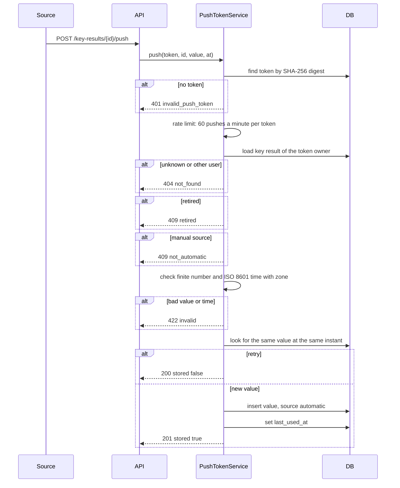

# Annual planning

Annual planning is the only planning flow that owns goals. A goal belongs to a year. A key
result is a measurable number under a goal. The plan also keeps theme links, a dated value
series, flags, a history that can be undone and a push token for automatic values.

Read [Plan for the year](../user/annual-planning.md) for the user flow.

## Tables

The migration `0020_annual_planning` adds these tables and four columns on `goals`:

| Table | What it holds |
| --- | --- |
| `goals` | A goal of one year. The new columns are `updated_at`, `retired_at`, `retired_reason` and `position`. |
| `key_results` | The metric, kind (`number` or `yes_no`), start value, target, deadline, update source, status, slot and the seed source. A yes/no key result stores 0 (No) and 1 (Yes). |
| `key_result_values` | The append-only dated series. `seq` orders values entered on the same day. |
| `key_result_themes` | The link periods between a key result and a theme project. |
| `plan_changes` | The append-only plan history. Each user action is one `batch_id`. |
| `value_push_tokens` | One token per user. Tefteri stores only the SHA-256 digest and the four-character hint. |

The migration `0025_key_result_kind` adds `kind` with the default `number`. Existing key results
stay numbers.

Tefteri derives the current value and the progress. It does not store them. A value row stores `at`,
the time stamp, and `on_date`, the day of `at` in the user time zone. `value_on` reads the last
row on or before a day.

### Slots

A goal has at most three active key results (FR-003). The database enforces this with

- a unique constraint on `(goal_id, slot)`,
- a check that `slot` is 1, 2 or 3, and
- a check that `status = 'active'` exactly when `slot` is not null.

A retire sets `slot` to null and frees the place. A restore takes the lowest free slot. The
service checks the free slots before it writes, so a restore cannot fail halfway. The same rule
applies to the undo of a retire.

## Domain rules

`domain/key_results.py` has no database and no adapter import:

- `validate` checks the metric, the finite numbers, the target and the deadline. A yes/no key
  result skips the number checks; its start value is 0 and its target is 1.
- `progress` is `(current - start) / (target - start)`. It is not capped.
- `is_met` compares the current value with the target in the direction of the plan.
- `current_value` takes the latest `(on_date, seq)`. An empty series gives the start value.
- `value_on_or_before` returns the last entry on or before a day. It never assumes the start
  value: before the first entry the answer is empty (FR-034).
- `is_overdue` is true for an active, unmet key result after its deadline.
- `key_result_flags` returns `no_usable_theme` and `overdue`. A flag has a reason and one or
  more actions. A retired key result has no flags.
- `goal_flags` returns `no_key_result` while a goal has no active key result.
- `goal_progress` is the mean of the key result progresses, each limited to 0 to 1. It is empty
  when there is no key result.

`domain/annual_plan.py` holds the year and seeding rules:

- `year_state` returns `past`, `current` or `future` for a year and today.
- `today_in` converts the clock to the user time zone. The API uses it for every write guard.
- `next_free_slot` returns the lowest free slot, or nothing when all three slots are in use.
- `shift_deadline` moves a deadline into a new year. 29 February becomes 28 February when the
  new year is not a leap year.
- `suggest` reads year N and returns goals and key results for year N+1. It offers only active,
  unmet key results, drops links that are not usable now, and writes nothing.

The past-year guard raises `past_year` (409) for a structure change in a year that ended. A
value entry is still allowed in a past year (FR-033).

## History and undo

Every write path uses `services/plan_changes.py`. One user action gets one `batch_id`, one
`source` (`user`, `seed`, `undo` or `migration`) and one `plan_changes` row per change. The rows
of a batch get increasing `at` stamps, so the time order is stable even when everything happens
in the same instant.

The history is append-only. Tefteri does not update or delete a row. It marks a batch as undone
by writing the reverse changes with `source = 'undo'`. The read model sets `undone` on the rows
of a batch when a later undo row has the same `batch_id`.

Tefteri refuses an undo with `already_undone` after the first undo. It refuses an undo with
`not_undoable` when the batch has a kind that cannot change back. A re-link changes back in the
other direction. The links that the batch added end. The links that it ended start again when
their project is still a usable theme.

## Push contract

An outside source sends a value to an automatic key result. The route is
`POST /api/v1/key-results/{key_result_id}/push`. It uses only the token in the header
`Authorization: Bearer tfv_...`. It does not accept a session, a cookie or the
`X-Tefteri-Client` header.

A rejected push writes nothing. The rate limit is in memory and counts accepted attempts per
token. Tefteri stores the same value at the same instant once, so a source can retry safely.

## Migration of existing goals

`0020` keeps every goal, task link and stored period review (SC-004). The later `0024` removes the
legacy plan and period-review tables with the Reviews screen. For year goals:

- The row, title, description, criteria text, id and task links stay.
- `active` stays `active`.
- `dropped` becomes `retired` with the retired time and the reason "Dropped before annual
  planning".
- `done` stays `done`. Tefteri shows it as a goal that was complete before annual planning.

Month and week goals do not change. They are read-only history. The migration writes one
`plan_changes` row with `kind = 'migrated'` and `source = 'migration'` for each year goal that
changed status or has criteria text. It creates no key result. The old criteria text becomes
`criteria_suggestion` while the goal has no key result. The client can use it as the metric of
the first key result, and the suggestion is gone when a key result exists.

The downgrade drops the new tables and the four columns. It sets a migrated `retired` year goal
back to `dropped`. Key results, values, links and plan history are lost on downgrade.

## How features 007 and 008 read the plan

Features 007 and 008 do not copy the annual tables. They read the same read model:

- `GET /api/v1/annual/{year}` returns the plan: `year`, `state`, `editable`, `goals`,
  `retired_goals` and `theme_usage`. A goal has its key results, flags and notes. A key result
  has its derived value, progress, met state and links.
- `KeyResultService.value_on(user_id, key_result_id, day)` is the in-process call for the value
  on or before a day. Feature 007 uses it for the month review and snapshot. Feature 008 uses
  it for statistics.

The client feature 007 reads the plan of the current year and the relevant value series. It
does not write goals. Feature 008 reads the saved monthly snapshots and does not recalculate the
plan.
