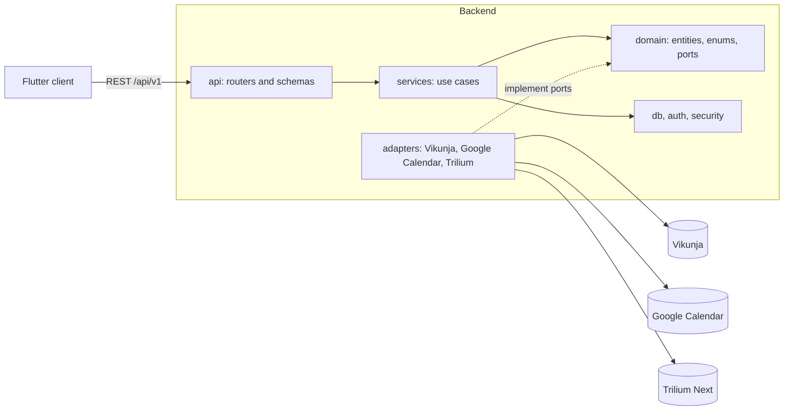

# Architecture

A Python (FastAPI) backend syncs on demand with Vikunja (tasks), Google Calendar (events) and
Trilium Next (notes). It does this through adapter ports. A Flutter client shows the views.

The layers are `api`, `services`, `domain` and `adapters`. The `tach` tool checks them:
`api` calls `services`, `services` use `domain`, and `adapters` implement the `domain` ports.
The `services` use the `db`, `auth` and `security` modules. The `domain` never uses them.

The arrows show the allowed imports. The core code (`api`, `services`, `domain`) never imports
`adapters`. At start-up, `main.py` registers the adapters in an adapter registry. The services
get a backend for a connection from this registry. Refer to [Sync](sync.md) for the sync flow
and the conflict flow.
