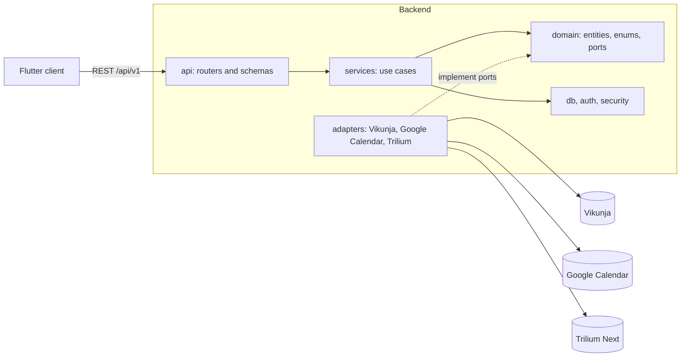
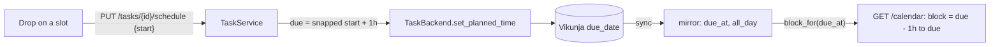

# Architecture

A Python (FastAPI) backend syncs on demand with Vikunja (tasks), Google Calendar (events) and
Trilium Next (notes). It does this through adapter ports. A Flutter client shows the views.

The layers are `api`, `services`, `domain` and `adapters`. The `tach` tool checks them:
`api` calls `services`, `services` use `domain`, and `adapters` implement the `domain` ports.
The `services` use the `db`, `auth` and `security` modules. The `domain` never uses them.

The arrows show the allowed imports. The core code (`api`, `services`, `domain`) never imports
`adapters`. At start-up, `main.py` registers the adapters in an adapter registry. The services
get a backend for a connection from this registry. Refer to [Sync](sync.md) for the sync flow
and the conflict flow.

## Monthly planning and review

Monthly planning and review use five tables for focus entries, change history, review headers
and immutable snapshot versions. `MonthlyFocusService` also implements the focus-provider seam
used by weekly planning. `MonthlyReviewService` reads milestone facts from 004, category counts
from 005 and key result data from 006. Its only write outside its own tables is a manual value
that the user enters into a key result series. Feature 008 reads current monthly snapshot
versions without recalculating them. Read [Monthly planning and review](monthly-cycle.md) for
the tables and contracts.

## The planned time of a task

The due date of a task is its planned time. For Vikunja it is the only date that tefteri stores
for planning (constitution Principle VII). Tefteri never writes the start date or the end date.

The core code uses one value that does not name Vikunja: `due_at` plus `all_day`. The code in
`tefteri.domain.planning_time` derives the calendar block from it. The block starts one hour
before the due time and ends at the due time.

Each layer has one job:

- `domain.planning_time` holds the rules: the block, the 15-minute grid and the random start.
- `services.tasks` writes the due date to the task app first. It changes the cache only after the
  task app accepted the change. It records a conflict when the task changed in the app.
- The Vikunja adapter maps a date-only task to 00:00 in the time zone of the user. Only the
  adapter knows this rule.
- Tefteri derives the cached columns `scheduled_start` and `scheduled_end` from the due date. It
  never sends them to a task app.
- `services.task_filters` holds the planner filters. The list endpoint runs them in the database.
  The counts use the same rules in Python. A test keeps both in step.
