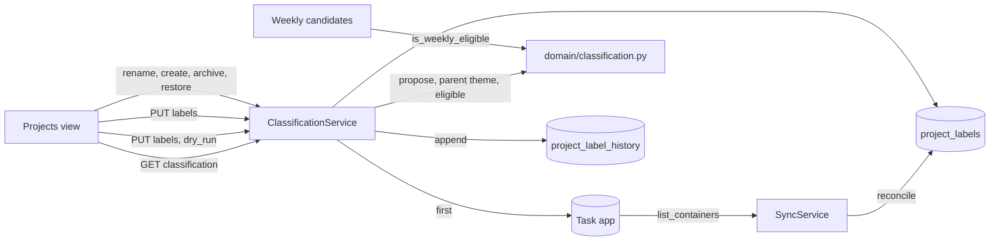

# Project classification

Project classification gives each project of a task app one label. The label says what the
project is for. Later planning features read the label. This page describes the data, the rules
and the parts that work together. The user guide is [Sort your projects](../user/organizing-projects.md).

## The labels

The enum `ProjectLabel` in `tefteri.domain.enums` has four values:

| Value | Meaning | Name in the client |
| ----- | ------- | ------------------ |
| `theme` | A long-running home for related work. | Theme |
| `milestone` | A small outcome that the user can finish in about a week. | Milestone |
| `maintenance` | Routine work that never finishes. | Routine |
| `ignored` | Hidden from planning. | Ignored |

Tefteri calls a project with no label unclassified. It stores a label only in its own database. It never
writes a label, a tag or a field to the task app (FR-003).

## Data

Migration `0018_project_labels` adds two tables. The models are in
`backend/src/tefteri/db/models/project_label.py`.

- `project_labels`. One row for each project that tefteri has seen. The key is the pair
  `connection_id` and `remote_id`. The remote id is the identity of the project in the task app, so
  a rename or a move does not change the key. The row keeps the last known `name` and
  `parent_remote_id`. `label` is a copy of the newest history entry. `orphaned_reason` is `missing`,
  `archived` or null.
- `project_label_history`. Tefteri only adds rows here. A row has the label, the time `from_at`
  and the `source` (`user`, `suggestion` or `undo`). The rows of one save share a `batch_id`. The
  label of a project on a given day is the newest entry that starts on or before that day. Later
  features read this to know what a project was in the past.

The table `source_containers` does not change. It still lists the live projects that tefteri syncs.
The sync writes `project_labels` next to it. The table `weekly_plan_projects` does not change
either. Its `name` column keeps the name of a project that is gone.

## The rules

The pure rules are in `tefteri/domain/classification.py`. They use no database and no adapter, so
unit tests and later features can use them directly. Each function takes a mapping from a key to a
`ProjectNode` (key, parent key, stored label, `was_committed`, `orphaned`).

| Function | What it returns |
| -------- | --------------- |
| `propose` | The proposal for a depth and for `was_committed`. |
| `proposal_of` | The proposal for one project of a tree. It adds the routine rule. |
| `label_of` | The stored label, or the proposal if the project has none. |
| `parent_theme` | The key of the nearest ancestor with the effective label `theme`, or `None`. |
| `is_eligible` | Whether a planning picker may list the project. |
| `is_weekly_eligible` | Whether the weekly picker may list the project. |

The proposal follows these rules, in this order:

1. A project inside a project with the stored label `maintenance` gets `maintenance`, with the
   reason `inside_routine`.
2. A project that is in a past weekly plan gets `milestone`, with the reason `was_committed`.
3. A top-level project gets `theme`, with the reason `top_level`.
4. Any other project gets `milestone`, with the reason `nested`.

The proposal is never stored until the user accepts it or chooses a label.

A project is eligible (FR-007) when all of these are true:

- The project is not orphaned.
- The effective label of the project is not `ignored`.
- No ancestor has the effective label `ignored`.

A project is weekly-eligible (FR-008) when it is eligible, its effective label is not
`maintenance`, and no ancestor has the stored label `maintenance`. Other features add the rule for
the label that their picker needs. They must not repeat these rules.

The functions cut a loop in the parent links, so a bad tree cannot make them run for ever.

## Orphans

An orphaned project is not live in the task app. The reason is `missing` or `archived`. Tefteri owns
these rules, and other features refer to them.

- The sync calls `reconcile` (`services/project_labels.py`) for each task connection. It adds a
  row for a new project. It updates the name and the parent of a listed project. It clears the
  orphan mark of a project that is back. It marks a live row that the app no longer lists as
  `missing`. It never deletes a row and never changes a label.
- `ProjectService.archive` archives the project and its subprojects in the task app. It then marks
  the rows `archived`. It keeps the label and the history.
- `ClassificationService.restore` restores the project in the task app first. It clears the mark
  only if that works.
- Every reader of projects must work with an orphaned project and show the stored name.

## The services

`ClassificationService` (`services/classification.py`) holds all the operations. The router is
`api/routers/projects.py`.

| Operation | Route | Notes |
| --------- | ----- | ----- |
| Read the tree | `GET /projects/classification` | One entry for each task connection, with the proposal, the effective label, the parent theme, `eligible`, the counts and `in_committed_plan`. |
| Save labels | `PUT /projects/labels` | `dry_run=true` returns only the effect. A save returns a `batch_id`. |
| Undo | `POST /projects/labels/undo` | Adds new history entries. A second undo of one batch gives 409. |
| Rename | `PATCH /projects/{id}` | Task app first. 409 `not_supported` if the app cannot rename. |
| Create and label | `POST /projects` | The shared rule of FR-024. Task app first. |
| Archive and restore | `POST /projects/{id}/archive` and `/restore` | The old route in `connections` still works. |

The preview and the save use one code path to count the effect, so they cannot disagree. A save
adds one history entry for each project whose label really changes. The entry of a project starts
after its earlier entry, so the order is always clear.

The "create project and label it" rule is `create_and_label`. Features 004 and 006 must use it.
It writes the project to the task app first. It records the label only if that works. If the
record fails after the creation, the next sync finds the project and proposes a label.

The OpenAPI file `docs/openapi.json` has the full request and response shapes. A test fails when
the file is old. Run `just backend::openapi` to update it.

## Flow

## The weekly picker

`WeeklyService.candidates` lists only weekly-eligible projects. Each item has the field `unsorted`,
which is true when the project has no label. The client counts these items for the quiet reminder in
the weekly planning view. `GET /projects/classification` has the total in `unsorted_count`.
Read [Weekly planning](weekly-planning.md) for the milestone picker that builds on it.

## Capabilities

Each task adapter declares what it can do in `capabilities()`. The table is in
`tefteri/domain/capabilities.py`.

| Capability | Needed for | Must have |
| ---------- | ---------- | -------- |
| `subprojects` | Milestones inside themes. At least two levels. | Yes |
| `project_tree` | Reading the whole tree and seeing what moved or left. | Yes |
| `stable_project_ids` | Labels that belong to an identity. | Yes |
| `archive_projects` | Archive a project. | Yes |
| `create_tasks` | Weekly planning. | Yes |
| `completion_times` | Cadence and statistics. | Yes |
| `rename_projects` | Rename from tefteri. | No |
| `restore_projects` | Undo of an archive. | No |
| `move_tasks` | Close a milestone and return its tasks to the theme, and undo it. | No |

When the user connects a task app, `ConnectionService` calls `missing_required`. A task app that
lacks a needed capability gets the answer 422 `missing_capability`. The message names each
missing capability, and tefteri stores nothing. On a check, such an app gets the status `error`
with the reason `missing_capability`. A missing optional capability only sets a flag in the
`capabilities` field of the answer, and the client hides the matching control.

## Test it

- `backend/tests/unit/test_classification.py` tests the pure rules.
- `backend/tests/integration/test_classification_service.py` tests the service.
- `backend/tests/integration/test_orphans.py` tests the sync and the orphan marks.
- `backend/tests/integration/test_weekly_picker_eligibility.py` tests the weekly picker.
- `backend/tests/integration/test_backend_contracts.py` runs the rename and restore tests on every
  adapter.
- `frontend/test/features/projects/` holds the widget tests of the Projects view.
- `just backend::live-vikunja` runs the flow against a real Vikunja.

## Screenshots

`frontend/test/screenshots/projects_screens_test.dart` makes the images `docs/images/projects-*.png`
from fake data. Run `just docs::screenshots` to make them again after you change the view.
