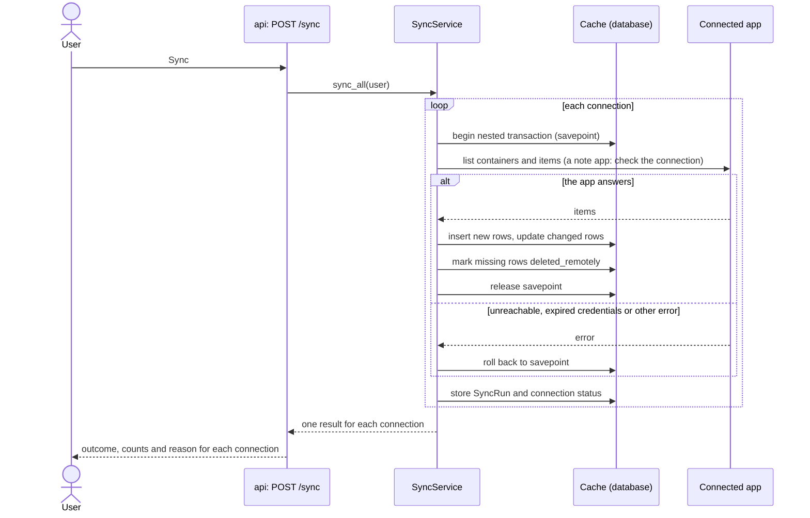
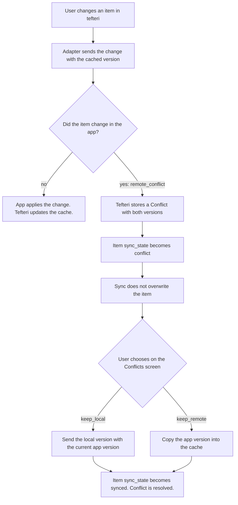

# Sync and conflicts

Sync starts only when the user asks for it (the Sync button, F5, or `POST /sync`). The
`SyncService` reads every connection of the user, one after the other. For a task app and a
calendar, it copies the items into the cache tables (`tasks`, `calendar_entries`).

A note app is not copied. A sync of a note connection only calls `check_connection` (the address
and the token), and it reports the result like any other sync. Tefteri reads and writes the few
notes that it needs when it needs them: the daily note, and the retrospective of a review. The
`notes` table has a row for a note that tefteri created or opened, so that a task link or a review
can point at it. It does not hold the notes of the note app.

## Sync flow

Each connection syncs inside its own savepoint. A failure rolls back only the changes of that
connection. The other connections still sync. The result names the connection and gives a
reason: `unreachable`, `auth_expired` or `error`. The connection status changes to `error` or
`needs_attention`.

After the sync lists the projects of a task connection, it calls `reconcile` to bring the
`project_labels` rows in line. It updates the name and the parent of each project and adds a row for
each new project. It marks a project that the app no longer lists as orphaned with the reason
`missing`, and it clears the mark when the project returns. It never deletes a row and never
changes a label. Read [Project classification](project-classification.md#orphans).

After a full sync of a task connection, the sync calls `MilestoneService.settle`. It marks each
milestone as done when no task stays open and at least one task has a completion. After a full sync,
a task that the app no longer lists counts as dropped for good. Read
[Weekly planning](weekly-planning.md#completion).

The sync does not overwrite a row in the `conflict` state. The row stays as it is until the
user solves the conflict.

## The automatic sync

The server syncs all connections of all users at a regular interval
(`TEFTERI_SYNC_INTERVAL_MINUTES`, 60 by default; 0 turns it off). `BackgroundSync` in
`services/background_sync.py` does it. The lifespan of the app starts it as a task and cancels it at
shutdown.

- The first pass comes 30 seconds after the start. Then a pass comes at each interval.
- Each connection syncs in its own session and transaction. A failing connection, or a failing
  user, never stops the others.
- A connection with the status `needs_attention` is left out. A manual sync still tries it.
- `SyncService` takes a lock for each connection. A scheduled sync, a manual sync and a double
  click on Sync of the same connection run one after the other, never at the same time.
- Each pass deletes the records of syncs (`sync_runs`) that are older than 30 days.

The server is one process. If you run more than one, each one runs its own loop. Set the interval
to 0 on all but one.

## Times

The cache holds every time as UTC. SQLite drops the time zone of a stored time, so the sync
converts each time to UTC before it stores it (`mirror.to_utc`).

- A time with an offset, such as `2026-11-02T11:00:00+02:00`, is converted. A time without an
  offset but with a named zone (Google sends `timeZone`) takes the offset of that zone. A time
  with neither is UTC.
- An all-day event comes as dates. The sync puts it on the local days of the user: midnight in
  the time zone of the user, converted to UTC (`sync.anchor_all_day`).
- The API sends every time from the cache with its zone (`...Z`). Use the type `UtcDatetime` in
  `api/schemas.py` for every such time in a response. Without the zone, a browser reads the time
  as its own local time, and the client shows every time shifted by its offset from UTC.

## Writes from tefteri

A write (for example, change a task title) goes to the connected app first. The adapter sends
the version of the cached item. When the app accepts the change, tefteri updates the cache. When
the app is unreachable or refuses the change, tefteri changes nothing and returns the error.
Tefteri does not queue changes.

## Conflict flow

Tefteri never solves a conflict itself. The `Conflict` row keeps the two versions until the user
chooses one. Tasks and calendar entries use this flow. For a note, tefteri returns the
`remote_conflict` error and saves nothing. The user syncs and then makes the change again.
