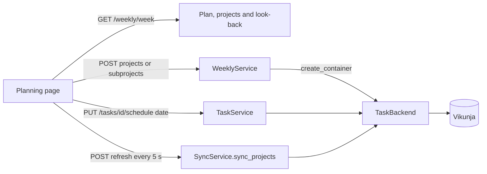

# Weekly planning

The weekly planning session is a workflow on top of tasks, projects and calendar entries. It
adds two tables to the database and one router. This page describes how the parts fit together.

## Data

- `weekly_plans`. One row for each user and week (the Monday). `status` is `draft` or
  `committed`. The look-back sets `reviewed_at` and `reflection`. `retro_skipped`
  records that the user planned without a look-back.
- `weekly_plan_projects`. The projects of a plan (at most three). `committed_task_ids` is the list
  of tasks that the user planned for the week when the user committed the plan. The look-back counts
  against this
  list. After the look-back, `outcome`, `leftover_action`, `reviewed_committed` and
  `reviewed_done` keep the result, so that the history does not change when tasks change later.
- `source_containers.parent_remote_id`. The project that holds a subproject. Sync fills it.

A task has no new column. The day of a task is its due date, as for the planner. A date-only due
date is an all-day task (`TaskService.schedule_date`).

## Flow

- Tefteri creates a new subproject in the task app first (`TaskBackend.create_container`, capability
  `SUBPROJECTS`). Only then does it store the container and add it to the plan.
- The page polls `POST /weekly/{day}/refresh`. It reads only the tasks of the chosen projects (and
  of the week that is under review). It writes no `SyncRun` and does not change the connection
  status. Tefteri marks a task that left a listed project as deleted until the next full sync.
- `POST /weekly/{day}/spread` gives a day to each task without one. It picks the day with the
  fewest tasks, from Monday to Friday and never in the past.
- The look-back writes to the task app too. The choice Back to the backlog clears the due date of
  the tasks that remain (`TaskService.unschedule`).

## Rules that tests keep

- A week holds at most three projects (`MAX_PROJECTS`). The server checks it before it creates a
  subproject in the task app.
- A committed plan is not editable until `reopen`. The commit stores the planned tasks again.
- A look-back happens once for each plan. The look-back covers only committed plans.
- Vikunja saved filters (negative ids) are not containers. Sync removes a container that the app no
  longer lists.

The tests are in `backend/tests/integration/test_weekly.py` and, for the interface,
`frontend/test/features/weekly/`. `just backend::live-vikunja -k weekly` runs the flow against a
real Vikunja.
