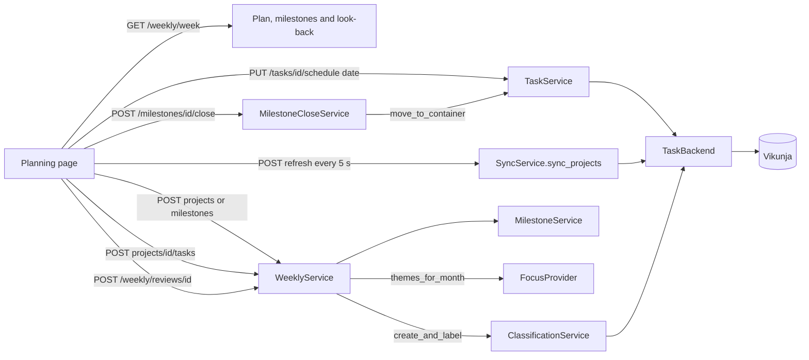

# Weekly planning

The weekly planning session is a workflow on top of tasks, projects and calendar entries. The unit
of the weekly commitment is a milestone project. It is a small project under a theme, with a
done-state. The user can finish it in one week. This page describes how the parts fit together. Read
[Project classification](project-classification.md) first. It defines the labels `theme` and
`milestone`, the parent theme and the eligibility rules that this page uses.

## Data

The migration `0019_weekly_milestones` adds three tables and six columns. It runs no `UPDATE` and
no backfill. The models are in `backend/src/tefteri/db/models/milestone.py` and
`backend/src/tefteri/db/models/weekly.py`.

### Tables

- `weekly_plans`. One row for each user and week (the Monday). `status` is `draft` or
  `committed`. The look-back sets `reviewed_at` and `reflection`. `retro_skipped` records that the
  user planned without a look-back. This table did not change.
- `weekly_plan_projects`. The weekly commitment: one row for each milestone of a plan. There is no
  limit on the number of rows. `committed_task_ids` is the list of tasks that the user planned
  when the user committed the plan. `parked_task_ids` is the list of tasks that the user set aside
  (the screens say "Not this week"). After the look-back, `outcome`, `reviewed_committed` and
  `reviewed_done` keep the result, so that the history does not change when tasks change later.
- `milestones`. One row for each milestone project, unique on `project_id`. It holds the
  done-state, the `state` (`active`, `parked`, `closed` or `done`) and the `rollover_count`. When a
  milestone becomes done, it also holds `done_on`, `done_by` (`auto` or `user`) and the theme at
  that time (`done_theme_id` and `done_theme_name`). The weekly flow adds the row the first time it
  touches a project. A project with no row is `active` with a count of 0.
- `milestone_rollovers`. One row for each recommit. It is append only. Each row has its own
  `expected` marker, `from_week`, `to_week` and `created_at`. The code never edits or deletes a
  row. `milestones.rollover_count` equals the number of rows. A test keeps them equal.
- `milestone_closures`. The log of one close and return. `status` is `moving`, `closed` or
  `reopened`. `moved` is a JSON list with one entry for each task that moved. An entry holds the
  task, its remote id, the project that it came from and its version after the move.
- `source_containers.parent_remote_id`. The project that holds a subproject. Sync fills it.

### New columns of `weekly_plan_projects`

All six columns allow null. A row from before the migration has null in all of them.

| Column | Meaning |
| ------ | ------- |
| `milestone_id` | The milestone of the entry. Null for a legacy entry. |
| `theme_project_id` | The parent theme when the milestone entered the plan. The commit stores it again. |
| `theme_name` | A copy of the name of that theme. Null means "no theme" or a legacy entry. |
| `decision` | `recommit`, `park`, `close` or `decide_later`. Null before the review and for a legacy entry. |
| `expected_rollover` | The marker that came with a `recommit`. Tefteri copies it to the rollover event. |
| `decided_at` | When the review stored the decision. |

A unique constraint on (`plan_id`, `milestone_id`) keeps a milestone in a week at most once. The old
column `leftover_action` stays, but new code never writes it.

A task has no new column. The day of a task is its due date, as for the planner. A date-only due
date is an all-day task (`TaskService.schedule_date`). A move writes `container_id` and
`remote_version` of the task.

## Where the rules are

Pure rules are in `backend/src/tefteri/domain/milestones.py`. They use no database, no adapter and
no name of a task app. They use the types of `domain/classification.py` and do not restate its
rules.

| Function | Rule |
| -------- | ---- |
| `commit_kind` | `milestone` for a weekly-eligible milestone that is not closed or done. `label_then_commit` for a project with no label and no live subproject. `None` for all others. |
| `completion` | Done when no task stays open and at least one task has a completion. A dropped task never keeps a milestone open. A milestone with no task, or with only dropped tasks, stays open. |
| `needs_rescope` | True when the two newest rollover events are both unmarked. The order is `created_at`, then `id`. |
| `decision_of` | The stored decision wins. Otherwise `carry` gives `recommit` and `backlog` gives `park`. |
| `close_options` | Says if close is possible. The reasons, in this order: `no_theme`, `theme_unusable`, `not_supported`. |
| `over_cap`, `MILESTONE_CAP` | True when a week has more than three milestones. |
| `outside_focus`, `focus_share` | Computed on read from the focus of the month. |

`month_of_week` in `domain/periods.py` gives the first day of the month of the Monday of a week.

The services that use the rules are in `backend/src/tefteri/services/`:

- `weekly.py` (`WeeklyService`): the picker, the themes, add, create, add task, commit, the
  look-back and its summary, the review and the history.
- `milestones.py` (`MilestoneService`): the rows, the done-state, the rollover events, the
  completion (`settle`), mark done and reopen of a done milestone.
- `milestone_close.py` (`MilestoneCloseService`): close and return, the retry, and the undo.
- `focus.py`: the `FocusProvider` seam.

The routes are in `api/routers/weekly.py` and `api/routers/milestones.py`. The file
`specs/004-weekly-milestones/contracts/api.md` describes them, and `docs/openapi.json` is the
authority.

## Flow



- The picker (`WeeklyService.candidates`) lists the projects for which `commit_kind` is not `None`,
  with the theme, the state, the rollover count and the flag `decision_open`. Focus themes come
  first when focus data exists. `GET /weekly/{day}/themes` gives the groups and the empty states.
- `add_project` adds a milestone. It never checks the cap. A project of the kind
  `label_then_commit` gets the label `milestone` first, with the source `user`.
- `create_milestone` follows the shared rule "create the project and label it" of feature 003
  (`ClassificationService.create_and_label`). Tefteri checks the done-state before it calls
  the task app. Tefteri creates the subproject in the task app first (`TaskBackend.create_container`,
  capability `SUBPROJECTS`). Only then does it store the label, the done-state and the entry.
- `add_task` creates a task under the milestone (`TaskBackend.create_task`, capability
  `CREATE_TASKS`). The task is not committed until it gets a day.
- The page polls `POST /weekly/{day}/refresh`. It reads only the tasks of the chosen milestones
  (and of the week that is under review). It writes no `SyncRun` and does not change the
  connection status. Tefteri marks a task that left a listed project as deleted until the next
  full sync.
- `POST /weekly/{day}/spread` gives a day to each task without one. It picks the day with the
  fewest tasks, from Monday to Friday and never in the past.
- The commit stores `committed_task_ids` and the theme of each milestone. A plan with no milestone
  can get a commit.

## Review decisions

`WeeklyService.review` stores one decision for each unfinished milestone of the reviewed week. A
done milestone needs none. Tefteri ignores a decision for it.

- `recommit` adds a rollover event with the marker `expected`, raises `rollover_count` by one, and
  adds the milestone to the plan of the next week. If that plan had a commit, it goes back to
  draft, and the answer has a notice. A parked milestone becomes `active` again. The answer lists a
  nudge for each milestone for which `needs_rescope` is now true.
- `park` sets the state `parked`. The count does not change. The review never clears the due dates
  of tasks.
- `decide_later`, and no answer, change nothing: not the state, not the count and not the events.
  The picker shows a reminder (`decision_open`) while the newest decision of the milestone is
  `decide_later`.
- `close` must come after the close. The review only records a close that already happened. For a
  milestone that is still open, it answers 422 `confirm_required`.
- `mark_done` marks the milestone done by hand. The done date is today of the user, never the day
  of the review.

An entry of a week that had a commit before this feature gets its milestone row when the user
reviews that week (`WeeklyService._adopt`). The project is not relabelled.

## Close and return

`MilestoneCloseService.close` moves the open tasks of a milestone to its parent theme, one at a
time, and then closes the milestone.

1. `POST /milestones/{id}/close` with `dry_run` returns the number of open tasks and the theme.
   It writes nothing.
2. The same call with `confirm` creates a row in `milestone_closures` with the status `moving`.
3. For each open task, `TaskService.move_to_container` calls `TaskBackend.move_task`. The cache of
   tefteri changes after the task app answers. Tefteri appends the task to `moved` after each
   successful move. When a move fails, it commits the log first, so the moves that worked stay.
4. After the last move, the closure gets the status `closed` and the milestone gets the state
   `closed`.

If a move fails, the milestone stays as it was. The moves that worked stay in the log. The answer
is 502 (or 409 `remote_conflict`) with the list `moved` and the number `remaining`. A second call
finds the closure with the status `moving` and moves only the tasks that remain.

`close_options` hides close in three cases. There is no parent theme. The user ignored the theme,
or it left the task app. The task app lacks `MOVE_TASKS`. The service sets the reason `orphaned`
for a project that left the task app.

`POST /milestones/{id}/reopen` undoes a close. It moves back the tasks of the newest closure that
are still in the theme and have the version that the move gave them. It lists the others with a
reason: `changed`, `moved`, `missing` or `failed`. A task that does not move back never fails the
reopen. A done milestone loses only its done fields.

## Completion

`MilestoneService.settle` marks the milestones whose tasks are all closed or dropped as done. It
runs:

- after each full sync of a connection (`SyncService`), with `full_sync=True`. A task with the mark
  deleted-remotely is then dropped for good.
- when the page refreshes the chosen projects, and when the look-back of a week that is not
  reviewed yet reads the plan. With `full_sync=False`, the service skips a project that holds a task that looks
  deleted. A task that moved to another project looks deleted until the next full sync.
  It must not finish a milestone by mistake.

A dropped task is a task that the task app does not list any more and that was not completed. The
done date is the latest completion day of the closed tasks, in the time zone of the user. The theme
at that moment goes with it. A later change of theme never changes these fields.

## The focus seam

Monthly planning (feature 007) supplies the real focus provider. Weekly planning reads the
focus through `FocusProvider` in `services/focus.py`:

```python
async def themes_for_month(db, user_id, month_start) -> set[UUID] | None
```

The default `NoFocus` returns `None`, which means no focus data exists. The application wires
`MonthlyFocusService` as the real provider. It returns `None` when no plan is saved, or a set of
theme ids when a plan exists. An empty set is a saved empty focus. The picker puts focus themes
first. Read [Monthly planning and review](monthly-cycle.md) for the provider and its storage.
Tefteri never stores "outside focus". Tefteri computes it on each read, from the focus of the month of
the Monday of the week.

## Capability MOVE_TASKS and `move_task`

Moving a task needs the optional capability `MOVE_TASKS`. The port operation is
`TaskBackend.move_task(remote_id, container, expected_version)`. It returns the task, read back
from the app. It raises `NotSaved` when the task is not in `container`, and `RemoteConflict` when
the task changed since `expected_version`. The Vikunja adapter changes `project_id` of the task.
The capability is in `OPTIONAL_PROJECT_CAPABILITIES`. A task app without it is still accepted. Only
the close choice is hidden. `report_for` has the flag `move_tasks`, and the capability answers of
`POST /connections`, `POST /connections/{id}/check` and `GET /projects/classification` carry it.
Read [Add an adapter](adding-an-adapter.md#move-a-task) for the contract.

## Legacy plan rows

Rows from before this feature are not rewritten. Tefteri maps them when it reads them:

| Stored | Shown as |
| ------ | -------- |
| `leftover_action = 'carry'` and no `decision` | Keep and recommit |
| `leftover_action = 'backlog'` and no `decision` | Keep but park |
| no `leftover_action` and no `decision` | No decision |
| `milestone_id` is null | A legacy project: name, counts and outcome only |

The answers of the look-back and the history carry `legacy: true` for such an entry. Old month and
week goals stay in their tables as read-only history. The weekly flow does not read them. Read
[Annual planning](annual-planning.md) for the yearly goal flow.

## Archive a project

`ProjectService.archive` archives a project in the task app (`TaskBackend.archive_container`,
capability `ARCHIVE_PROJECTS`) and then forgets it. The endpoint is
`POST /connections/{id}/containers/{id}/archive`. The look-back can ask for it with `archive` in
the answer for a milestone. It happens after tefteri stores the counts.

Vikunja archives the subprojects too, so tefteri drops them too. It marks their tasks as deleted
in the app, as the next sync would. It removes the projects from draft plans. Committed plans
keep the name. Tefteri refuses a project that is in a committed plan with no look-back yet.

## Rules that tests keep

- The cap of three is a warning. The server accepts a fourth milestone. `over_cap` shows it.
  Maintenance projects and tasks never count.
- A milestone is in a week at most once. It can be in consecutive weeks.
- Decide later changes nothing and never blocks a review.
- Close moves all tasks first. The milestone closes only after the last move.
- A milestone with no closed task is never done by itself.
- A done milestone keeps the theme that it had when it became done.
- The rollover count equals the number of rollover events. The marker belongs to one event.
- A committed plan is not editable until `reopen`. The commit stores the planned tasks again.
- A look-back happens once for each plan. The look-back covers only committed plans.
- Vikunja saved filters (negative ids) are not containers. Sync removes a container that the app no
  longer lists.
- Every weekly screen works when a milestone or a theme left the task app. It shows the stored name.

## Test it

The tests are in `backend/tests/`:

- `unit/test_milestones.py` and `unit/test_periods.py` test the pure rules.
- `integration/test_weekly.py` tests the flow as a whole.
- `integration/test_weekly_picker_eligibility.py`, `test_milestone_picker.py` and
  `test_milestone_create.py` test the picker and the creation of a milestone.
- `integration/test_weekly_cap.py` tests the warning.
- `integration/test_weekly_focus.py` tests the focus seam.
- `integration/test_weekly_tasks_inline.py` tests the new tasks.
- `integration/test_milestone_completion.py` tests the completion rule.
- `integration/test_weekly_review_decisions.py` tests the four decisions and the nudge.
- `integration/test_milestone_close.py` tests close, the retry and the reopen.
- `integration/test_weekly_review_summary.py` tests the numbers of the review.
- `integration/test_weekly_legacy_plans.py` tests the legacy rows.
- `integration/test_orphans.py` tests the weekly screens with an orphaned milestone.
- `integration/test_backend_contracts.py` runs the `move_task` tests on every adapter.
- `e2e/test_milestones_api.py` tests the milestone routes.
- `migrations/test_migrations.py` tests migration 0019 with old rows.

The tests of the interface are in `frontend/test/features/weekly/`. `just backend::live-vikunja`
runs the weekly flow and `move_task` against a real Vikunja.

## Screenshots

`frontend/test/screenshots/weekly_test.dart` makes the images `docs/images/weekly-*.png` from fake
data. Run `just docs::screenshots` to make them again after you change the view.

## Completed work and statistics

The weekly state has no list of tasks that the user did outside the plan. Feature 005 removed
`done_outside_plan` from `GET /weekly/{day}` and removed `ExtraDone`, `MAX_EXTRA_DONE` and
`WeeklyService.done_outside_plan`. The week page reads the counts, the days and the progress of
the committed plan from `GET /statistics`, and the completed tasks from `GET /statistics/tasks`.
`StatisticsService` computes the progress (`domain/week_progress.py`). The list has no limit.
Maintenance work and work outside the plan have their own categories. Read
[Work categories and statistics](work-categories.md).
