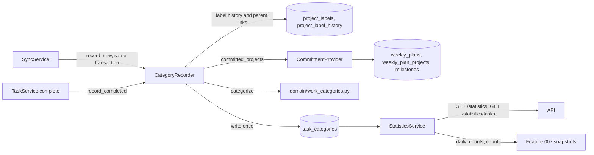

# Work categories and statistics

Tefteri puts every completed task in one work category: goal-aligned, maintenance or off-plan.
It also keeps a hidden count for tasks in ignored projects. Tefteri decides the category once, when
it first sees the task as completed, and stores it. This page describes the table, the
rules, the recorder, the statistics service and the API. The user guide is
[See what you did](../user/work-categories.md). Read
[Project classification](project-classification.md) and [Weekly planning](weekly-planning.md)
first. They define the labels and the weekly commitment that the rules use.

## Design in short

- The category is a result of rules. It is not a setting.
- A row in its own table keeps the result. The sync never touches it.
- Nothing recomputes a row. A relabel, a changed plan, a move, a rename, an orphan and a re-sync
  leave it as it is.
- Every number is read from the stored rows. The week, the month and the year are sums of days,
  so they always agree.
- Tefteri counts tasks. It records no time, duration or effort (FR-014).



## The table `task_categories`

Migration `0021_work_categories` adds the table. It writes no data. The model is in
`backend/src/tefteri/db/models/task_category.py`.

| Column | Meaning |
| ------ | ------- |
| `user_id` | The owner. Deleting the user deletes the row. |
| `task_id` | The task. Unique: a task has at most one row. Deleting the task deletes the row. |
| `completed_at` | The completion time of the decision. |
| `completed_on` | The local day of `completed_at`, in the time zone of the user at the time of the decision. Tefteri never recomputes it. |
| `category` | `goal_aligned`, `maintenance`, `off_plan` or `hidden`. A check constraint limits it to these values. |
| `reason` | One of the nine reason codes below. |
| `unsorted` | True for the reasons `unclassified` and `no_project`. |
| `project_id` | The project (`project_labels`) that the task was in at its completion. Null for no project. Deleting the project sets it to null. |
| `project_name` | A copy of the name at the time of the decision. The screens show it when the project is gone or has a new name. |
| `project_label` | The label that the project had on the completion day. |
| `plan_id` | The committed plan that made the task goal-aligned. Null for all other results. |
| `decided_via` | `sync` or `app`. |
| `decided_at` | When tefteri saw the completion. |

The indexes are (`user_id`, `completed_on`, `category`) for the counts, (`user_id`, `category`,
`completed_at`) for the lists, and (`project_id`).

A row counts only while three things are true. The task has the status done. `tasks.completed_at` equals
`task_categories.completed_at`. The sync state of the task is not `deleted_remotely`.
`_counted()` in `services/statistics.py` is the one place for this rule. A reopened task keeps its
row, but the row does not count while the task is open. A task that the task app deleted keeps its
row, but the row does not count.

A done task with no completion time gets no row. Tefteri cannot tell which week it belongs to.

## The pure rule

`categorize(context, committed)` in `backend/src/tefteri/domain/work_categories.py` decides. It
uses no database and no adapter. The first rule that fits wins:

1. The task has no project. The result is off-plan, unsorted, reason `no_project`.
2. The project has the label `ignored`. The result is hidden, reason `ignored`. An ancestor with
   that label gives hidden, reason `ignored_ancestor`.
3. The project has the label `maintenance`. The result is maintenance, reason
   `maintenance_label`. An ancestor with that label gives maintenance, reason `inside_routine`.
4. The project is a milestone and is in the commitment of the completion week. The result is
   goal-aligned, reason `committed_milestone`.
5. The project is a milestone that is not in the commitment. The result is off-plan, reason
   `milestone_not_committed`.
6. The project is a theme. The result is off-plan, reason `theme`.
7. The project has no label. The result is off-plan, unsorted, reason `unclassified`.

Ignored comes before maintenance. A project that the user hides must not show in the numbers. This
needs the agreement of the owner (open point 2 of the plan). Decision 10 of
`specs/planning-cycles/decisions.md` gives the maintenance rule: work inside a routine project is
maintenance, whatever the label of the inner project is.

The reason codes are the members of `CategoryReason` in `domain/enums.py`. `WorkCategory` has the
same module. `hidden` is a member of `WorkCategory`, but it is not a work category. It is the
ignored count.

| Reason | Category |
| ------ | -------- |
| `committed_milestone` | goal-aligned |
| `maintenance_label`, `inside_routine` | maintenance |
| `milestone_not_committed`, `theme`, `unclassified`, `no_project` | off-plan |
| `ignored`, `ignored_ancestor` | hidden |

The module has more pure functions:

| Function | What it does |
| -------- | ------------ |
| `label_on(entries, day_end)` | The label of a project on a day. It takes the entry with the latest `from_at` that is not after the end of the day. If all entries start later, it takes the oldest. No entry means unclassified. With equal times, the last entry wins. |
| `percentages(counts)` | Three whole numbers that add up to 100, by the largest remainder method. A tie goes to goal-aligned, then maintenance, then off-plan. A total of 0 gives zeros. The hidden count never enters. |
| `CategoryCounts` | The three counts and `hidden`. `total` leaves out `hidden`. `+` adds field by field. |

Percentages are for display only. Tefteri never stores them.

## The recorder

`CategoryRecorder` in `backend/src/tefteri/services/category_recorder.py` reads the facts, calls
`categorize` and writes the rows. It has two entry points. Both use the same code, so there is one
rule.

- `record_new(db, user_id, previously_open)` runs in the sync. `SyncService` calls it after the
  task sync and the label reconcile, in the same transaction. This is also true of the quick sync
  of single projects (`sync_projects`). If the recorder fails, the sync of that connection fails
  like any other sync error, and the cache stays as it was.
- `record_completed(db, user_id, task)` runs in `TaskService.complete`. It runs after the task app
  confirmed the completion and the cache changed. The row has `decided_via = app`, and the
  project is the cached one. If the task app refuses, tefteri writes no row.

`main.py` builds one recorder and gives it to both services.

The recorder loads the facts once for each run: the projects, their label history, the parent
links and the time zone of the user. It reads the commitment once for each week. It never reads
once for each task, so a first sync of 20,000 tasks does not make 20,000 queries. It writes in
batches of `BATCH_SIZE` (500) rows and flushes after each batch.

A row is never edited, with one exception. When a task gets a new completion time, the recorder
replaces the row in place. This is a new first sight with a new decision.

The ancestors of a project follow `parent_remote_id`, the last known parent. Feature 003 keeps no
history of moves. The walk stops at `MAX_DEPTH` (64) or at a loop.

### The project of a task that moved

A sync can see a task as done that the cache held as open. Then the project that decides is the
one that the cache held for the open task. If the cache never saw the task open, the project is the current
one. A task completed in tefteri uses the cached project. A move after the recorder stored the row
changes nothing.

### The open snapshot and the same-second reopen

The cache keeps completion times in whole seconds. A user can complete a task, reopen it and
complete it again within one second. Then the new completion time equals the time in the row, and a
check on the time alone sees no change.

`_open_snapshot(existing)` in `services/sync.py` solves this. It runs before the upserts of a
task sync. It takes a map from the task id to the container id of every task that the cache holds as open.
`record_new` gets this map as `previously_open`. It does two things:

- It decides the project of a task that moved.
- It finds done tasks that already have a row but that the cache held as open before this sync
  (`_reopened`). The sync saw the task open in between, so this is a new completion. The recorder
  replaces the row.

A task that the sync never saw open has no entry. The recorder trusts its row.

### The commitment seam

`CommitmentProvider` in `services/commitments.py` is a protocol with one method:

```python
async def committed_projects(db, user_id, week_start) -> set[uuid.UUID] | None
```

It returns the ids of the `project_labels` rows of the projects that the user committed to in the
week of that Monday. `WeeklyCommitments` is the real provider. It reads the plan of that Monday
only when its status is `committed`. A draft plan commits nothing, so the set is empty. It finds
the project of each entry through `milestone_id`, or, for an older entry, through the container.
A milestone stays in the set when the user parks, closes or finishes it during the week. The rule uses the
project and not the committed task ids. A task in a committed project is goal-aligned also when
the user did not plan that task.

`None` means that the weekly commitment cannot be read. The recorder then writes nothing and
guesses nothing (FR-026). The next sync records those tasks. `StatisticsService.summary` answers
`available: false` in that case. Tests use this seam to prove both behaviors.

## The statistics service

`StatisticsService` in `backend/src/tefteri/services/statistics.py` reads the stored rows. It
never recomputes a category.

| Method | What it returns |
| ------ | --------------- |
| `daily_counts(db, user_id, start, end)` | A `CategoryCounts` for every day of `[start, end)`. It uses one grouped query over `completed_on` and `category`. Days with no task have zeros. |
| `counts(db, user_id, start, end)` | The sum of `daily_counts`. |
| `summary(...)` | The data of `GET /statistics`. |
| `progress(...)` | The week progress of the committed plan. |
| `tasks(...)` | One page of completed tasks. |

A week is the sum of 7 days. A month is the sum of its days. A year is the sum of its 12 months.
Python makes the sum from the same query, so the parts always add up to the total
(FR-009).

The service keeps no table of daily counts. Such a table would be a second copy that can drift
from the rows after a reopen or a delete (research R-07). FR-025 asks for counts for every day.
`daily_counts` gives them. If the owner wants a stored row for each day, this is an open point.

### How feature 007 reads the counts

Feature 007 stores the counts of a month in its snapshot. It calls `daily_counts` or `counts`
through the service. It does not call HTTP. It stores counts and never shares. It uses
`percentages` only to show them. `end` is exclusive. Both methods read stored rows only.

A snapshot keeps its numbers if a count changes later, for example after a delete in the task app.

### Empty and unavailable states

`summary` returns `empty` when a period has no counted and no hidden task. The reason is
`no_labels` when no project has a label (the action is `label_projects`). Otherwise it is
`no_tasks` (the action is `plan_week`). When the provider returns `None`, the answer has
`available: false` and the reason `weekly_commitment_unavailable`. All counts are zero then.

`sync` holds the end time of the newest sync run of the task connections and its outcome. The
numbers are the last stored ones also when the outcome is not `ok`.

## The API

The routes are in `backend/src/tefteri/api/routers/statistics.py`.
`specs/005-work-categories/contracts/api.md` describes them, and `docs/openapi.json` is the
authority. A snapshot test fails when the file is old. Run `just backend::openapi` to make it
again.

- `GET /api/v1/statistics?period=&day=` gives the counts of one period. `period` is `week`
  (default), `month` or `year`. `day` is a day inside the period (default: today in the time zone
  of the user). The answer has the three `counts`, `total`, `percentages`, `hidden`, `unsorted`,
  `parts`, `empty`, `sync` and, for a week with a committed plan, `progress`. `counts` always has
  the three keys.
- `GET /api/v1/statistics/tasks` gives the tasks behind a count. It takes `period`, `day`,
  `category` (omit it for the three work categories, or use `hidden`), `order` and `limit`
  (1 to 200, default 50), and `cursor`.

A bad `period`, `category`, `order` or `limit` gives 422 with the code `invalid`. A cursor that
does not decode, or that belongs to another filter, gives 422 with the code `invalid_cursor`.

### Paging

The task list uses keyset paging. The cursor is an opaque string. It holds the sort key and the
task id of the last item, and the filter that it belongs to. The orders are:

- `newest`: completion time descending, then the task id.
- `project`: the project name in lower case, then the completion time descending, then the task
  id. Tasks with no project come last.

`total` is the count of the whole filter, from a separate `COUNT`. The number of pages has no cap.
A task that a user completes during paging does not move the next page. A test reaches every
task of a list of 1,000.

The response models use the enum classes `WorkCategory` and `CategoryReason` as field types. Do
not write a `Literal` by hand. A `Literal` that missed a new value crashed the real API once. A
unit test builds a response for every member of both enums. The live test
`backend/tests/live/test_statistics_live.py` starts the real server with uvicorn and reads every route
over a real socket, with a real task app.

## Performance

The tests keep these limits (SC-003):

| Case | Limit |
| ---- | ----- |
| A week of 1,000 tasks: the counts and the first page | 2 seconds |
| A year of 20,000 tasks: the counts, the parts and the percentages | 3 seconds |
| The first sync after an upgrade that records 2,500 tasks | The number of queries does not grow with the number of tasks |

A year is one grouped query. A list page is one query for the page and one for the total. The
indexes of the table cover both.

## Add a reason

1. Add the member to `CategoryReason` in `domain/enums.py`.
2. Add the rule to `categorize`, at the right place in the order. Add the row to the table of
   allowed pairs in `specs/005-work-categories/data-model.md`.
3. Write the unit test first. The test that checks every pair that `categorize` returns must pass.
4. Make the migration test and the OpenAPI snapshot pass. The enums are in the response models, so
   `just backend::openapi` changes the file.
5. Add the reason to the e2e test that serves a task of every reason.
6. Change this page and the user guide.

## Rules that tests keep

- Every completed task is in exactly one category, or in the hidden count.
- A month equals the sum of its days. A year equals the sum of its months.
- A relabel, a changed commitment, a rename, a move after completion, an orphan and a re-sync
  leave the stored rows as they are.
- A reopened task that the user completes again counts once, also within one second.
- A task that the task app deleted does not count. Its row stays.
- A recurring task counts once for each completion. A checklist item is never a row.
- No screen and no field holds a time spent.

## Test it

The tests are in `backend/tests/`:

- `unit/test_work_categories.py` tests the rules, `label_on`, `percentages` and `CategoryCounts`.
- `unit/test_week_progress.py` tests the port of the week progress.
- `unit/test_statistics_schema.py` validates a response for every category and reason.
- `integration/test_work_categories_recording.py` tests the recorder, the commitment seam and the
  case with no weekly commitment.
- `integration/test_work_categories_stability.py` tests that a stored row does not change, the
  reopen cases, the delete case and the time zone.
- `integration/test_work_categories_unusual.py` tests the moved tasks, the label history, the
  ignored and routine ancestors and the orphaned projects.
- `integration/test_statistics_periods.py`, `test_statistics_tasks_paging.py` and
  `test_statistics_week_progress.py` test the sums, the paging and the progress.
- `integration/test_statistics_performance.py` tests the limits above.
- `integration/test_connections_sync.py` tests the first sync after the upgrade.
- `integration/test_tasks.py` tests the recording of a task that the user completes.
- `e2e/test_statistics_api.py` tests the routes, the errors and the privacy between users.
- `migrations/test_migrations.py` tests migration 0021.

The tests of the interface are in `frontend/test/features/statistics/`.

`live/test_vikunja_live.py` has a test for a task in a real Vikunja. The test completes, moves,
reopens and deletes the task. It checks the stored category and the count after each step. It is not part of
`just test`. Run it with `just backend::live-vikunja`, or add `-k categor` to run only the
category tests. Read [Tests and migrations](testing.md#live-tests-with-a-real-vikunja) for the
settings.

## Screenshots

`frontend/test/screenshots/statistics_test.dart` makes the images `docs/images/statistics-*.png`
from fake data. Run `just docs::screenshots` to make them again after you change a view.
