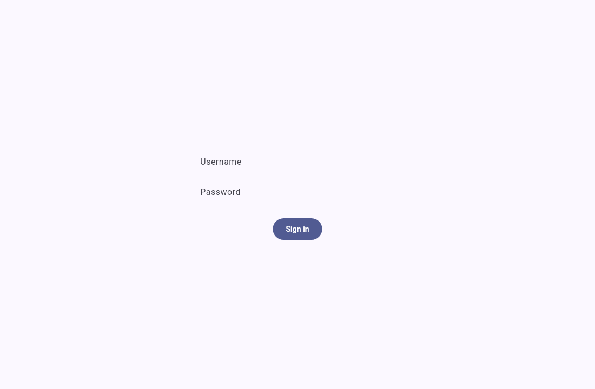
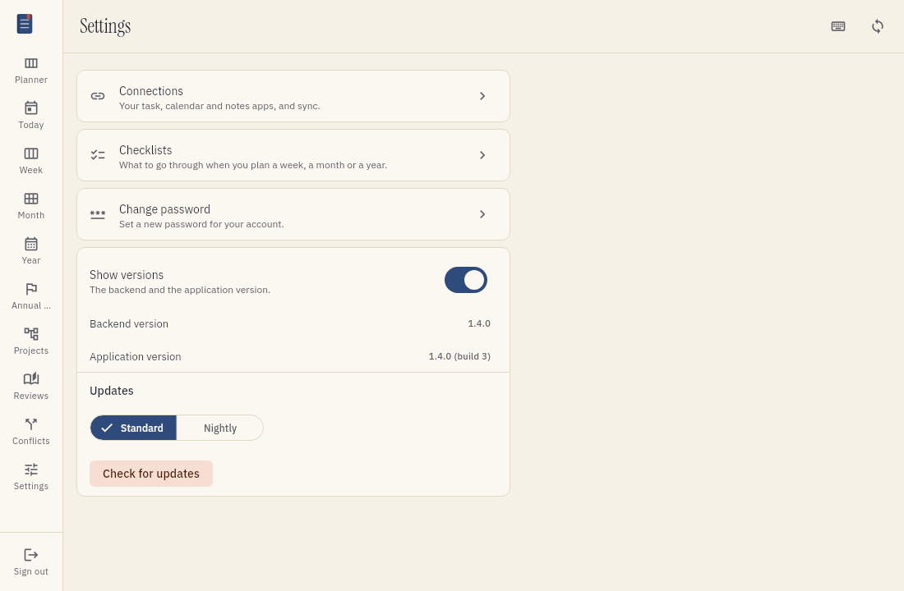
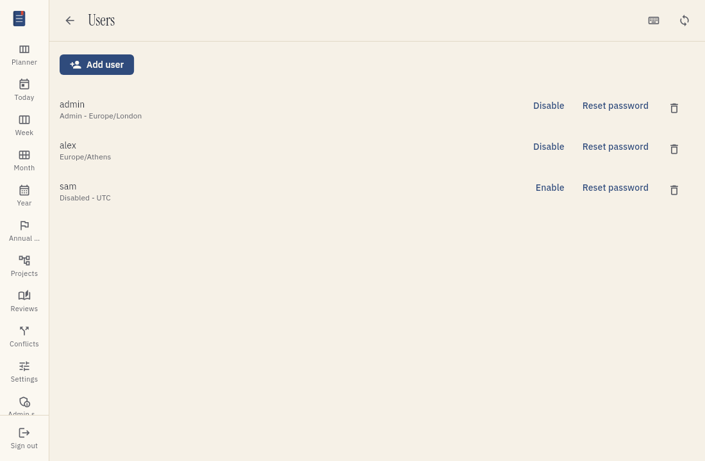
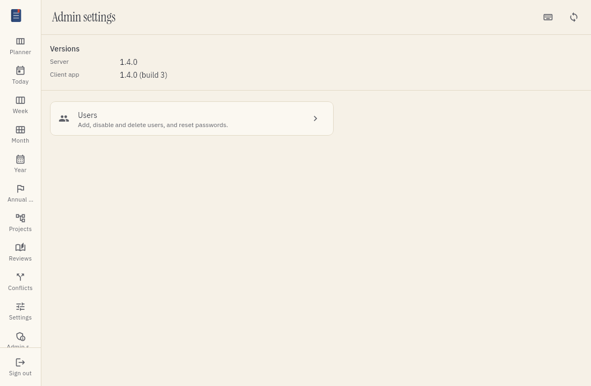

# Accounts and sign-in

Each person who uses tefteri has their own account. You sign in with a username and a password.
This guide also shows the administrator how to manage users.

## How accounts work

- Each user sees only their own data. This includes connected apps, items, annual goals, monthly
  themes, weekly milestones and plans.
- Nobody can register an account alone. Only an administrator can add a user.
- A visitor who is not signed in cannot see any data.

## Sign in

1. Open tefteri in your web browser.
2. Type your username.
3. Type your password.
4. Choose Sign in.

Tefteri shows your planning screens after you sign in.

## Session length

Your session ends after 8 hours. Then tefteri shows the sign-in screen again. Sign in again to continue.
Your administrator can change this time.

In the web browser, you stay signed in when you reload the page or open tefteri again,
until the session ends. Choose Sign out to end the session before that time.

## Blocked sign-in

Tefteri blocks sign-in for an account after 5 wrong passwords in 15 minutes. The block lasts 15 minutes.
This stops other people from guessing your password.

If tefteri blocks your sign-in, do these steps:

1. Wait 15 minutes. Do not try to sign in during this time.
2. Sign in again with the correct password.
3. If you forgot your password, ask your administrator to set a new one.

Your administrator can change these limits.

## Open your settings

The menu has one item for your settings. Choose Settings. The page lists your settings pages: Connections and Change password.

## Change your password

1. Open the menu and choose Settings.
2. Choose Change password.
3. Type your current password.
4. Type your new password two times.
5. Choose Save.

Use the new password the next time you sign in.

## Manage users (administrators only)

Only an administrator sees the Admin settings menu item. The Users screen is inside it. The first administrator comes from the deployment settings.

## See which versions run

Everyone can see the version of the client app. It is in the menu, under the Sign out button, for example `Version 0.1.0 (build 14)`.

An administrator can see both versions at the top of the Admin settings page:

- Server is the version that the server runs.
- Client app is the version of the app in your window.

The two versions help you find out if an update reached you. After you update the server, reload the page of the web client. If Client app still shows the old build, your browser still holds the old app: reload the page again without the cache (Ctrl+Shift+R).

### Add a user

1. Open the menu and choose Admin settings.
2. Choose Users.
3. Choose Add user.
4. Type a username for the new user.
5. Type a first password for the new user.
6. Choose Save.

Give the username and password to the new user. Ask the user to change the password at the first sign-in.

### Set or reset a password

1. Open the menu and choose Admin settings.
2. Choose Users.
3. Choose the user.
4. Choose Set password.
5. Type the new password.
6. Choose Save.

Use this when a user forgets a password.

### Disable a user

A disabled user cannot sign in. The data of the user stays in tefteri.

1. Open the menu and choose Admin settings.
2. Choose Users.
3. Choose the user.
4. Choose Disable.

To let the user sign in again, choose Enable.

### Delete a user

Delete a user only when you do not need the data of the user again.

1. Open the menu and choose Admin settings.
2. Choose Users.
3. Choose the user.
4. Choose Delete.
5. Confirm the deletion.

Tefteri removes the account and the data of the user. You cannot undo this action.
