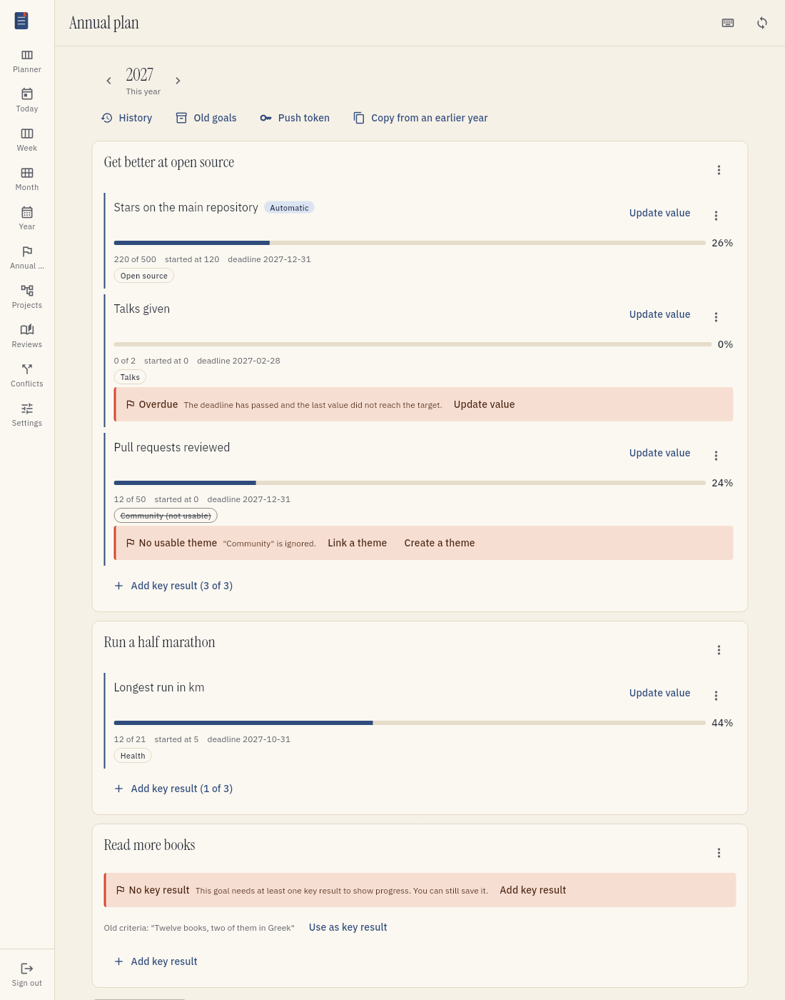
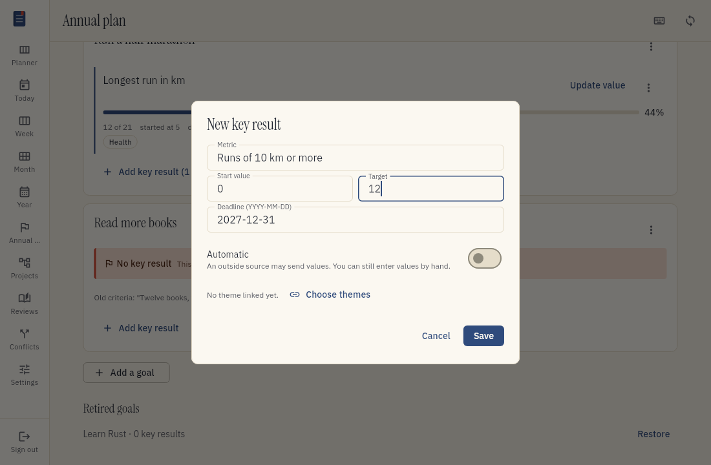
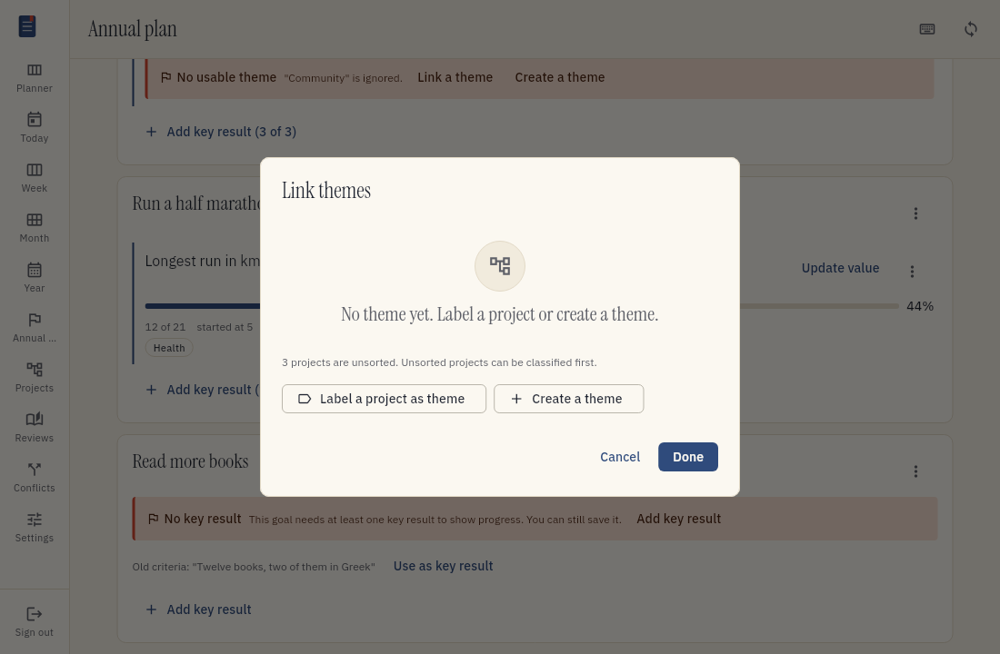
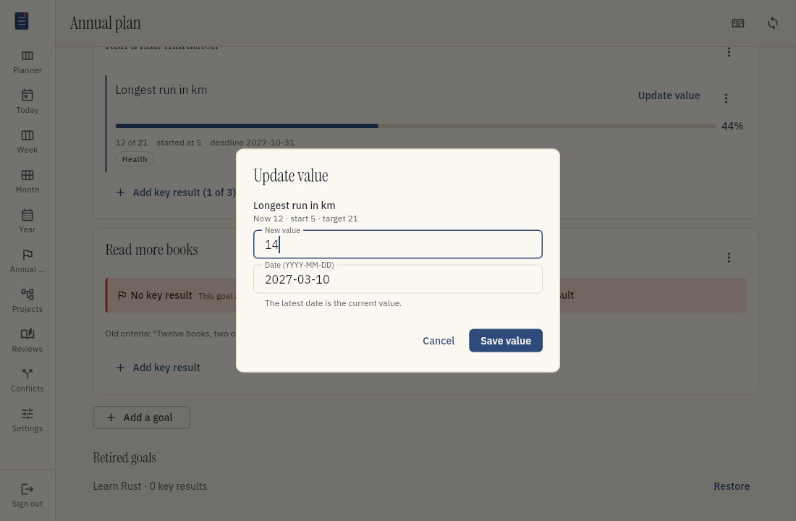
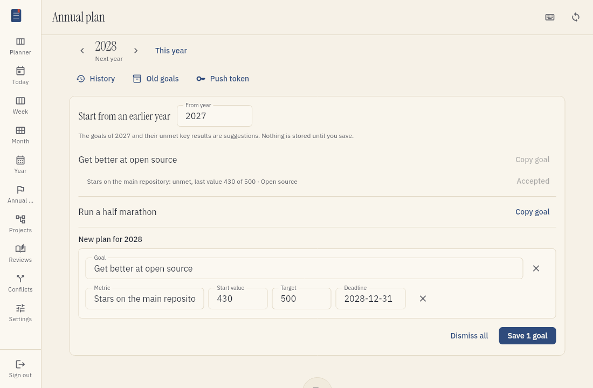
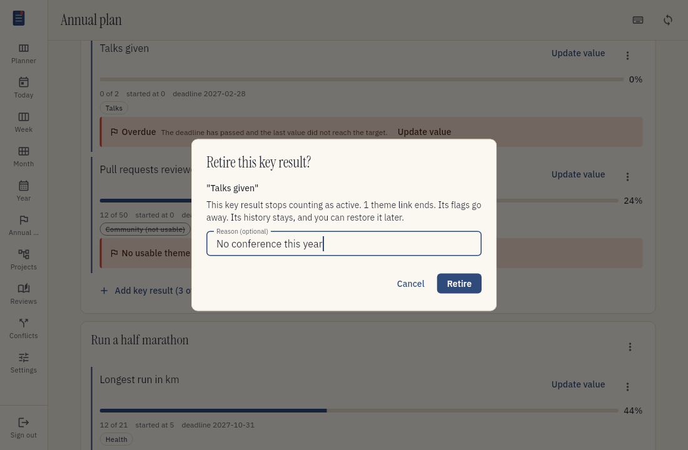
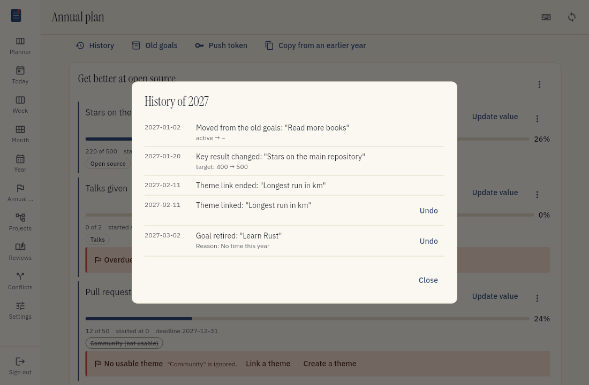
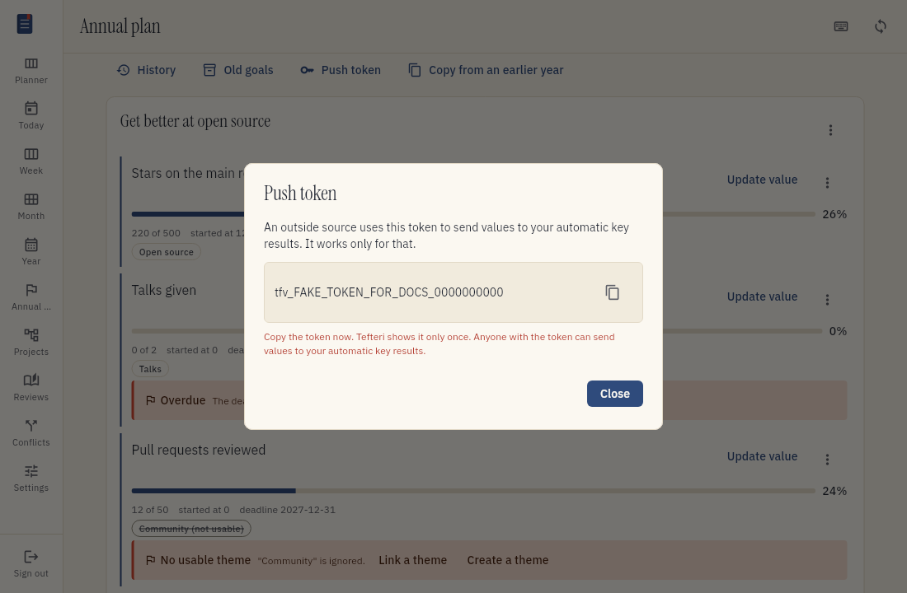
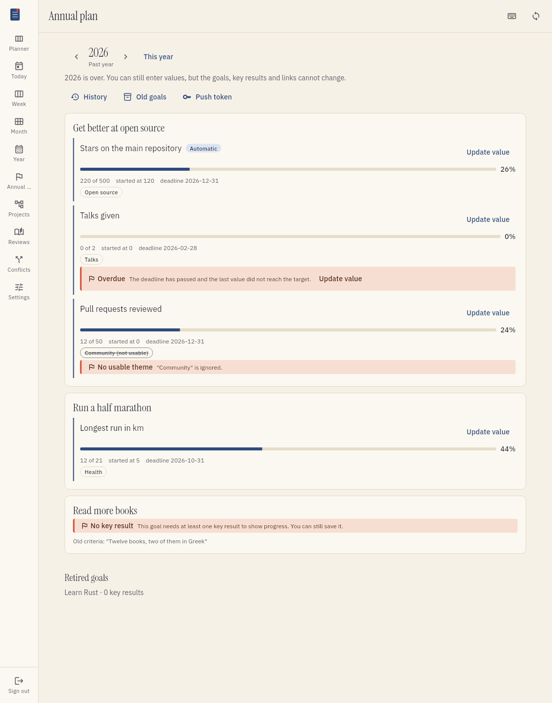
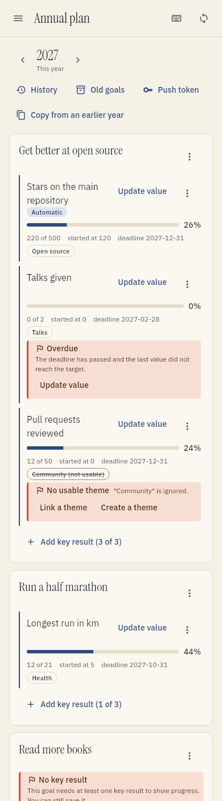

# Plan for the year

Annual planning helps you decide what you want to achieve in a year. Write a few goals. Add one
or more measurable key results to each goal. You can prepare a plan for a future year and change
the plan during that year.

Goals belong to years. Month and week goals from older plans stay in a read-only history. Use
[Monthly planning](monthly-planning.md) to choose themes for a month and
[Weekly planning](weekly-planning.md) to choose milestones for a week.

## Open annual planning

1. Open the menu.
2. Choose Annual plan. You can also press G.

Choose the year at the top of the screen. The plan of the current year is editable. You can plan
a future year before it starts. A past year is read-only, but you can read its values and history.

## Add a goal

1. Choose Add a goal.
2. Type a short sentence, for example "Get better at open source".
3. Choose Save.

A goal can have up to three active key results. Tefteri lets you save a goal without a key
result, but it shows a reminder to add one.

## Add a key result

A key result is a number that shows progress towards a goal. Open the goal, then choose Add key
result. A key result has:

- A metric, for example "Stars on one repository".
- A start value and a target.
- A deadline in the planning year.
- A current value. It starts at the start value.
- An update source: manual or automatic.

The target must not equal the start value. The deadline must be in the planning year.

## Link theme projects

A key result can serve one or more theme projects. A theme can serve more than one key result.

1. Open the key result.
2. Choose Link themes.
3. Select the themes.
4. Choose Done.

Only projects with the theme label are in the list. If no suitable theme exists, use the list to
label a project as a theme or to create a theme.

## Read the flags

Tefteri shows a flag when a key result has no usable theme or is overdue. A goal with no key
result also has a flag. A flag does not stop you from saving the plan.

A key result with no usable theme has an action to link a theme or to create one. An overdue key
result has an action to update its value. Read the reason in the flag and select the action that
solves it.

## Update a key result value

1. Open the key result.
2. Choose Update value.
3. Type the new value.
4. Choose a date.
5. Choose Save.

Each value stays in the history of the key result. The latest value is the current value. You can
enter a value by hand when the update source is automatic.

## Start a plan from an earlier year

When a year has no plan, you can copy goals and unmet key results from an earlier year.

1. Choose Copy from an earlier year.
2. Choose the source year.
3. Select a goal or a key result.
4. Edit the suggestion.
5. Choose Save.

Tefteri moves the deadline into the new year. It keeps a key result only when the key result is
active and not met. A link to a theme that is not usable now is dropped. Nothing is stored before
you save.

## Change or retire a goal

Open the menu on a goal or a key result to edit it. You can change a goal title. You can change
the metric, target, deadline and update source of a key result.

Retire a goal or a key result when it no longer belongs in the plan. Tefteri shows what the
retire changes before you confirm it. A retired item stays in the year history. You can restore
it while the year is open.

## Read the history and undo a change

1. Choose History.
2. Read the changes in time order.
3. Choose Undo on a change that you want to reverse.

The history shows the old value and the new value of each change. Tefteri groups the changes of
one action in a batch. You can undo a batch that has no later change. An undone change stays in
the history with the mark "Undone".

## Use a push token

An automatic source can send values to Tefteri. The source needs a push token.

1. Choose Push token.
2. Choose Create token.
3. Copy the token. Tefteri shows the full token only one time.
4. Give the token to the source.

Tefteri shows only the last four characters after you close the dialog. Choose Create token again
to replace the token. The old token stops at once.

Do not put the token in a file that other people can read. The token can write values for your
key results.

## Plan a past year

A year that ended is read-only. You cannot add or change goals, key results or theme links. You
can still read the plan and its history. You can also enter a value for a key result of a past
year.

## Use a checklist

You can keep a reusable checklist for annual planning. Read
[Planning checklists](planning-checklists.md) to create and use a checklist.

## Read older goals

Month and week goals from older plans are in Old goals. This view is read-only. You cannot create
or edit these goals. Task links to these goals stay in place.

## Use a small screen

On a phone, the plan uses one column. Open a goal to read its key results. The actions stay in the
menu at the top of the screen.

