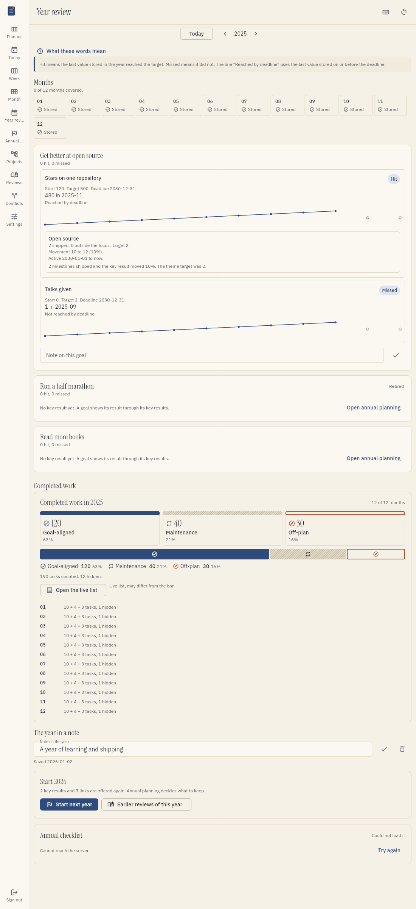
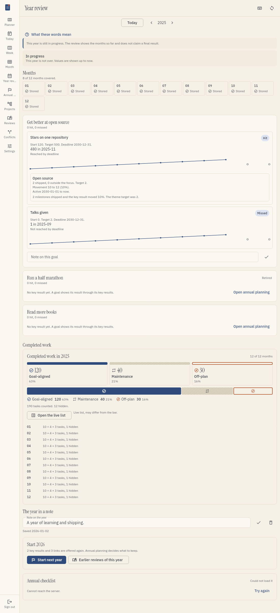
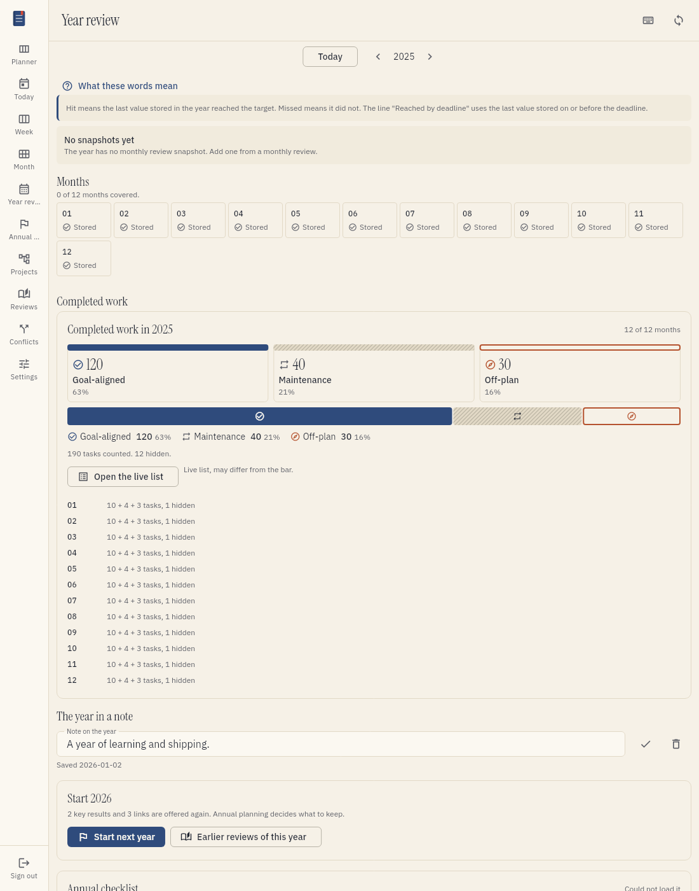
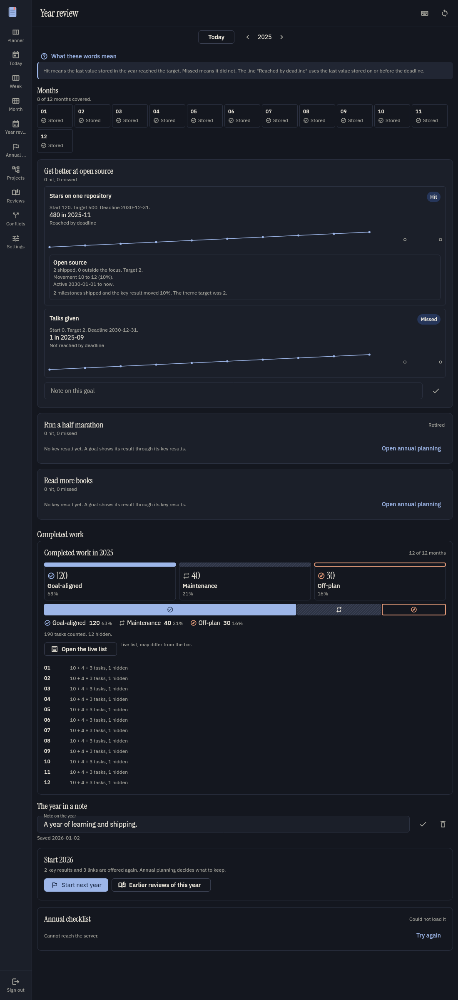

# Annual review

The annual review shows the result of one planning year. It reads the stored monthly reviews and
the annual plan. It does not change them.

## Open the review

1. Press `Y`, or select **Year review** in the menu.
2. Use the arrows to change the year, or select **Today** to return to this year.

The review shows the current year as **In progress**. It does not claim a final result before the
year ends.

## Read a goal and its key results

Each goal lists its key results. For each key result you see:

- the start value and the target;
- the last stored value and the month it came from;
- **Hit** or **Missed**;
- the line **Reached by deadline**.

A key result is **hit** when its last value in the year reached the target. A key result with no
stored value is not hit and not missed.

The line **Reached by deadline** uses the last value stored on or before the deadline. It does not
change the hit or missed result. When the deadline is still open, the line says so.

## Read the series

The strip has twelve points, one for each month. An open marker is a month with no stored value.
Tefteri does not fill a gap. When the best value is not the last value, the review also shows the
peak.

## Read the themes

The review lists the themes that served each key result. Each theme shows:

- the milestones shipped inside the dates of the link;
- the milestones shipped outside the month's focus;
- the sum of the theme targets;
- the movement of the key result in the same months.

A quiet hint appears when many milestones shipped and the key result moved less than 25% of its
span. The hint states two numbers and does not claim a cause. A second hint appears when the key
result moved 25% or more and no milestone shipped.

A theme that is no longer in your task app stays in the list, with its stored name and a mark.

## Read the year split

The year split sums the stored counts of the months that have a monthly review. It shows
goal-aligned, maintenance and off-plan work as one bar. Hidden tasks are a separate count and are
not in the total. Every total states how many months it covers.

Select a category, or **Open the live list**, to see the tasks. This list is live, so its numbers
can differ from the bar.

## Missing months and empty years

A month without a monthly review is marked **Missing**. Select it to open that month's review.
A year with no snapshots still lists its goals, key results, start values, targets and current
values. A future year shows a quiet empty state.

## Retired items and notes

A retired goal or key result shows its date. It is never counted as missed.

You can write one note for the year and one note for each goal. Select **Save** to store the note.
Select **Delete** to remove it. The review shows the text that was lost and offers **Undo** for
eight seconds.

## Start the next year

Select **Start next year** to open annual planning with the reviewed year as the source year. The
review creates no goal, key result or link. Annual planning decides what to keep. Read
[Annual planning](annual-planning.md) for the rules of a new year.

The link **Earlier reviews of this year** opens the stored reviews of the year.

