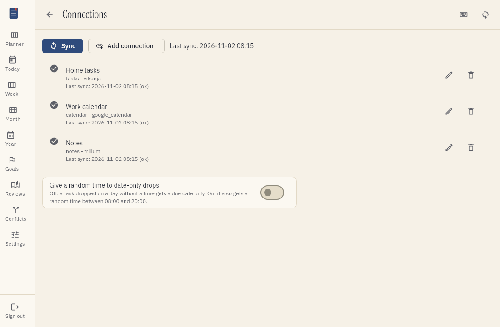
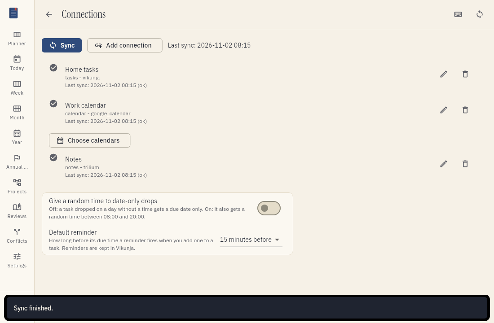

# Connect your apps

Tefteri does not store your tasks, events or notes by itself. It shows the data from your own apps.
You connect each app one time. After that, you press Sync to get the newest data.

You can connect these apps:

- Vikunja for tasks.
- Google Calendar for events. You can connect more than one Google account.
- Trilium Next for notes.

## Before you start

1. Log in to tefteri.
2. Open the menu and choose Settings.
3. Choose Connections. You see the list of connections.

## Connect Vikunja

You need the web address of your Vikunja server and an API token.

1. Open Vikunja in your web browser.
2. Open the Vikunja settings and find the API tokens.
3. Create a new token. Copy the token.
4. In tefteri, open Settings and choose Add connection.
5. Choose Vikunja.
6. Type the base URL of your Vikunja server. Type it in full, with https at the start.
7. Paste the API token.
8. Choose Save.
9. Press Sync to test the connection. If the sync works, the connection shows the status OK.

## Connect a Google account

You use the Google sign-in page. Tefteri never sees your Google password.

1. In tefteri, open Settings and choose Add connection.
2. Choose Google Calendar. Then choose Continue.
3. Choose Open Google sign-in. Sign in to your Google account on the Google page.
4. Read the access request. Choose Allow.
5. Wait for tefteri to show the connection in the list.

To connect more than one Google account, do these steps again for each account.
Each account shows as its own connection.
Each connection shows the calendars of that account. For example, you can see personal, family and work calendars.

## Connect Trilium Next

You need the web address of your Trilium Next server and an ETAPI token.

1. Open Trilium Next in your web browser.
2. Open the Options and choose ETAPI.
3. Create a new ETAPI token. Copy the token.
4. In tefteri, open Settings and choose Add connection.
5. Choose Trilium Next.
6. Type the base URL of your Trilium Next server.
7. Paste the ETAPI token.
8. Choose Save.

Tefteri tests each connection when you save it. If the connection does not work, a message
tells you why. For example, it names the address that answered and what it answered. Fix the
address or the token, and choose Save again.

The base URL is the address that you use to open Trilium Next, for example
`https://notes.example.com`. If you copy the address of a page, tefteri ignores the part after
`#`, and it ignores `/etapi` at the end. Tefteri does not show the hidden notes of Trilium
Next, such as the launch bar and the options.

## Choose what each connection shows

Each connection has containers. A container is a Vikunja project, a Google calendar or a group of notes.
You can set each container to Life or Work. Then the Life and Work switch shows the right items.

When you add a connection, choose where the items without a label show: Life, Work or both.
If you choose both, these items show when the switch is on Life and when it is on Work.
Items and containers that have a label show only in their own context.

## Use Sync

Tefteri does not sync in the background. You start each sync.

1. Press the Sync button at the top of the screen.
2. Wait until the button stops moving.
3. Read the result for each connection.

To sync one connection only, open Settings and choose Sync next to that connection.

If one app fails, tefteri still syncs the other apps. The failed app shows a message.
Read [Troubleshooting](troubleshooting.md) to find out what to do.

## Read the last-sync status

Each connection shows the time and the result of its last sync.

| Status | Meaning |
| ------ | ------- |
| OK | The last sync worked. |
| Needs attention | The app refused your credentials. Reconnect the app. |
| Error | Tefteri could not reach the app. Retry later. |

If you did not sync for a long time, the data on the screen can be old. Press Sync to get new data.

## Change a connection

1. Open Settings.
2. Choose the edit button (the pencil) next to the connection.
3. Change the name, the base URL, the token or the context.
   To keep the stored token, leave the token field empty.
4. Choose Save. Then press Sync.

## Remove a connection

1. Open Settings.
2. Choose the remove button (the bin) next to the connection.
3. Choose Remove to confirm.

Tefteri deletes the stored token. Your data stays in your app.
