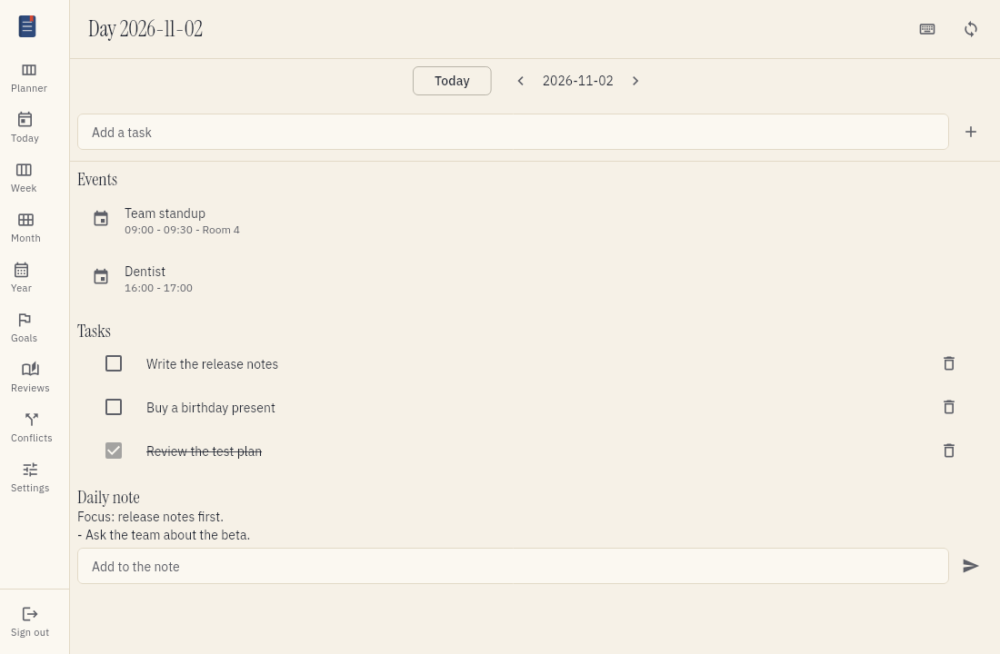
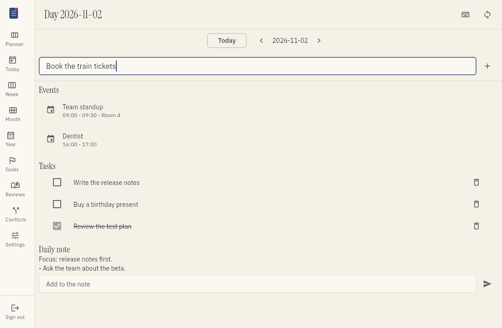

# Plan your day

The daily view shows your whole day on one screen. You plan the day in it and you do your work in it.
This page tells you how to use the daily view.

## What the daily view shows

The daily view has three parts:

- Entries. These are the calendar events of the day.
- Tasks. These are the tasks that are due on the day or that you put on the day.
- The daily note. This is your note for the day in Trilium Next.

Tefteri does not store these items. They stay in your own apps. Tefteri changes them for you.

## Open the daily view

1. Log in to tefteri.
2. Choose Today in the menu, or press T.
3. To see a different day, choose the arrows or the date at the top.
4. Press Sync to get the newest data.

If you did not connect your apps, read [Connect your apps](connect-apps.md) first.

## Add a task

1. In the daily view, choose Add task.
2. Type the title of the task.
3. Choose the project for the task.
4. Choose Save.

The task goes to your task app. It shows in the daily view when it is due on that day.

## Complete a task

1. Find the task in the daily view.
2. Choose the check box next to the task.

The task app marks the task as done. To reopen the task, choose the check box again.

## Edit a task

1. Choose the title of the task.
2. Change the title, the due date or other fields.
3. Choose Save.

## Delete a task

1. Choose the task.
2. Choose Delete.
3. Choose Confirm to delete the task.

The task is gone from your task app. You cannot undo this action in tefteri.

## Add to the daily note

The daily note keeps your short notes for the day. Tefteri adds your text to the end of the note. It does not change the text that is there.

1. In the daily view, find the daily note.
2. Choose Add to note.
3. Type your text.
4. Choose Save.

If the day has no daily note yet, tefteri offers to create one. Choose Create to accept. The note goes to Trilium Next.

## Link a note to a task

You can write a note about a task. Tefteri links the note to the task.

1. Choose the task.
2. Choose Add note.
3. Type your text.
4. Choose where the text goes. You can choose the daily note or a note that you choose.
5. Choose Save.

The text goes to Trilium Next. The task shows a link to the note. Choose the link to read the note.

## If an app does not answer

If your task app or your note app does not answer, tefteri tells you. The change does not happen.
Tefteri does not keep the change to send it later. Fix the problem and make the change again.
Read [Troubleshooting](troubleshooting.md) for the steps.

If you and another app change the same item, read [Conflicts](conflicts.md).
