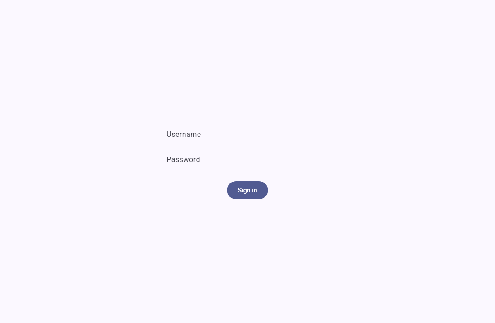

# Get started

This guide shows how to install the tefteri client and sign in the first time. Your
administrator gives you the server address, a username and a first password.

## Install the client

Tefteri has a client for the Linux desktop, for Android and for the web browser. Get the
packages from the releases page of the project on GitHub.

On Debian or Ubuntu:

1. Download the file `tefteri_<version>_amd64.deb`.
2. Install it: `sudo apt install ./tefteri_<version>_amd64.deb`.
3. Start Tefteri from the application menu.

On other Linux systems:

1. Download the file `tefteri-<version>-x86_64.AppImage`.
2. Make it executable: `chmod +x tefteri-<version>-x86_64.AppImage`.
3. Start the file.

On Android:

1. Download the file `tefteri-<version>.apk` on your phone.
2. Open the file. Let your phone install apps from this source if it asks.
3. Start Tefteri.

In a web browser, open the address that your administrator gives you.

The `nightly` pre-release has the newest packages. These packages are not tested as much as a
release. Use them only to try new features.

## Sign in for the first time

1. Start tefteri.
2. Type your username and the first password from your administrator.
3. Choose Sign in.
4. Open the menu and choose Change password. Set a password that only you know.

Refer to [Accounts and sign-in](accounts-and-sign-in.md) for more about passwords and sessions.

## Connect your apps

Tefteri does not keep your tasks, events and notes itself. It shows the items from your own
apps. Connect them next. Refer to [Connect your apps](connect-apps.md).

## Use a company Google account

A company Google account (Google Workspace) can block apps that the company did not approve.
In this case, Google shows a message that it blocks the app when you connect the calendar.

1. Ask the Google Workspace administrator of your company to approve the tefteri OAuth client.
   Give the administrator the client ID from the administrator of your tefteri server.
2. Tell the Google Workspace administrator that tefteri asks for one scope:
   `https://www.googleapis.com/auth/calendar` (read and change your calendars).
3. After the approval, connect the calendar again. Refer to
   [Connect a Google account](connect-apps.md).

You can connect a personal Google account and a company Google account at the same time. Each
account is a separate connection.

## Learn the main screens

- [Plan with the planner](planner.md)
- [Plan your day](daily-planning.md)
- [Put tasks on the calendar](scheduling.md)
- [Plan goals](planning-goals.md)
- [Use the keyboard](shortcuts.md)
