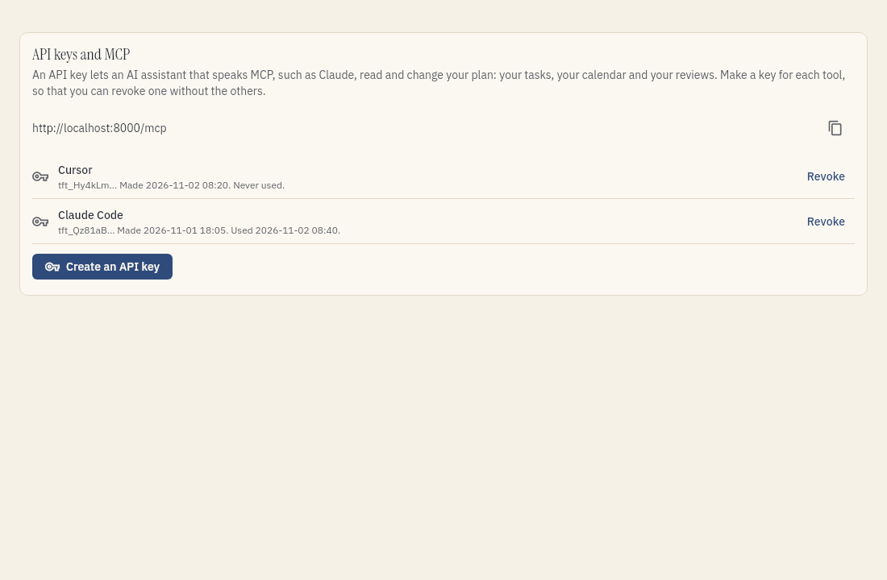
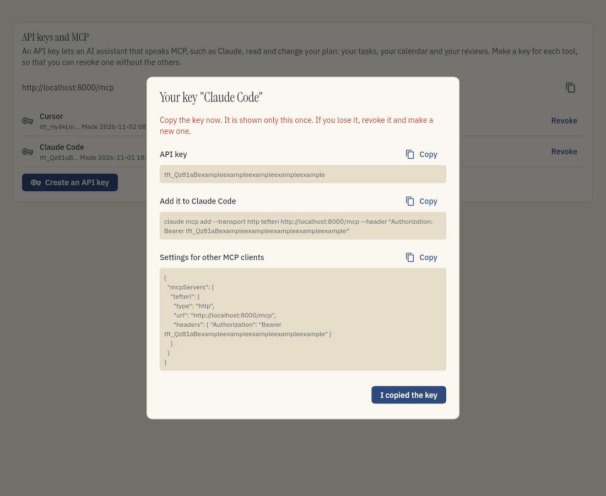

# Use tefteri with an AI assistant

Tefteri has a built-in MCP server. MCP is the Model Context Protocol. It lets an AI assistant, such
as Claude, read and change your plan. The assistant sees your tasks, your calendar, your daily
notes, and the numbers of your reviews. This page tells you how to connect an assistant and what to
ask it.

## What the assistant can do

- Plan your day and your week. It looks at your events and your tasks, finds the free time, and
  puts tasks on the calendar.
- Manage your tasks. It adds, changes, plans, finishes and deletes tasks.
- Manage your calendar. It adds, moves and deletes events, and invites people.
- Write better reviews. For the weekly, the monthly and the annual review, it reads the real
  numbers: what you committed to, what you finished, how your work divides into goal-aligned,
  maintenance and off-plan work, how the weeks compare, and what you wrote in your daily notes.
  It then helps you decide what to carry on.

The assistant always works as you. It can see only what you can see.

## Before you start

You need three things:

1. A tefteri server that the assistant can reach. A server on the internet needs HTTPS, so that
   nobody can read your key.
2. A connected task app and a connected calendar app. Read [Connect your apps](connect-apps.md).
3. An assistant that can connect to an MCP server over HTTP and send a header. Claude Code, Cursor
   and Visual Studio Code can. Claude Desktop can, with a small helper (see below).

## Make an API key

An API key is a long secret text. The assistant sends it with each request, so that the server
knows who it is.

1. Open the menu and choose Settings.
2. Find the card API keys and MCP.
3. Choose Create an API key.
4. Type a name for the tool, for example Claude. Choose Create.
5. Copy the key. Tefteri shows it only one time. If you lose it, revoke it and make a new one.



The card also shows the address of the MCP server. It is the address of your tefteri server with
/mcp at the end, for example `https://tefteri.example.com/mcp`.

Make one key for each tool. Then you can revoke one key and the other tools keep working.

## Connect the assistant

The dialog that shows your new key also shows the lines below, with your key already in them.
Each line has a Copy button.



### Claude Code

Run this command in a terminal. Put your address and your key in it.

```bash
claude mcp add --transport http tefteri https://tefteri.example.com/mcp --header "Authorization: Bearer tft_your_key"
```

### Cursor, Visual Studio Code and other clients

Add this to the MCP settings file of the client:

```json
{
  "mcpServers": {
    "tefteri": {
      "type": "http",
      "url": "https://tefteri.example.com/mcp",
      "headers": { "Authorization": "Bearer tft_your_key" }
    }
  }
}
```

### Claude Desktop

Claude Desktop connects to a remote server through a helper that runs on your computer. Install
Node.js, and add this to the settings file of Claude Desktop:

```json
{
  "mcpServers": {
    "tefteri": {
      "command": "npx",
      "args": [
        "mcp-remote",
        "https://tefteri.example.com/mcp",
        "--header",
        "Authorization: Bearer tft_your_key"
      ]
    }
  }
}
```

Restart the assistant after you change its settings.

## Your first conversation

Start with a simple question:

> What do I have to do today?

The assistant first asks tefteri for an overview. This tells it the date, your time zone, and your
calendars and projects. Then it reads your day.

## Things to ask

### Plan a day or a week

- "Plan my day. Put the most important tasks in my free time."
- "I have 90 minutes free tomorrow afternoon. What should I do in that time?"
- "Spread my open tasks over this week. Do not put more than four on any day."
- "Which tasks are overdue? Help me decide what to do with each one."

### Manage tasks

- "Add a task Buy compost in the project Garden, due Friday at 14:00."
- "Move the task Write report to Thursday at 10:00."
- "Mark the task Call Sam as done."
- "Show me the tasks I finished this week."

A task that has a due time, or a time on the calendar, also gets a reminder on your phone. Read
[Get reminders on your phone](reminders.md).

### Manage the calendar

- "Put a dentist appointment on Thursday from 16:00 to 17:00 in my Personal calendar."
- "Move my 10:00 meeting on Monday to 11:00."
- "Invite `sam@example.com` to the planning meeting."
- "When am I free for one hour on Wednesday?"

An event that is in more than one of your calendars is one event for the assistant, not two.

### Reviews

The assistant has a ready prompt for each review. In most clients you find the prompts in a menu,
or you type a slash. You can also ask in your own words.

- Weekly review. "Do my weekly review." The assistant reads the look-back: how many committed tasks
  you finished, the tasks that are left, your pace on each day, and how this week compares with the
  last weeks. It also reads your daily notes. It then proposes what to do with each milestone that is
  not finished, and asks you before it saves the review.
- Monthly review. "Do my monthly review." The assistant reads the focus of the month, the key
  results and the numbers of each week. It proposes carry, drop, replace or later for each theme. It
  first shows a preview. It saves the review only after you agree.
- Annual review. "Do my annual review." The assistant reads each goal with its key results and the
  record of each month. It writes a note for the year and a note for each goal, and saves them after
  you agree.

Saving a review ends its reminder. Read [Get reminders on your phone](reminders.md).

The assistant uses only the numbers that tefteri has. If a week has no committed plan, the
assistant tells you that there is no look-back. Read [Plan your week](weekly-planning.md) for how
the numbers are made.

## All the tools

| Tool | What it does |
| ---- | ------------ |
| get_overview | The date, your time zone, your apps, calendars and projects. The assistant calls it first. |
| get_day | The events, the tasks and the daily note of one day. |
| get_week | One week: the events and the tasks. |
| list_events | The events of some days, each one once. |
| find_free_time | The free gaps of a day. |
| list_tasks | Open tasks by due date, a search, or finished tasks. |
| get_task | One task with its description. |
| create_task | Adds a task. |
| update_task | Changes the title or the description. |
| schedule_task | Plans a task for a day or for a time. |
| unschedule_task | Takes the day off a task. |
| complete_task | Marks a task as done. |
| reopen_task | Marks a done task as open. |
| delete_task | Deletes a task. The assistant asks first. |
| create_event | Adds an event to a calendar. |
| update_event | Changes an event. |
| delete_event | Deletes an event. The assistant asks first. |
| append_daily_note | Adds a line to the daily note. |
| get_weekly_review | All the data of a weekly review. |
| submit_weekly_review | Saves the weekly review. |
| get_monthly_review | All the data of a monthly review. |
| save_monthly_review | Previews or saves the monthly review. |
| get_annual_review | All the data of an annual review. |
| save_annual_review_note | Saves the note of the year or of one goal. |
| get_trends | The numbers of the last weeks. |
| get_work_balance | The completed work of a week, a month or a year, by category. |

## Keep your key safe

- A key gives the same access as you have, to your tasks, your calendar, your notes and your
  reviews. Keep it secret. Do not put it in a shared file.
- A key cannot change your password, manage users, make other keys, or export the passwords of your
  connections. Only you can do this, when you are signed in.
- You see when each key was last used in the card API keys and MCP. If you do not know a key, or
  you lose a device, choose Revoke. The tool is signed out at once.
- Tools that delete something say so, and good assistants ask you before they use them. Read
  what the assistant plans to do before you agree.

## If something does not work

- The assistant says the key is not valid. The key was revoked, or it was copied with a mistake.
  Make a new key.
- The assistant cannot reach the server. Check the address. It must end with /mcp. A server on your
  own computer is not reachable from an assistant that runs in the cloud.
- The assistant says no task app or no calendar app is connected. Connect one in Settings, and then
  Connections.
- The assistant uses the wrong time. Tell it your time zone, or check the time zone of your account.
  Times that the assistant sends without an offset are in your time zone.
