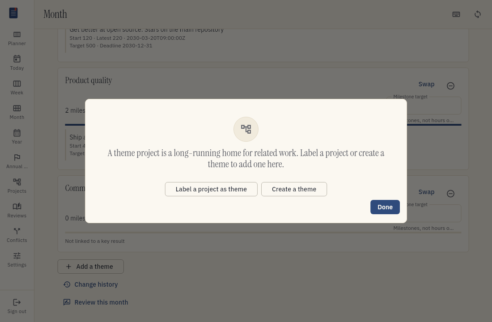
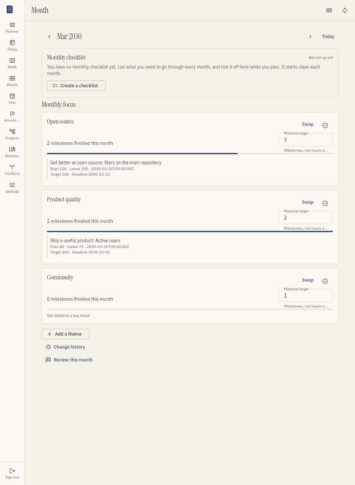
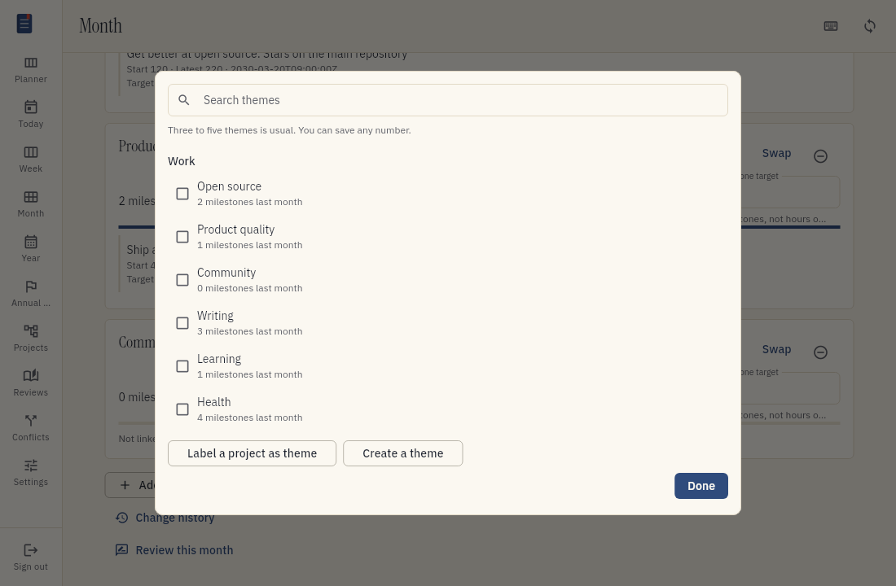
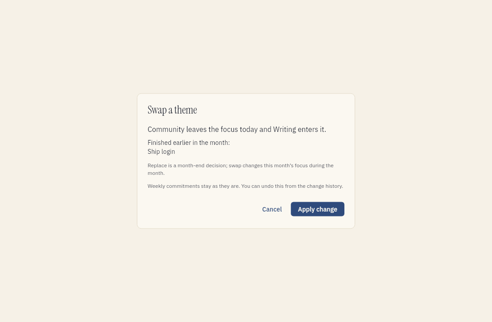
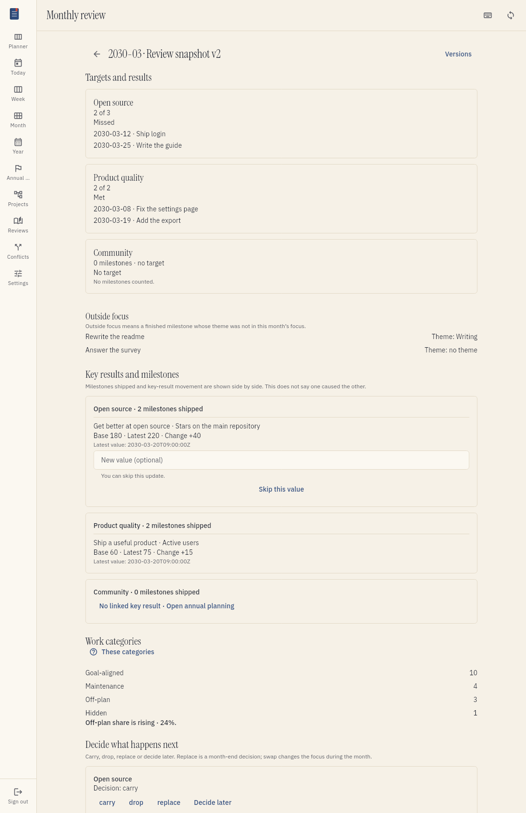
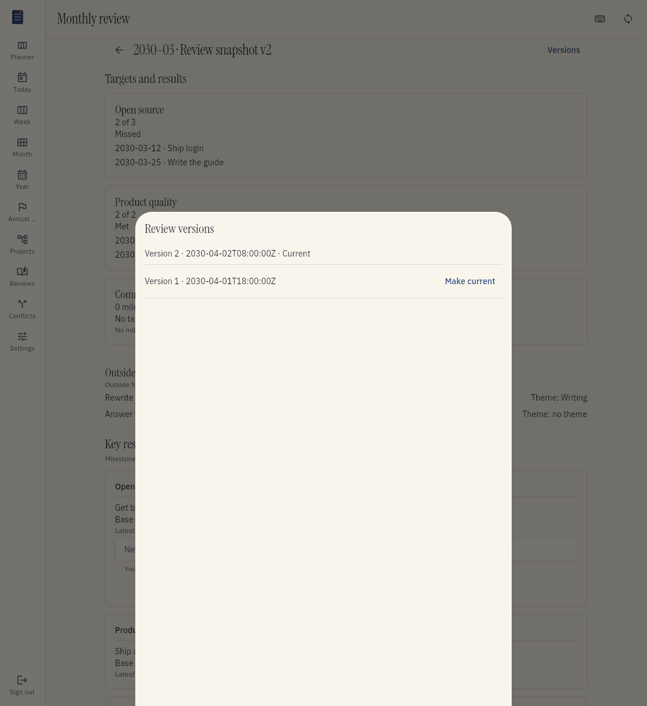
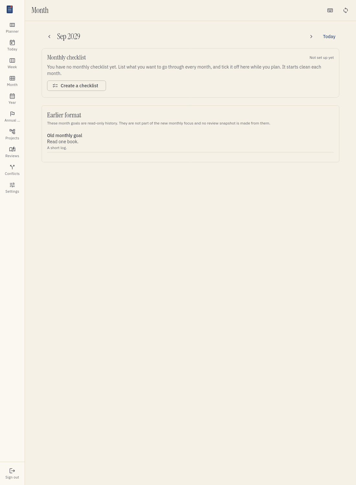
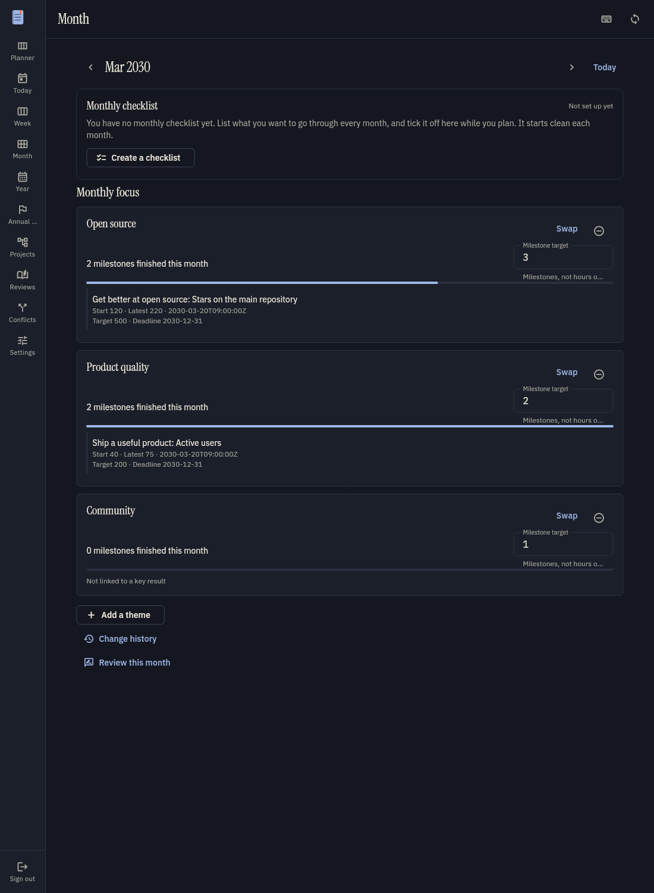

# Plan your month

Monthly planning helps you choose the themes for a month. A theme is a long-running project for
related work, such as "Home" or "Open source". You set an optional target for each theme. The
target is a number of milestones to finish. You do not create milestones here. You choose and
finish them in weekly planning.

This guide explains how to set a monthly focus, change it, and review the month.

## Words used in this guide

- **Monthly focus**. The themes that you choose for one month, with an optional target for each.
- **Milestone**. A small project under a theme. It has a clear result and usually takes about one
  week to finish.
- **Key result**. A number that shows progress towards an annual goal.
- **Outside focus**. Work that was finished under a theme that was not in the month's focus, or
  work with no theme.
- **Review snapshot**. A saved copy of the monthly review. It does not change later.

## Start a monthly plan

1. Choose Month in the menu.
2. Choose the month that you want to plan.
3. Choose the themes for the month.
4. Set a milestone target for each theme, or leave the target empty.
5. Review the key results beside the themes.
6. Save the plan.

For a new month, Tefteri may show suggestions from your last saved review. A carried theme keeps
its target as an editable suggestion. A replacement theme is also suggested. These suggestions
are not a plan until you save them.

Tefteri suggests three to five themes. This is guidance, not a rule. You can choose fewer or more.
Tefteri shows a quiet note when you choose none, fewer than three, or more than five. The note
does not stop you from saving.

The theme list only shows projects that you labelled as themes. It does not show milestones,
maintenance projects, ignored projects or projects that are no longer available. If the list is
empty, use the actions in the picker to label or create a theme.

### Set a target

A target is the number of milestones that you want to finish under a theme during the month.
Enter a whole number of zero or more. You can also leave the field empty.

- An empty field means **no target**. Tefteri does not compare the result with a number.
- Entering **0** sets a real target of zero. If you finish no milestones, the result is 0 of 0
  and the target is met.
- A negative number, decimal or text is not a valid target.

You can choose a theme with no key result. Tefteri marks it as not linked to a key result. A key
result with no usable theme in the focus has a quiet note. Monthly planning does not change links
between themes and key results. Change those links in annual planning.

The key results beside a theme show their start value, latest value and its date, target and
deadline. Tefteri reads the latest value from the key result series. It does not request a new
value from another source.

## Change the focus during the month

You can swap, add or remove a theme while the month is in progress. You can also change a target.
Before you confirm a change, Tefteri shows its effect.

A theme that enters the focus during the month has a target that counts from the date it enters.
Milestones that it finished earlier in the month still appear in the review, but do not count
towards that target. A theme that leaves the focus stays in the review with its target and result.
The change does not alter milestones or weekly commitments.

Tefteri records each change with its date in the focus history. You can undo a change from that
history. Undo restores the focus to its earlier state.

## Review the month

At the end of the month, open the review for that month. Before you save it, the review is a
draft. You can leave it and return later. Tefteri stores nothing until you finish the review.

For each theme, the review shows the target and the number of milestones that became done under
that theme during the month. It marks a target as missed, met or beaten. A theme with no target
has the marker No target. A milestone counts in the month of its done date and under the theme
that it had when it became done. Closed or parked milestones do not count.

Milestones done under a theme outside the focus appear in a separate Outside focus list. A
milestone with no theme appears there as No theme. These milestones do not count towards a
target.

### Key results and the gap

The review shows the value at the start of the month, the latest value, and the change for each
key result. It shows these values beside the number of milestones finished under the theme. This
helps you compare work with movement in a key result. It does not say that the milestones caused
the change.

For a manual key result, you can enter a new value or skip it. A value that you enter is saved
in the key result series. For an automatic key result, the review shows the latest value in the
series. It does not ask the source for a new value. When a value is shared by more than one
theme, the review marks it as shared.

### Work categories and the off-plan trend

The review shows the number of completed tasks in each work category: goal-aligned, maintenance
and off-plan. It also shows the hidden count. Tefteri uses the counts from work categories. It
does not count the categories again. Percentages are calculated for display.

The review marks the off-plan share as rising when it is higher than in each of the previous two
months. If there is not enough history, it says so and shows no trend. A high or steady
maintenance share is not a problem marker. Read [Work categories](work-categories.md) for more
about the categories.

### Decide what happens next

For each theme, choose one of these decisions:

| Decision | What it means |
| --- | --- |
| Carry forward | Suggest this theme for next month with its target. You can edit the suggestion. |
| Drop | Do not suggest this theme for next month. It stays available in the theme list. |
| Replace | Suggest another theme for next month instead. |
| Decide later | Save the review without a decision for this theme. |

Tefteri shows the effect before you save a decision. You can change or undo a decision until you
save next month's plan.

**Replace** is a decision at the end of the month. **Swap** changes the focus during the month.
They are different actions.

### Save and read versions

When you finish the review, Tefteri saves a review snapshot. It keeps the theme names, targets,
milestone results, focus changes, key result values, category counts and decisions as they were
at that time.

A snapshot never changes. If you later rename or remove a project, move a task, or change a
label, the saved review stays the same. If you reopen a finished review and save it again,
Tefteri creates a new version. The earlier versions stay in the history. You can see which
version is current and make an earlier version current.

The annual review reads the current saved version of each month.

## Earlier month goals

The old Month view used month goals. Tefteri does not create or edit these goals in the new
monthly flow. If a past month only has old month-goal data, it opens in an **Earlier format**
read-only view. This view does not change the old goals or create a monthly review snapshot.

## Use a phone or dark mode

On a phone, the focus themes and targets appear in a single narrow column. The dark theme uses
the same layout and the same markers.

