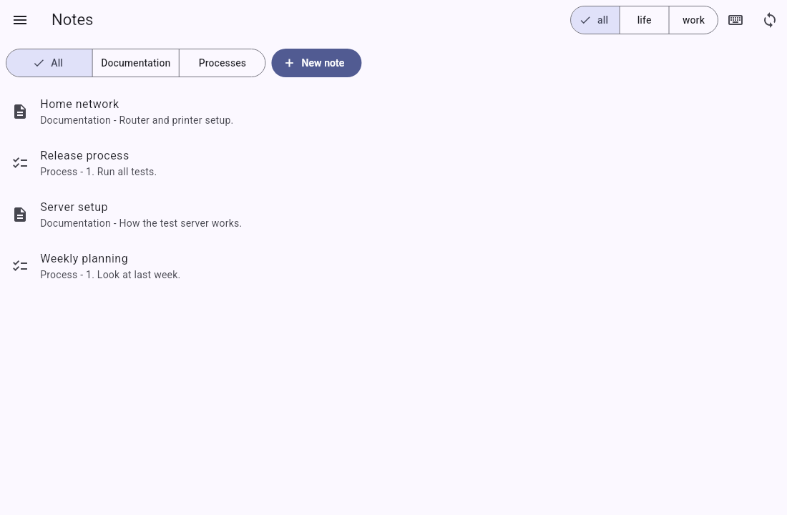
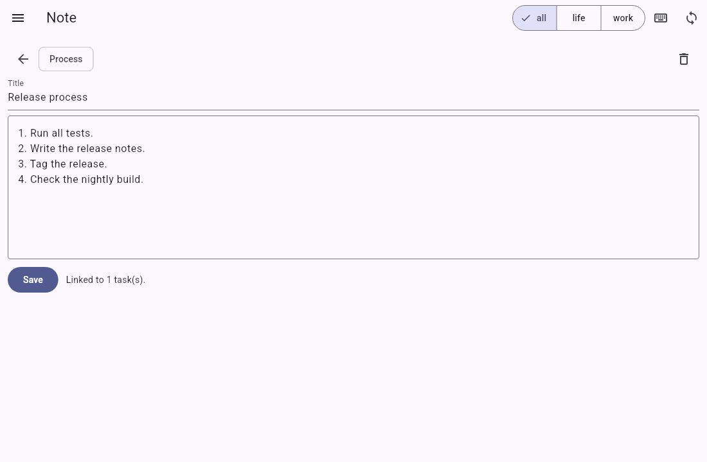

# Keep documentation and process notes

Tefteri has two kinds of notes in addition to the daily note:

- Documentation notes. Use them for information that you want to keep, for example how a
  server works.
- Process notes. Use them for steps that you do again and again, for example a release
  checklist. Write one step on each line.

Tefteri saves the notes in your notes app, for example Trilium Next. You can link a note to
one or more tasks. Then you can open the note from the task.

## See your notes

1. Open the menu and choose Notes.
2. To see one kind of note, choose Documentation or Processes. To see all, choose All.
3. Choose a note to open it.

## Add a note

1. Open the menu and choose Notes.
2. Choose New note.
3. Choose Documentation or Process.
4. Type the title.
5. Type the text. For a process, write one step on each line.
6. Choose Save.

## Edit a note

1. Open the note.
2. Change the title or the text.
3. Choose Save.

Tefteri saves the change in your notes app first. If the note changed in your notes app after
the last sync, tefteri does not save your change. Press Sync, open the note again and make
your change again.

## Delete a note

1. Open the note.
2. Choose the delete button.
3. Choose Delete.

Tefteri deletes the note in your notes app too. The linked tasks stay.

## Link a note to a task

1. Open the daily view.
2. Find the task. Choose the Notes button next to the task.
3. Choose New note for this task.
4. Write the note and choose Save.

Tefteri links the new note to the task.

## Open a note from a task

1. Find the task in the daily view.
2. Choose the Notes button next to the task.
3. Choose the note in the list.

To remove a link, choose the remove-link button next to the note. The note and the task stay.

## If your notes app does not answer

Tefteri shows a message with the name of the connection. It does not save the change. Refer to
[Troubleshooting](troubleshooting.md).
