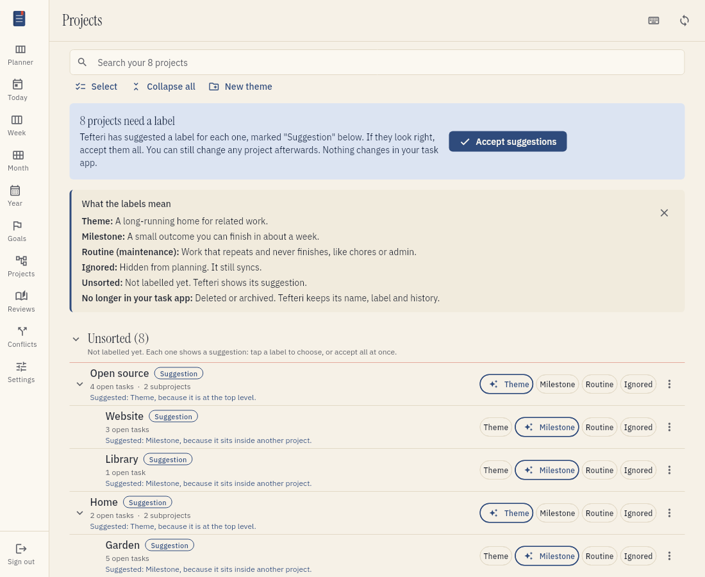
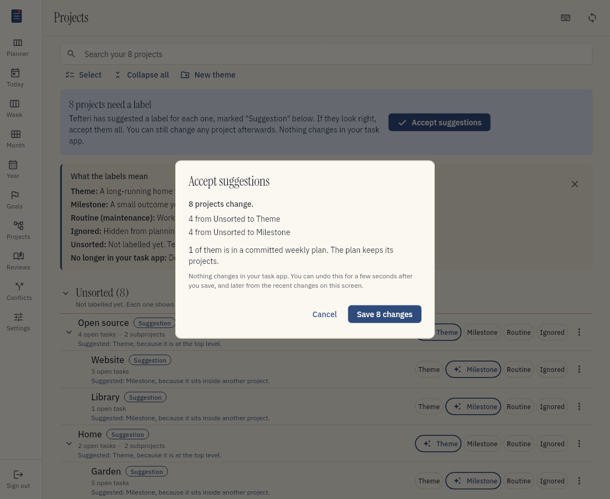
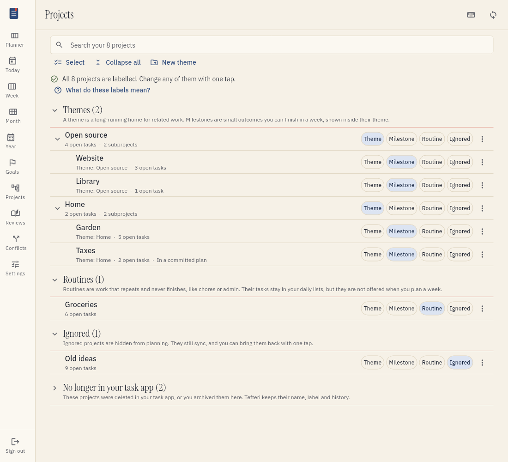
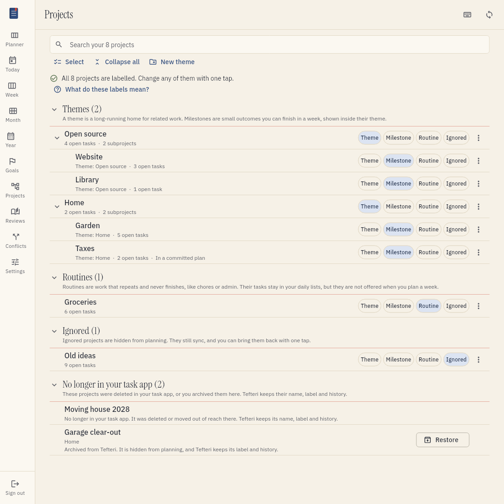
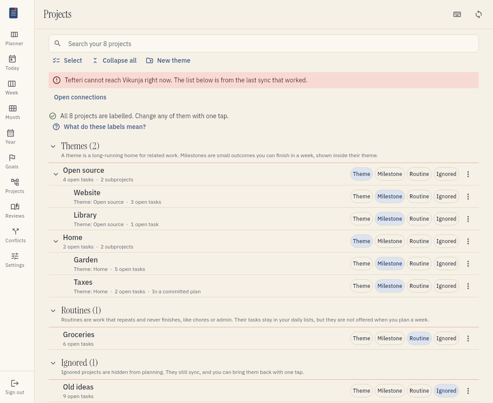
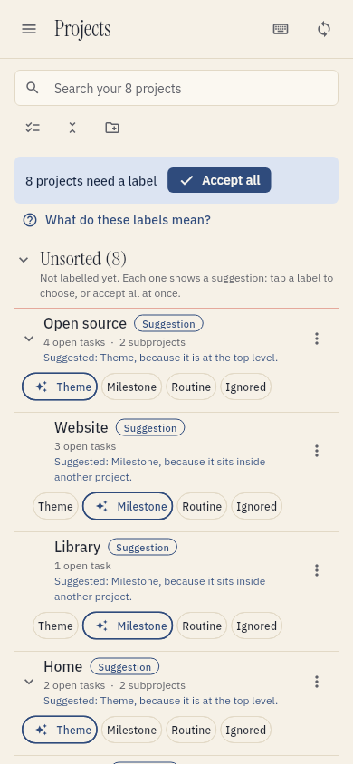

# Sort your projects

Tefteri needs to know what each of your projects is for. You give each project one label. Then
the planning views know which projects to offer and which to hide. This page tells you how to
check and change the labels.

## What the labels mean

Tefteri has four labels:

- Theme. A long-running home for related work. A theme has no end. Examples are "Home" and
  "Open source".
- Milestone. A small outcome that you can finish in about a week. A milestone sits inside a theme.
- Routine. Work that repeats and never finishes, such as chores or admin. The menu and the
  buttons call this label Routine.
- Ignored. A project that you do not want to plan with. Tefteri hides it from planning.

Tefteri puts a project with no label in the group Unsorted. It shows a suggestion for each one.

Tefteri keeps the labels in tefteri only. It never writes a label, a tag or a field to your task
app. Your task app does not change when you label a project.

## Open the Projects view

1. Choose Projects in the menu, or press O.
2. Read the list.

The view shows all projects of your task app, in the same tree as in your task app. Each project
shows its label. The groups are Themes, Routines, Ignored and No longer in your task app. A
group that is empty does not show.

The first time, a blue card at the top tells you how many projects need a label. The card has the
button Accept suggestions. A second card under it explains each label. Choose the cross
to hide it. Choose What do these labels mean? to show it again.

## How Tefteri suggests a label

Tefteri looks at where a project is in the tree. It gives a reason for each suggestion. The reason
shows under the name of the project.

| Project | Suggested label | Reason |
| ------- | --------------- | ------ |
| At the top level | Theme | It is at the top level. |
| Inside another project | Milestone | It sits inside another project. |
| In a weekly plan that you made in the past | Milestone | You planned it in a past week. |
| Inside a Routine project | Routine | It sits inside a routine project. |

A suggestion is only a suggestion. Tefteri does not store it until you accept it or choose a
label yourself.

## Accept the suggestions

If the suggestions look right, accept them all:

1. Choose Accept suggestions.
2. Read the preview. It tells you how many projects change.
3. Choose Save. The button shows the number of changes.

Tefteri shows the preview first, so that you know the result before it changes anything. The
preview also tells you how many of the projects are in a committed weekly plan. A committed
plan keeps its projects. The labels do not change the plan.

You can leave the view at any time. Projects that you did not label stay in the Unsorted group.
Tefteri does not stop you from planning because of them.

## Change one label

1. Find the project. To find it faster, type in the search field.
2. Choose another label on the row of the project: Theme, Milestone, Routine or Ignored.

Tefteri saves the new label at once. A message at the bottom has the button Undo. Choose it to
bring back the earlier label.

To show or hide what is inside a project, choose the arrow at the left of its name. Choose
Collapse all to close all projects at once. The button then changes to Expand all.

## Change the labels of many projects

1. Choose Select.
2. Tick the projects.
3. Choose a label, for example Label as Routine.
4. Read the preview and choose Save.

Choose Stop to leave the selection.

## See the sorted tree

After you save, tefteri puts each project in its group. A milestone shows inside its theme. The
row of the milestone shows the name of its theme. If a milestone is not inside a theme, tefteri
shows it in the group Milestones without a theme. Move it under a theme in your task app, or
change its label.

## What Routine and Ignored do

A routine project and an ignored project both leave the weekly planning list of projects. The
difference is in the rest of tefteri:

- A routine project stays in your daily list and in the planner. You still see its tasks.
- Tefteri hides an ignored project from all planning lists. Tefteri still syncs it, so nothing is lost.

A project is also hidden when you ignore a project above it. The row says so. A project inside a
routine project does not show in the weekly planning list either.

To bring a project back, choose another label.

## Undo a change

Tefteri keeps a history of every label change. You can undo a change in two ways:

- Choose Undo in the message that shows after a save. The message stays for a few seconds.
- Choose Recent changes at the top of the view, and then choose Undo next to the change. The
  list stays until you leave the view.

An undo restores the earlier labels. It does not block other work.

## Projects that are no longer in your task app

Sometimes a project leaves your task app. You deleted it there, or you archived it from tefteri.
Tefteri does not delete the project. It keeps the name, the label and the history. Tefteri calls
this project orphaned. An orphaned project is hidden from all planning lists, and old weekly
plans still show its name.

To see these projects, choose the group No longer in your task app. The group starts closed.

- If the project came back in your task app, tefteri finds it at the next sync. It is not
  orphaned any more.
- If you archived the project from tefteri, choose Restore to bring it back. Tefteri restores it
  in your task app first. Your task app must support this. If it does not, there is no Restore
  button.
- If you deleted the project in your task app, tefteri cannot restore it. Restore it in your
  task app. Then sync.

## Rename a project

1. Choose the three dots at the right of the project.
2. Choose Rename.
3. Type the new name and choose Rename.

Tefteri changes the name in your task app first. If the task app refuses, tefteri shows a
message, and the name does not change in either place. If your task app cannot rename projects,
the menu has no Rename.

If you rename a project in your task app, tefteri shows the new name at the next sync. The label
stays the same. A label belongs to the project, not to its name. A move to another parent works
the same way.

## Archive a project

1. Choose the three dots at the right of the project.
2. Choose Archive in your task app.
3. Read the message. It tells you what happens and if you can undo it.
4. Choose Archive.

Tefteri archives the project in your task app, with the projects inside it. The project moves to
the group No longer in your task app. You can undo the archive, or use Restore later, if your
task app supports it.

## Make a theme

1. Choose New theme.
2. Type the name.
3. If you have more than one task app, choose the app.
4. Choose Create theme.

Tefteri creates the project in your task app first. Only then does it give the project the label
Theme. If the task app refuses, tefteri creates nothing.

## New projects

When you add a project in your task app, tefteri finds it at the next sync. The project shows
in the Unsorted group with a suggestion. Planning still works. The weekly planning view shows a
quiet line that tells you how many projects have no label. Choose Label them to open the
Projects view.

## If something goes wrong

- If the view shows a red message about your task app, tefteri could not read your latest
  projects. The list shows the projects from the last sync that worked. Choose Open connections
  to fix the connection. Read [Troubleshooting](troubleshooting.md) for more information.

  

- If a change does not save, tefteri shows a message and changes nothing. Try again when the
  task app answers.
- If your task app has no nested projects, tefteri refuses the connection and names the
  missing feature. Tefteri needs projects that hold other projects.

## Use a phone

On a narrow screen, the toolbar shows only icons. The label buttons go below the name of the
project. The card at the top has the short button Accept all. Choose the menu button at the top
left to open the menu.

