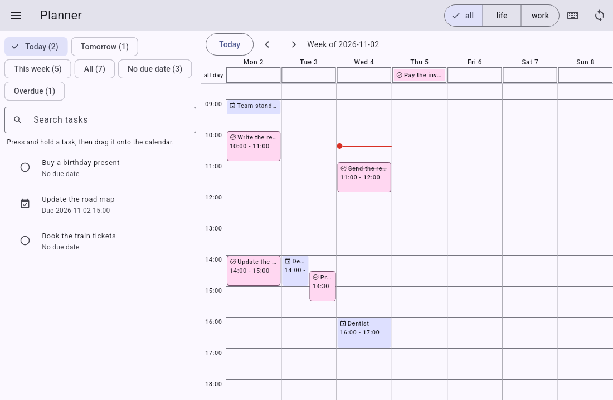
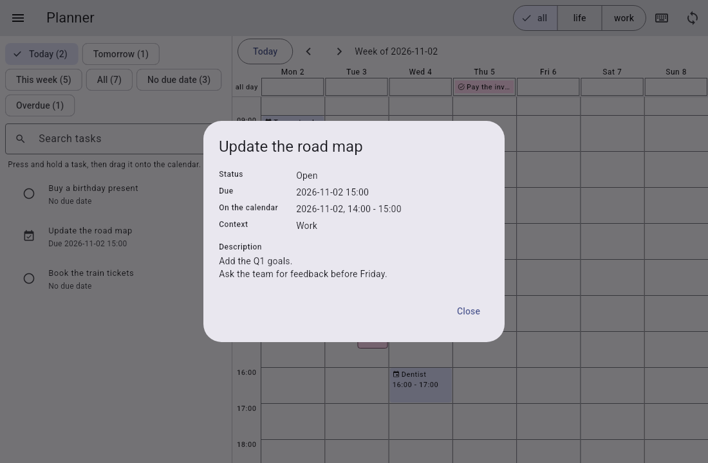
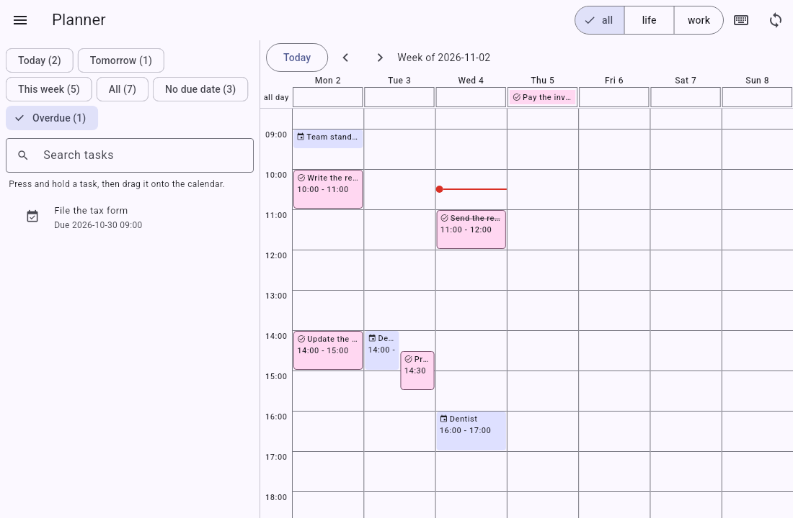
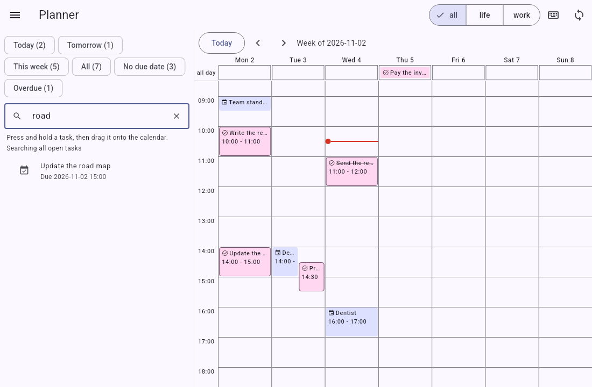
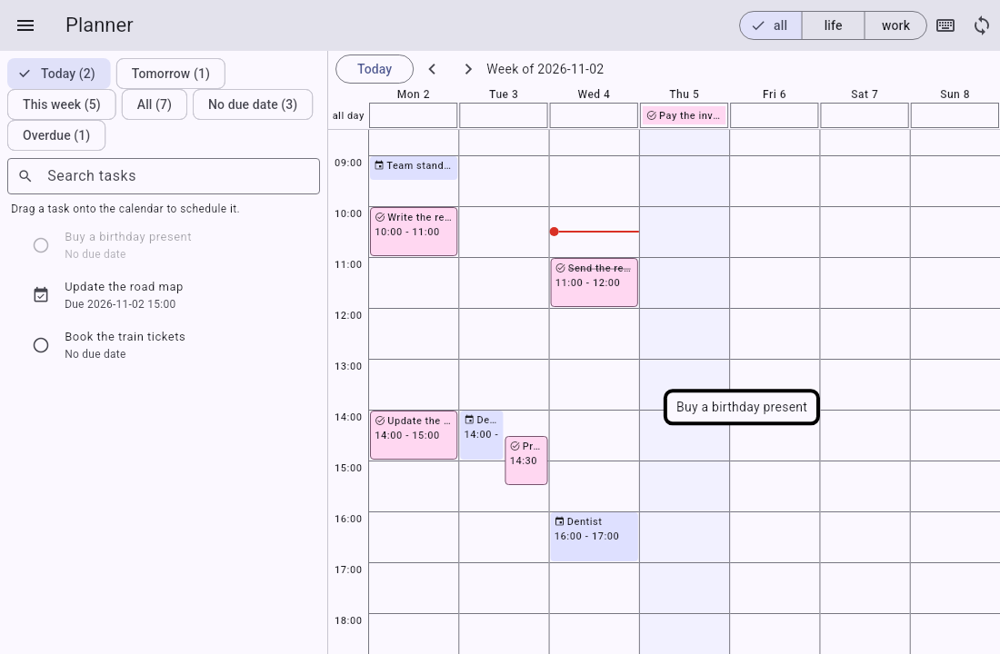
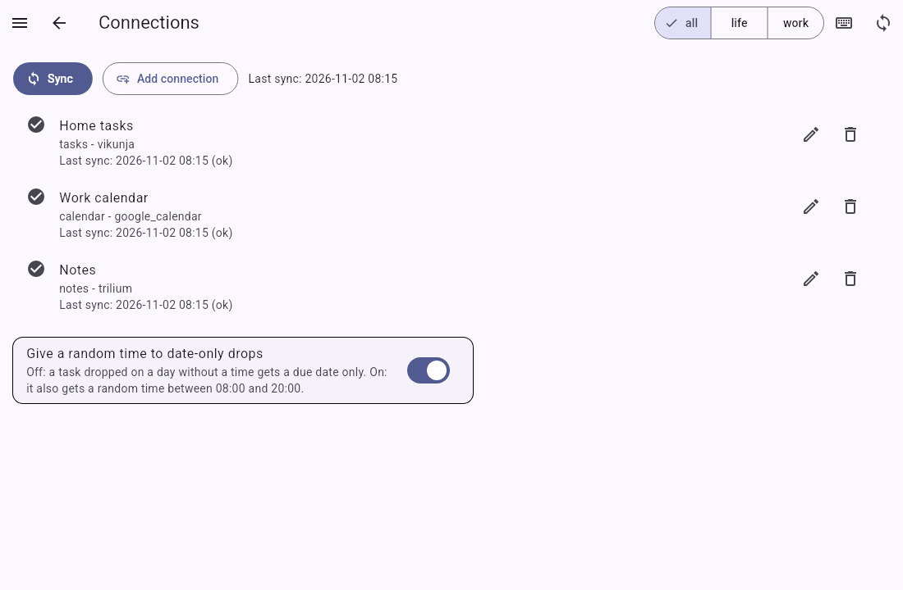
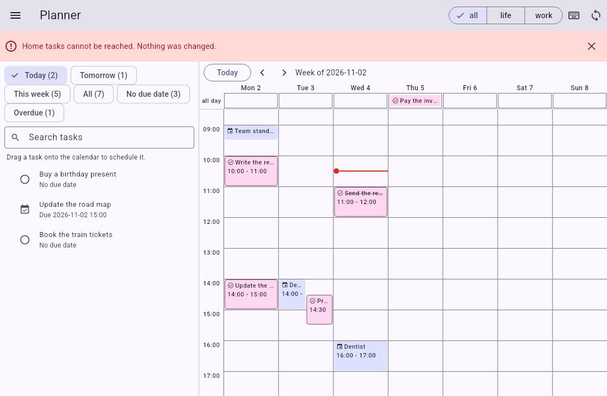
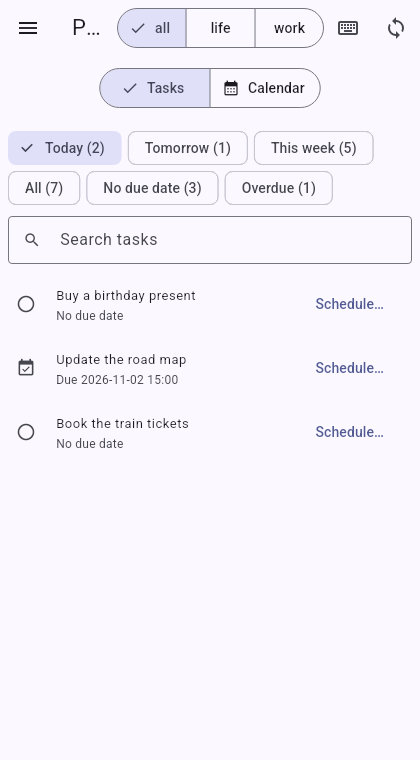
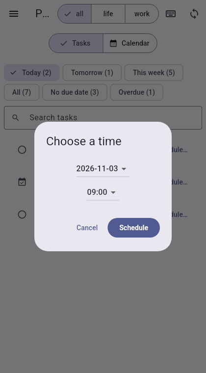

# Plan with the planner

The planner is the first screen of tefteri. It shows your tasks on the left and your calendar on the right.
You can see what you must do and when you have time, on one screen.

## What the two columns show

The left column is the task list. At the top you find the filters and the search box.
The right column is the calendar for one week. It shows your calendar entries and your tasks together.

Task blocks have a colored outline and a check mark. Calendar entries have no outline.
A red dot and a red line show the current time in the column of the current day. The line moves while you work.
A task with a date and no time shows in the row called all day.

The work and life switch and the sync button work for both columns. When you choose work, both columns show work items only.
When you sync, both columns update.

## Move to today

Choose Today at the top of the calendar to go to the week of today. The calendar scrolls to the current time.
To move by one week, choose the arrows next to the Today button. You can also press the Left arrow key and the Right arrow key.
The arrow keys do not work while you type in the search box.
Every screen with a calendar or a period has a Today button: the planner, Today, Week, Month and Year.

## See the details of a task

Choose a task in the list, or a task block on the calendar. A pop-up shows the details of the task:
the status, the due date, the time on the calendar, the context and the description.
Choose Close to close the pop-up.

If you choose a calendar entry, the pop-up shows the time and the context of the entry.

## Find a task

Use the filters at the top of the task list. Each filter shows how many open tasks it holds.

| Filter | Tasks it shows |
| --- | --- |
| Today | Open tasks that are due today |
| Tomorrow | Open tasks that are due tomorrow |
| This week | Open tasks that are due from Monday to Sunday of this week |
| All | All open tasks |
| No due date | Open tasks that have no due date |
| Overdue | Open tasks whose due date is in the past |

When you open the planner, the filter Today is on. To use another filter, choose it.

To find a task by name, type part of the name in the search box. Tefteri searches all open tasks.
It does not use the filter while you search. To go back to the filter, choose the X in the search box.

If no task matches, tefteri tells you. Choose Clear search to see the list again.

## Put a task on the calendar

When you point at a task with the mouse, the task lifts, gets an outline and shows a grip on the left. The cursor becomes a hand. This shows that you can drag the task.

1. Find the task in the list.
2. Drag the task to a time on the calendar.
3. Drop the task.

Tefteri saves the time at once. The task shows as a block on the calendar.

The block starts at the time slot where you drop the task. Time slots are 15 minutes long.
A block is one hour long. Your task app gets the due date and time of the task. The due time is one hour after the start of the block.

For example, you drop a task at 14:30. The block is from 14:30 to 15:30. The due time of the task is 15:30.

Tefteri changes only the due date of the task. It does not make an event in your calendar app.

## Put a task on a day with no time

1. Drag the task to the row called all day at the top of the calendar.
2. Drop the task on the day that you want.

The task gets a due date and no time. It shows in the all day row.

You can change what happens in this case. Open the menu, choose Settings, and then choose Connections. Use the switch
"Give a random time to date-only drops". When the switch is on, the task gets a random time on that day.
The time is from 08:00 to 19:45. You can move the block later.

## Move a task or take it off the calendar

- To move a task, drag its block to a new time. Tefteri saves the new due date.
- To take a task off the calendar, drag its block to the task list. The task loses its due date and time.

## See tasks that already have a date

Tasks that have a due date show on the calendar, also when you set the date in your task app.
Press sync to get the latest dates.

- A task with a date and a time shows as a block. The block ends at the due time and is one hour long.
- A task with a date and no time shows in the all day row.
- A task that you completed has a line through its name.

If a due time is in the first hour of the day, the block starts at 00:00. A small arrow on the block shows this.

If a task and a calendar entry are at the same time, tefteri shows them side by side.

A task that is due at exactly 00:00 in your time zone shows as a task with a date and no time. Vikunja has no separate field for this case.

## If a change does not save

If your task app is not available, tefteri shows a message at the top. The message gives the name of the app and the reason.
The task does not show as scheduled. Nothing changes in your task app.

Fix the problem, then drag the task again.

If you changed the task in your task app after the last sync, tefteri shows a conflict.
Open the Conflicts screen and choose the version that you want to keep. See [Solve a sync conflict](conflicts.md).

## Use the planner on a phone

On a narrow screen, the two columns do not fit. The planner shows two tabs: Tasks and Calendar.
Your filter, your search text and your week stay the same when you change tabs.

You do not drag tasks on a phone. To schedule a task:

1. Choose Schedule next to the task.
2. Choose the day and the start time.
3. Choose Schedule.

The time that you choose is the start of the block. The due time is one hour later.
