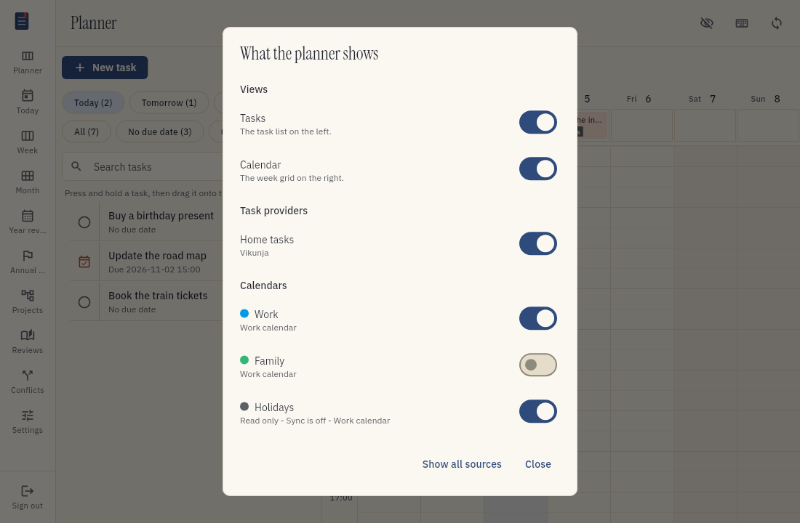
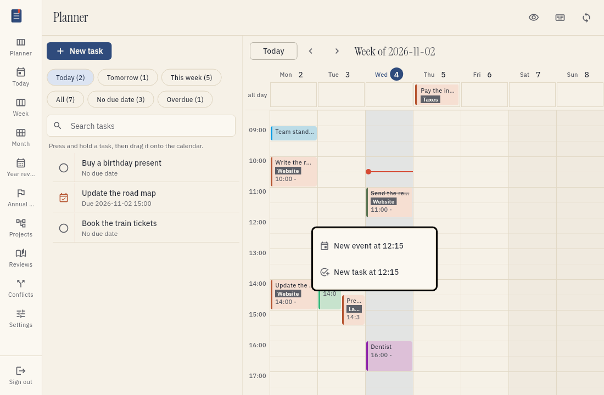
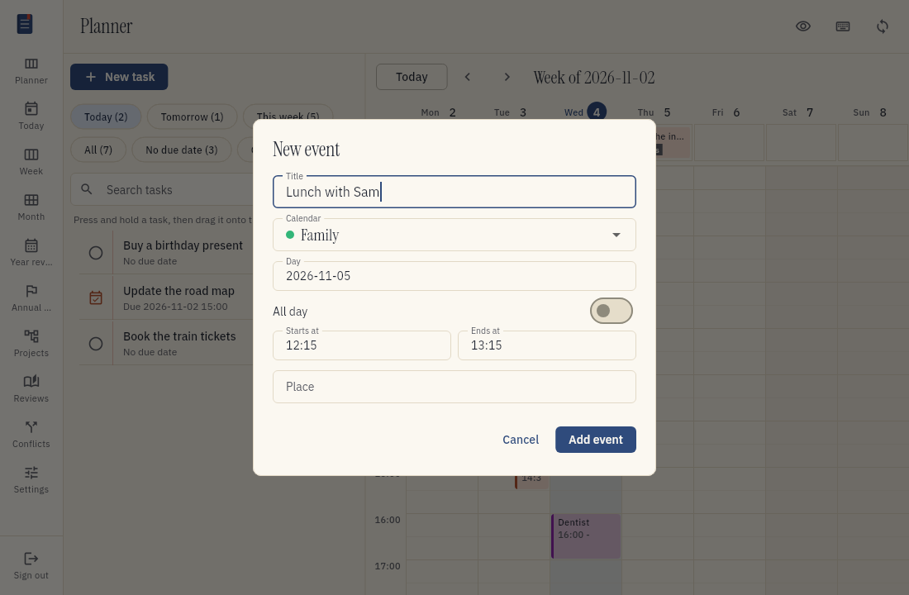

# Plan with the planner

The planner is the first screen of tefteri. It shows your tasks on the left and your calendar on the right.
You can see what you must do and when you have time, on one screen.

## What the two columns show

The left column is the task list. At the top you find the filters and the search box.
The right column is the calendar for one week. It shows your calendar entries and your tasks together.

Task blocks have a colored outline and a check mark. Calendar entries have no outline. An entry
from a Google calendar has the color that you chose for that calendar in Google Calendar: a
strong line on its left edge and a softer color on the block. A task has the color of its
project in Vikunja in the same way. A finished task stays green.
A red dot and a red line show the current time in the column of the current day. The line moves while you work.
A task with a date and no time shows in the row called all day.

When you sync, both columns update.

## Choose what the planner shows

Choose the eye button at the top of the planner. A window shows these switches:

- **Tasks** and **Calendar**: hide one of the two columns. The other column uses the whole window.
- **Task providers**: hide the tasks of one connected task app. The other task apps stay visible.
- **Calendars**: hide the events of one calendar. The other calendars stay visible.

A hidden source keeps syncing. Tefteri only leaves it out of the planner, so you can show it again at once.
Choose **Show all sources** to show every task provider and calendar again.
Tefteri keeps the choice on this device.

The eye button is also in the header when one pane is hidden. The planner always keeps at least one
column visible. To hide the tasks, show the calendar first, or the other way around.

Hiding a calendar in this window is not the same as switching off its sync. To stop syncing a
calendar, open Settings, choose Connections, and choose Choose calendars. Read
[Connect your apps](connect-apps.md).

## Change the width of the sidebar and the task list

You can make the sidebar and the task list wider or narrower.

1. Point at the line between the sidebar and the page, or at the line between the task list and the
   calendar. The pointer changes and the line gets thicker.
2. Drag the line to the left or to the right.

To use the keyboard, choose the line with the Tab key or with a click. Then press the left arrow
key or the right arrow key. Each press moves the line by 16 pixels.

To go back to the standard width, double-click the line, or choose it and press Home.

Tefteri keeps the widths and uses them the next time you open it. The sidebar is 200 to 360 pixels
wide. The task list is 260 to 640 pixels wide, and it always leaves room for the calendar. The
sidebar has a line to drag only when the window is wide enough to show the names of the views.

## Move to today

Choose Today at the top of the calendar to go to the week of today. The calendar scrolls to the current time.
To move by one week, choose the arrows next to the Today button. You can also press the Left arrow key and the Right arrow key.
The arrow keys do not work while you type in the search box.
Every screen with a calendar or a period has a Today button: the planner, Today, Week, Month and Year.
The Month view is for the monthly theme focus and review. Read [Plan your month](monthly-planning.md).

## Mark a task as done with Ctrl and a click

Hold Ctrl and click a task with the left mouse button. Tefteri marks the task as done in your task
app. This works for a task block on the calendar, for a task in the all day row and for a task in
the task list.

A click that holds Ctrl does not open the task. A click without Ctrl opens the task, as before.

A task that is done stays done: the same click does nothing on it. To reopen a task, open it and
choose Mark not done. An event has nothing to complete.

## See the project of a task

A task on the calendar has a small dark label with the name of its project. This shows you
where each task belongs without opening it. In a short block, the label sits next to the title.
A long name is cut. Point at the label to read the whole name. Events have no label.

## Create a task

1. Press N, or choose New task above the task list.
2. Type the title.
3. Choose the project. Type a few letters, and tefteri shows the projects that match. Use the
   arrow keys and Enter, or choose a project with the pointer. Tefteri remembers the project
   for the next task.
4. Add labels. Type a few letters, and tefteri shows the labels that exist. Press Enter to add
   the label. If the label does not exist, tefteri creates it in your task app.
5. Optional: choose a day and a start time. Tefteri puts the task on the calendar.
6. Choose Create task, or press Ctrl+Enter.

Tefteri creates the task in your task app. The task shows in the list at once.

## See and change a task

Choose a task in the list, or a task block on the calendar. A pop-up shows the task. You can
change these fields:

- The title.
- The description.
- The day. To remove the day, choose the cross in the field.
- The start time. Without a start time, the task is all day. With a start time, the task is a
  block of one hour. The due date in your task app is the end of that hour.

The pop-up also shows the status, the time on the calendar and the project.

1. Change the fields.
2. Choose Save.

Tefteri writes the changes to your task app. Tefteri closes the pop-up when the task app accepts
them. If the task app does not accept a change, the pop-up stays open and shows the reason. Your
changes stay in the fields, so you can try again.

Save is off until you change something. If you choose Cancel after a change, tefteri asks if you
want to discard the change.

### Add a reminder

When a task has a day and a start time, the pop-up has a button, for example Remind me 15 minutes
before. Choose it to add a reminder to the task in Vikunja. Vikunja then tells you at that time,
the way you set it up there.

- The reminder is relative to the due date. If you move the task to another time, the reminder
  moves with it.
- The pop-up then shows the reminder and a Remove button. Choose Remove to delete the reminder.
- The button is off when the task has no start time, because an all day task has no time to count
  back from. It is also off while you have a change in the day or the time that is not saved. Save
  the change first.
- The button is not there when the app that holds the task has no reminders. Today, only Vikunja
  has them.

Tefteri adds or removes the reminder at once. You do not need to choose Save. Other reminders that
you made in Vikunja stay as they are.

To change the default time, open the menu, choose Settings, and then choose Connections. Use
"Default reminder". It offers at the due time, from 5 minutes up to 2 days before. A change
applies to the reminders that you add after it. The reminders that exist stay as they are.

If you choose a calendar entry, the pop-up shows the time of the entry.

## Find text on the page

Press Ctrl+F (Cmd+F on a Mac). A find bar opens at the top right of the screen. It works in every
view, in the web client and in the Android and Linux apps.

1. Type the text. Tefteri marks every match on the screen, for example in the task list, on the
   calendar and in the menu. The bar shows which match you are at, for example `2 of 7`.
2. Press Enter to go to the next match. Press Shift+Enter to go to the match before. Tefteri
   scrolls the match into view.
3. Press Esc, or choose the cross, to close the bar.

The search does not care about upper and lower case. Tefteri searches the text that the screen
shows. A long list shows only part of its items, so the bar finds the items that you can reach by
scrolling when you scroll to them.

Tefteri takes the Ctrl+F key from the browser. The browser cannot mark text in the web client,
because the client draws its text itself.

## Find a task

Use the filters at the top of the task list. Each filter shows how many open tasks it holds.

| Filter | Tasks it shows |
| --- | --- |
| Today | Open tasks that are due today |
| Tomorrow | Open tasks that are due tomorrow |
| This week | Open tasks that are due from Monday to Sunday of this week |
| All | All open tasks |
| No due date | Open tasks that have no due date |
| Overdue | Open tasks whose due date is in the past |

When you open the planner, the filter Today is on. To use another filter, choose it.

To find a task by name, type part of the name in the search box. Tefteri searches all open tasks.
It does not use the filter while you search. To go back to the filter, choose the X in the search box.

If no task matches, tefteri tells you. Choose Clear search to see the list again.

## Put a task on the calendar

When you point at a task with the mouse, the task lifts, gets an outline and shows a grip on the left. The cursor becomes a hand. This shows that you can drag the task.

1. Find the task in the list.
2. Drag the task to a time on the calendar.
3. Drop the task.

Tefteri saves the time at once. The task shows as a block on the calendar.

While you drag, the calendar turns grey. Only the place where the task will go stays clear. It
shows the start time and the end time of the block. The block moves from slot to slot when you
move the pointer. If you drag near the top or the bottom of the calendar, the calendar scrolls.
To plan only the day, drag the task to the all day row. The row then says All day.

The block starts at the time slot where you drop the task. Time slots are 15 minutes long.
A block is one hour long. Your task app gets the due date and time of the task. The due time is one hour after the start of the block.

For example, you drop a task at 14:30. The block is from 14:30 to 15:30. The due time of the task is 15:30.

Tefteri changes only the due date of the task. It does not make an event in your calendar app.

## Put a task on a day with no time

1. Drag the task to the row called all day at the top of the calendar.
2. Drop the task on the day that you want.

The task gets a due date and no time. It shows in the all day row.

You can change what happens in this case. Open the menu, choose Settings, and then choose Connections. Use the switch
"Give a random time to date-only drops". When the switch is on, the task gets a random time on that day.
The time is from 08:00 to 19:45. You can move the block later.

## Move an event to another time

Drag an event block to another time or to another day. The event keeps its length. While you
drag, the calendar shows where the event would land, with its start and end time in the color of
its calendar. Tefteri writes the new time to your calendar app, for example Google Calendar.

You can move an event only when you can change its calendar:

- An event of a calendar that is read-only does not move. This is a calendar that someone shared
  with you for reading. Tefteri still shows the event.
- An all-day event does not move.

If the calendar app does not accept the change, tefteri shows the reason and the event stays
where it was.

## Add an event or a task on an empty slot

Click an empty slot of the calendar with the right mouse button. A menu opens, with the time of
the slot (a quarter of an hour):

- Choose New event to add an event to one of your calendars.
- Choose New task to add a task to one of your projects. The task starts with that day and time.

Click the row all day with the right button to add an all-day event or a task for that day.

In the pop-up New event:

1. Type the title.
2. Choose the calendar. The list shows only the calendars that are on and that you can change.
   Tefteri starts with the calendar of your last new event.
3. Change the day, the start time and the end time if you need to. To add an event for the whole
   day, turn on All day.
4. Optional: type a place.
5. Choose Add event, or press Ctrl+Enter.

If you have no calendar that you can change, the pop-up tells you to connect a Google calendar
and to choose a calendar in Settings. Read [Connect your apps](connect-apps.md).

A right click on a task block or on an event block does nothing. In a web browser, the right
click opens the menu of tefteri, not the menu of the browser, while the pointer is over the
calendar.

## Move a task or take it off the calendar

- To move a task, drag its block to a new time. Tefteri saves the new due date.
- To take a task off the calendar, drag its block to the task list. The task loses its due date and time.

## See tasks that already have a date

Tasks that have a due date show on the calendar, also when you set the date in your task app.
Press sync to get the latest dates.

- A task with a date and a time shows as a block. The block ends at the due time and is one hour long.
- A task with a date and no time shows in the all day row.
- A task that you completed has a line through its name.

If a due time is in the first hour of the day, the block starts at 00:00. A small arrow on the block shows this.

If a task and a calendar entry are at the same time, tefteri shows them side by side.

A task that is due at exactly 00:00 in your time zone shows as a task with a date and no time. Vikunja has no separate field for this case.

## If a change does not save

If your task app is not available, tefteri shows a message at the top. The message gives the name of the app and the reason.
The task does not show as scheduled. Nothing changes in your task app.

Fix the problem, then drag the task again.

If you changed the task in your task app after the last sync, tefteri shows a conflict.
Open the Conflicts screen and choose the version that you want to keep. See [Solve a sync conflict](conflicts.md).

## Use the planner on a phone

On a narrow screen, the two columns do not fit. The planner shows two tabs: Tasks and Calendar.
Your filter, your search text and your week stay the same when you change tabs.

You do not drag tasks on a phone. To schedule a task:

1. Choose Schedule next to the task.
2. Choose the day and the start time.
3. Choose Schedule.

The time that you choose is the start of the block. The due time is one hour later.
