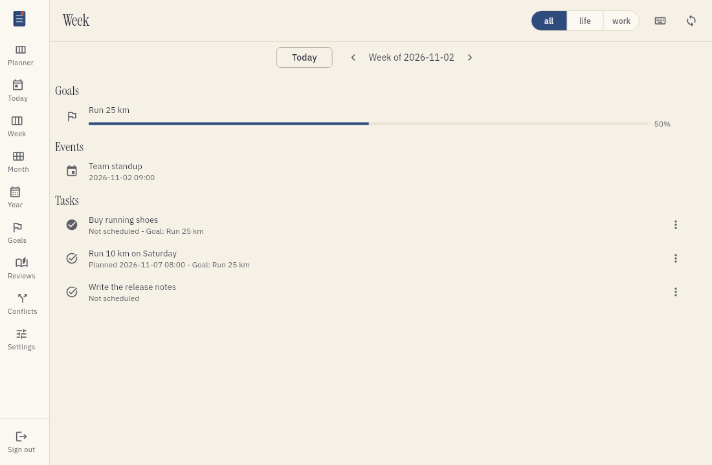
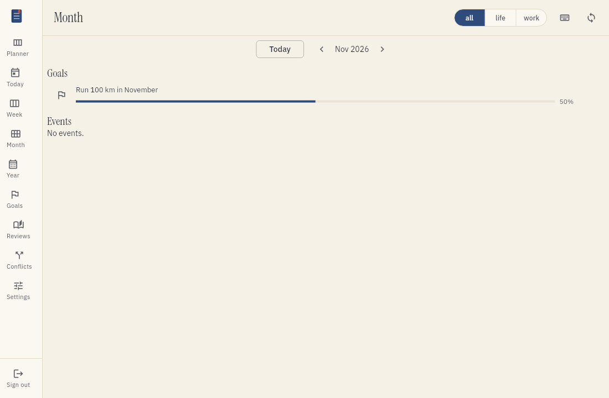
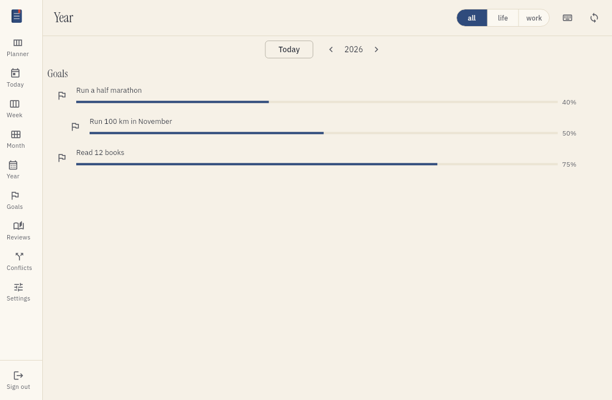
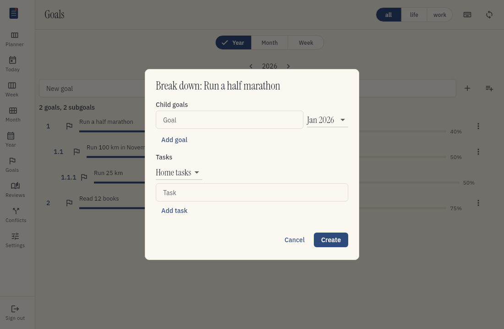
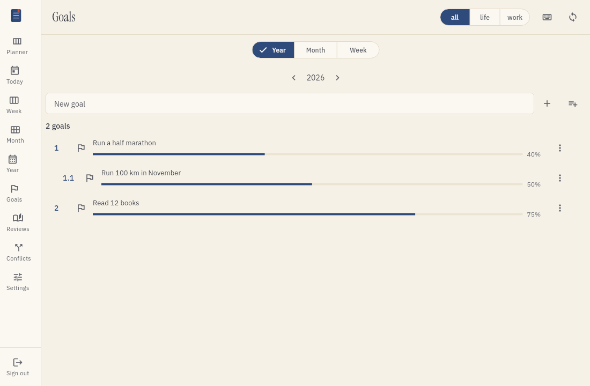

# Plan goals for the year, the month and the week

You can set goals for a year, a month or a week. You can break a goal into smaller goals and tasks.
This page tells you how to do it.

## What a goal is

A goal is something you want to reach in a period of time. The period is a year, a month or a week.
Tefteri keeps your goals in tefteri. It does not send them to your apps.

Your tasks stay in your task app. A goal can point to tasks in your task app.
You can keep your goals after the period ends.

## Open the planning views

1. Open the menu.
2. Choose Week, Month or Year.
3. To see a different period, choose the arrows or the date at the top.

The Week view shows the goals of the week. The Month view shows the goals of the month. The Year view shows the goals of the year.

## Add a goal

1. Open the Goals screen.
2. Choose the period type (Year, Month or Week) and the period.
3. Type the title of the goal.
4. Choose Add goal.

The goal shows in the views for its period. Each goal has a number at the left of its card.
Above the list, tefteri shows how many goals and how many smaller goals the list holds.

## Add several goals at once

1. Open the Goals screen and choose the period.
2. Choose Add several goals.
3. Type or paste one goal on each line.
4. Choose Add.

Tefteri ignores empty lines. It also ignores a list marker at the start of a line (a dash, an
asterisk, a bullet or a number). If one goal cannot be added, tefteri adds none of them and shows
the reason.

## Open a goal

Choose the text of a goal, in the Goals screen or in a planning view. A pop-up shows the goal. In
the pop-up you can:

- Change the title and the description.
- For a year goal, write the completeness criteria in the field Complete when. Write what must be
  true before you call the goal complete.
- Read the smaller goals of the goal.
- Add several smaller goals at once. Choose the month (or the week), type one goal on each line,
  and choose Add goals.
- Mark the goal complete, drop it, reopen it or delete it.

Save is off until you change the title, the description or the criteria. A year goal shows its
description and its criteria on its card.

## Break a goal into smaller goals and tasks

A year goal can have month goals. A month goal can have week goals. A week goal can have tasks.

1. Choose the goal.
2. Choose Break down.
3. To add a smaller goal, choose Add goal. Type the title.
4. To add a task, choose Add task. Type the title and choose the project.
5. Choose Save.

The period of a smaller goal must be inside the period of its larger goal.
Tefteri adds a new task to your task app.

## See how progress grows

A goal shows its progress as a number. The progress comes from the smaller goals and the tasks of the goal.

- When you complete a task, the progress of its goal goes up.
- When you complete a smaller goal, the progress of the larger goal goes up.
- When you reopen a task, the progress goes down.

Tefteri works out the progress each time. You do not type it.

## Schedule a task from the Week view

The Month view and the Year view show goals only. They do not list single tasks. You can schedule a task from the Week view. You do not need to open the Calendar screen.

1. Find the task under its goal.
2. Drag the task to a day or to a time.
3. To use the keyboard, choose the task and choose Schedule. Then choose a date and a time.
4. Choose Save.

Tefteri writes the date and the time into the task. It writes them to your task app.
The task stays in your task app. Read [Put tasks on the calendar](scheduling.md) for more information.

## Mark a goal complete or dropped

1. Choose the text of the goal. The pop-up opens.
2. Read the criteria and the smaller goals.
3. Choose Mark complete if you reached the goal. Choose Drop if you stop work on the goal.

A complete goal or a dropped goal stays in your plan. You can see it later.
To work on the goal again, open it and choose Reopen.

The goal card has no button to complete the goal. You complete a goal in its pop-up, after you
look at the details.

## Delete a goal

When you delete a goal, tefteri also deletes its smaller goals. You choose what happens to the tasks of the goal.

1. Choose the text of the goal. The pop-up opens.
2. Choose Delete.
3. Choose Keep tasks or Delete tasks.

If you choose Keep tasks, the tasks stay in your task app. They have no goal now.
If you choose Delete tasks, tefteri deletes the tasks from your task app.

## Show only work or only life

The switch at the top of every screen also filters goals. It has three choices: All, Life and Work.

1. Choose All, Life or Work at the top of the screen.
2. Look at the planning view.

You see only the goals that have the label that you chose. Read [Separate work and life](work-and-life.md) for the steps to label items.

## If an app does not answer

If your task app does not answer, tefteri tells you. The change does not happen.
Fix the problem and make the change again. Read [Troubleshooting](troubleshooting.md) for the steps.
