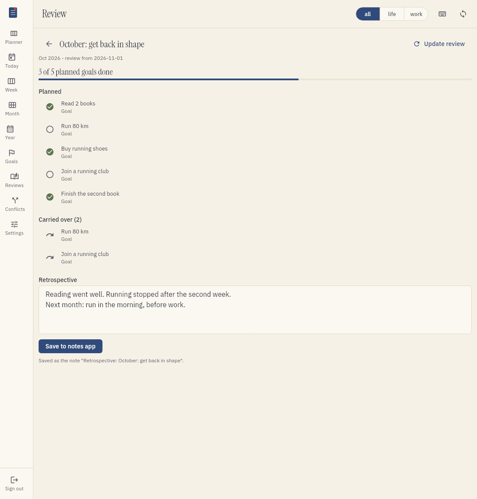
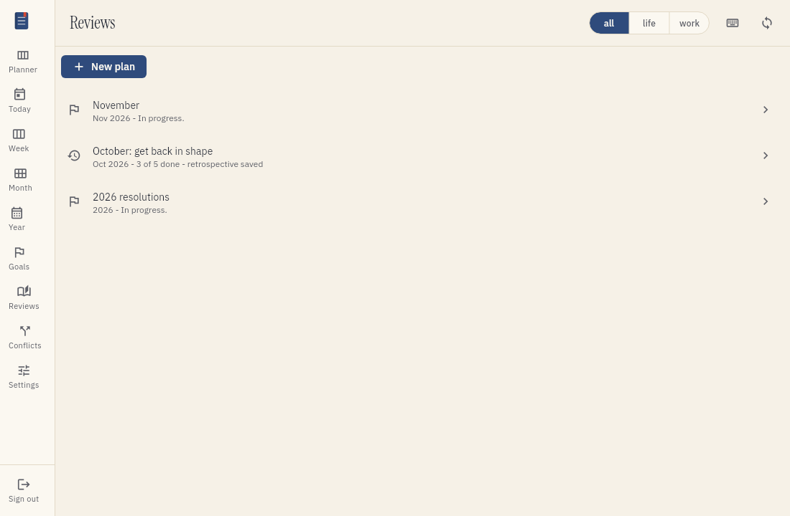

# Review your plans and write retrospectives

A plan holds the goals of one period: a year, a month or a week. At the end of the period, you
can open a review of the plan. The review shows what you planned and what you completed. You
can also write a retrospective. Tefteri keeps your plans after the period ends.

## What a review shows

The review counts the goals of the period as planned. Tefteri does not count dropped goals. The
review does not list single tasks.

A goal is complete when you mark it complete, or when you complete all its smaller goals and
tasks. The tasks of a goal only change its progress.

Tefteri carries over the goals that are not complete. The review lists them in a separate
section. Use this list when you plan the next period.

## Add a plan

1. Open the menu and choose Reviews.
2. Choose New plan.
3. Type a title for the plan.
4. Choose the period type: Year, Month or Week.
5. Choose the period.
6. Choose Add.

Add goals for the same period in the Goals screen. The plan collects all the goals of its
period. Refer to [Plan goals](planning-goals.md).

## Open a review

1. Open the menu and choose Reviews.
2. Choose the plan.
3. Read the number of completed goals and the progress bar.
4. Read the Planned list. A green check mark shows a completed goal.
5. Read the Carried over list.

Tefteri keeps the review as it was when you opened it the first time. Later changes to goals
do not change the review. To count the goals again, choose Update review.

## Save a retrospective to your notes app

1. Open the review.
2. Type your retrospective in the Retrospective field.
3. Choose Save to notes app.

Tefteri writes the retrospective as a note in your notes app, for example Trilium Next. The
note title starts with "Retrospective:" and the plan title follows. When you save again,
tefteri changes the same note.

If tefteri cannot reach your notes app, it shows a message and saves nothing. Your text stays
in the field. Fix the problem and choose Save to notes app again. Refer to
[Troubleshooting](troubleshooting.md).

## Browse your plan history

1. Open the menu and choose Reviews.
2. Read the list of plans. The newest period is at the top.
3. Choose a plan to open its review.

Each plan shows its period and its state:

- In progress. The period did not end yet.
- Ended. No review yet. Open the plan to make the review.
- A count such as "3 of 5 done". The plan has a review.
