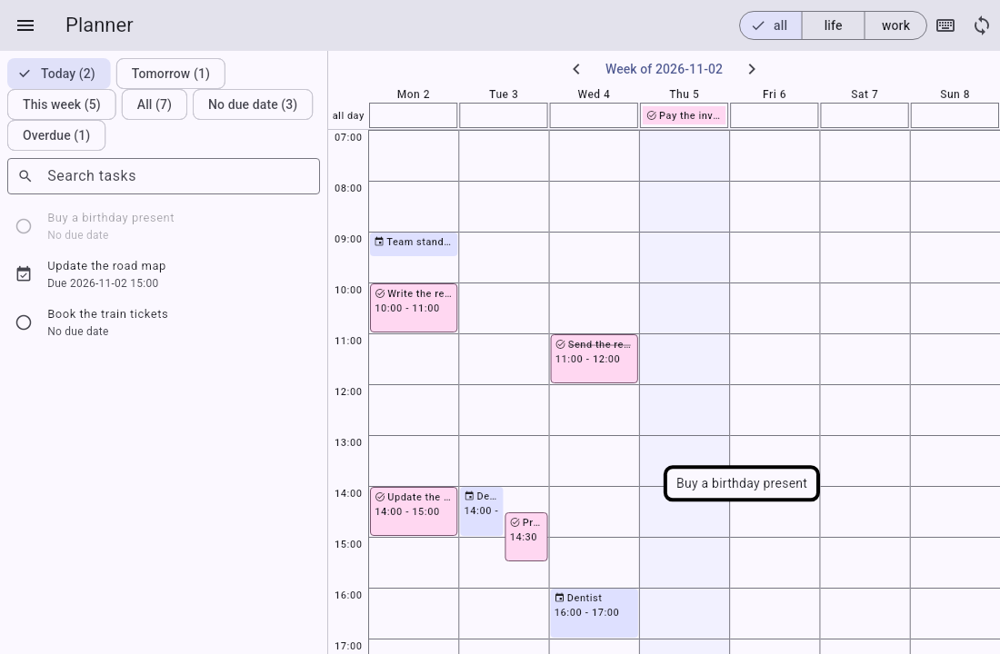

# Put tasks on the calendar

You can put a task on the calendar as a time block. This helps you make a plan that you can keep.
This page tells you how to do it.

## What happens when you schedule a task

When you schedule a task, tefteri writes the due date and the due time into the task. It writes them to your task app.
The due date is the one date that tefteri uses to plan a task. Tefteri does not use the start date or the end date of the task.

Tefteri does not make an event in your calendar app. The task stays in your task app.

The calendar shows your tasks and your calendar entries together. Tasks look different from calendar entries.
This way, you can see which items are tasks.

## Block and due time

On the calendar, a task is a block that is one hour long. The block ends at the due time of the task.
Tefteri works out the start of the block. It does not save the start in your task app.

When you drop a task on a time, that time is the start of the block. The due time is one hour later.

| You drop the task at | The block is | The due time is |
| --- | --- | --- |
| 09:00 | 09:00 to 10:00 | 10:00 |
| 14:30 | 14:30 to 15:30 | 15:30 |

Time slots are 15 minutes long. Tefteri uses the start of the slot where you drop the task.

## Put a task on the calendar

1. Open the Planner screen.
2. Find the task in the task list. Use the filters or the search box.
3. Drag the task to a day and a time on the calendar.
4. To use a phone, choose Schedule next to the task. Then choose a date and a time.

Your task app now has the new due date and time. The task shows on the calendar.
For all the steps, see [Plan with the planner](planner.md).

## Put a task on a day with no time

Drag the task to the row called all day. The task gets a due date and no time.
You can change this in the settings. Then the task gets a random time on that day.

## Move a scheduled task

1. Drag the block to a new day or a new time.
2. Wait for tefteri to save the change.

Tefteri writes the new due date and time to your task app.

## Take a task off the calendar

1. Drag the block to the task list.

The task stays in your task app. It has no due date and no time now.

## Add a calendar entry

1. Choose an empty time on the calendar.
2. Choose Add entry.
3. Type the title. Choose the calendar and the time.
4. Choose Save.

The entry goes to your calendar app.

## Edit a calendar entry

1. Choose the entry on the calendar.
2. Change the title, the time or other fields.
3. Choose Save.

Tefteri applies the change in your calendar app.

## Delete a calendar entry

1. Choose the entry on the calendar.
2. Choose Delete.
3. Choose Confirm.

The entry is gone from your calendar app.

## See overlaps

Sometimes a task is at the same time as a calendar entry. Tefteri does not stop you.
Both items show next to each other, so you can see the overlap. To remove the overlap, move the task block to a different time.

## If the task app cannot store a time

Some task apps have no field for the time of a task. If your app is like this, tefteri tells you that the action is not available.
Tefteri does not save the time in a different place. It does not lose data.

You can do these things:

1. Choose Cancel to keep the task as it is.
2. Make a calendar entry for the time block instead. Use the steps in Add a calendar entry.

## If an app does not answer

If your task app or your calendar app does not answer, tefteri tells you. The change does not happen.
Fix the problem and make the change again. Read [Troubleshooting](troubleshooting.md) for the steps.
