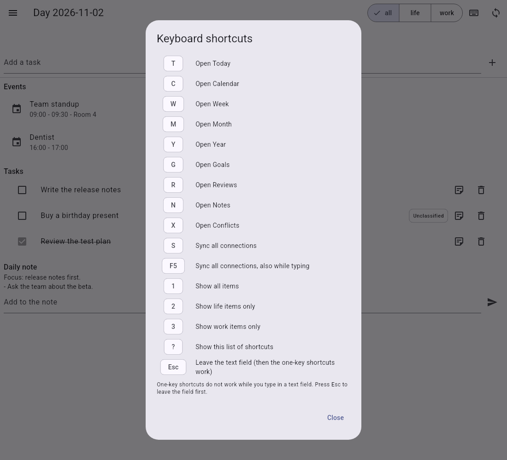

# Use the keyboard

You can open every view and do common actions with the keyboard. Each view opens with one key.

## See all shortcuts

1. Press the question mark key (?).
2. Read the list.
3. Choose Close or press Esc.

You can also choose the keyboard button at the top of the screen.

## Open a view

| Key | View |
| --- | --- |
| P | Planner (the first screen) |
| T | Today (the daily view) |
| W | Week |
| M | Month |
| Y | Year |
| G | Goals |
| R | Reviews |
| N | Notes |
| X | Conflicts |

The menu also shows the key next to each view.

## Do an action

| Key | Action |
| --- | --- |
| S | Sync all connections |
| F5 | Sync all connections, also while you type |
| 1 | Show all items |
| 2 | Show life items only |
| 3 | Show work items only |
| ? | Show the list of shortcuts |
| Esc | Leave the text field |

## Type in a text field

The one-key shortcuts do not work while you type in a text field. The key goes into the field
as text. F5 works at all times.

To use a one-key shortcut after you type:

1. Press Esc. The text field loses the focus.
2. Press the key of the shortcut.

The shortcuts do not work while a dialog is open. Close the dialog first.
