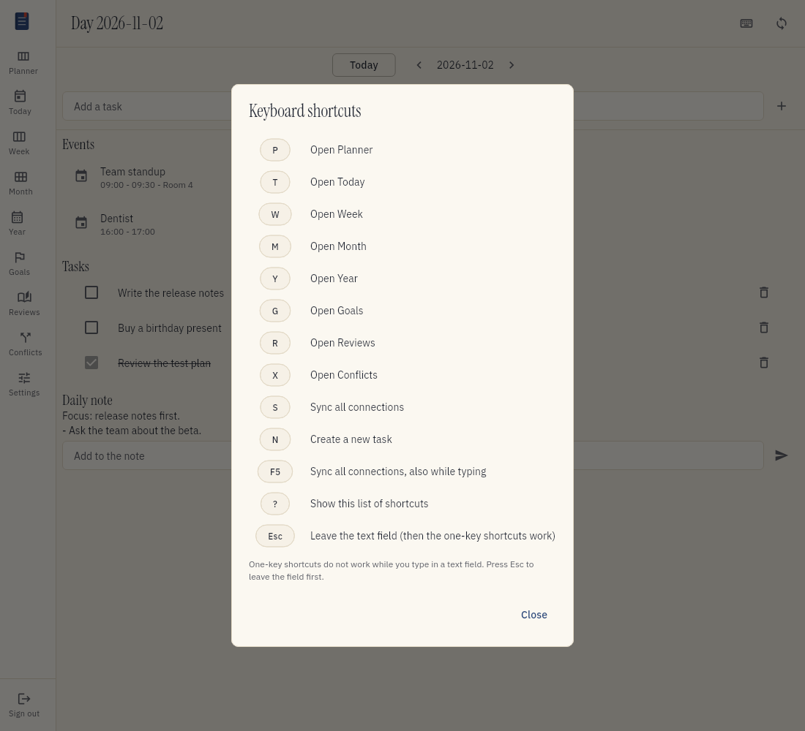

# Use the keyboard

You can open every view and do common actions with the keyboard. Each view opens with one key.

## See all shortcuts

1. Press the question mark key (?).
2. Read the list.
3. Choose Close or press Esc.

You can also choose the keyboard button at the top of the screen.

## Open a view

| Key | View |
| --- | --- |
| P | Planner (the first screen) |
| T | Today (the daily view) |
| W | Week |
| M | Month |
| Y | Year review |
| G | Annual plan |
| O | Projects |
| X | Conflicts |

The menu also shows the key next to each view.

Month opens the monthly theme plan and review. Read [Plan your month](monthly-planning.md).

## Do an action

| Key | Action |
| --- | --- |
| Left arrow | In the planner: show the week before |
| Right arrow | In the planner: show the week after |
| A | Open the Add menu: a daily note, a task or a calendar event |
| D | Add a line to the daily note |
| N | Create a new task (opens the New task dialog) |
| Shift+N | Create a new calendar event (opens the New event dialog) |
| S | Sync all connections |
| Ctrl+F | Find text on the page, also while you type |
| F5 | Sync all connections, also while you type |
| Page Down | Scroll the page down by one page |
| Page Up | Scroll the page up by one page |
| ? | Show the list of shortcuts |
| Esc | Leave the text field |

## Use a Greek keyboard

The keys work in the same way on a Greek keyboard layout. Press the key in the same place. For
example, the key for P makes π, and it opens the Planner. The table shows each letter and its
Greek letter.

| Latin | Greek | Action |
| --- | --- | --- |
| P | π | Planner |
| T | τ | Today |
| W | ς | Week |
| M | μ | Month |
| Y | υ | Year review |
| G | γ | Annual plan |
| O | ο | Projects |
| X | χ | Conflicts |
| A | α | Add menu |
| D | δ | Daily note |
| N | ν | New task |
| Shift+N | Shift+ν | New event |
| S | σ | Sync |
| Ctrl+F | Ctrl+φ | Find |

The keys that are not letters, such as F5, Page Down, Esc and ?, are the same on every layout.

## Type in a text field

The one-key shortcuts do not work while you type in a text field. The key goes into the field
as text. Page Down and Page Up scroll the page, also while you type in a field of one line or
in the find bar. In a field of several lines they stay with the field. F5 and Ctrl+F work at all
times.

To use a one-key shortcut after you type:

1. Press Esc. The text field loses the focus.
2. Press the key of the shortcut.

The shortcuts do not work while a dialog is open. Close the dialog first.
