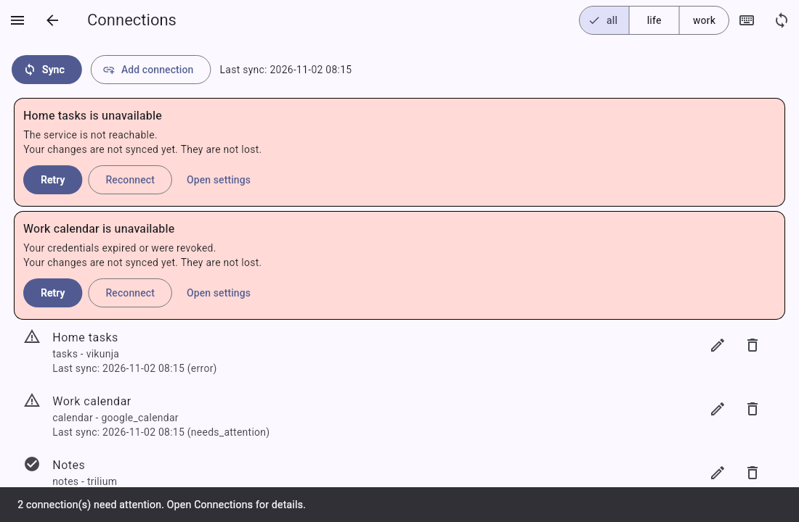

# Troubleshooting

This page tells you what to do when an app does not answer or refuses your credentials.

## Tasks do not show on the calendar after an upgrade

Older versions of tefteri saved the time of a task in the start date and the end date of the task in Vikunja.
The planner uses the due date only. A task that has a start date and an end date but no due date shows as not scheduled.

Tefteri does not change these tasks in Vikunja. To put such a task on the calendar again, drag it to a time in the planner.
Tefteri then saves the due date.

## An app answers but does not keep a change

The message says that the app answered, but it did not keep the change. Tefteri shows this message at once.
Nothing changed in tefteri, so the calendar still shows the old time. The app and tefteri agree.

Common causes:

- Another tool or a rule in the app changes the date back.
- The task is a repeating task, or it has rules that change its date.
- The app is an unusual version.

To fix the problem, try the change again in the app itself. If the app also takes the change back,
the cause is in the app. Tell your administrator the name of the connection and the time of the change.

## The choice Close and return tasks is missing, or a close stops part way

In the weekly look-back, a line under the choices tells you why the choice Close and return tasks
is missing. These are the causes:

- The milestone is not inside a theme. Label a project as theme in the Projects view, and move the
  milestone under it in your task app.
- You ignored the theme, or it is no longer in your task app. Give the theme another label, or choose
  another theme.
- Your task app cannot move tasks from one project to another. The other choices still work.

If the move fails part way, the milestone stays open. The window lists the tasks that moved already.
Fix the problem in your task app or the connection. Then choose Try again. Tefteri moves only the
tasks that remain. To undo a close, choose Reopen on the card of the milestone. Refer to
[Plan your week](weekly-planning.md#close-a-milestone-and-return-its-tasks).

## Rules that tefteri follows

- Tefteri always tells you which connection failed and why.
- Tefteri never hides a failed change.
- Tefteri never keeps a failed change in a queue to send later.
- A failure in one app does not stop the other apps.

If a change fails, the app did not get the change. Make the change again after you fix the problem.

## An app is unreachable

The message says that tefteri cannot reach the app. The connection shows the status Error.

Common causes:

- Your computer or phone has no network.
- The server of the app is off.
- The base URL in the connection is wrong.
- A firewall or a VPN blocks the server.
- The tefteri server runs in a container and the base URL starts with `http://localhost` or
  `http://127.0.0.1`. In a container, these addresses are the container itself, not your
  computer. Use an address that the tefteri server can reach, for example the name or the network
  address of the app server.

After a sync, the message also shows the error from the server, for example the address that
tefteri could not reach. Use it to find the cause.

To fix the problem:

1. Read the name of the connection in the message.
2. Make sure that you have a network connection.
3. Open the app in your web browser. Check that it loads.
4. Choose Retry in tefteri.
5. If Retry fails again, choose Open settings.
6. Check the base URL. Correct it if it is wrong.
7. Choose Save. Then press Sync.

## Credentials expired or revoked

The message says that the app refused your credentials. The connection shows the status Needs attention.

Common causes:

- You deleted the API token or the ETAPI token in the app.
- The token reached its end date.
- You removed the access of tefteri in your Google account.
- Google stopped the access because you changed your Google password.

To fix the problem:

1. Choose Reconnect in the message.
2. For Vikunja or Trilium Next, create a new token in the app. Paste it into tefteri.
3. For Google Calendar, sign in again on the Google page and choose Allow.
4. Press Sync.

## What each message means

| Message | Meaning | What to do |
| ------- | ------- | ---------- |
| Cannot reach the app | The app did not answer. | Choose Retry. |
| Credentials expired or revoked | The app refused your token or sign-in. | Choose Reconnect. |
| The item changed in the app | Someone changed the item after your last sync. | Press Sync. Make your change again. |
| Not supported by this app | The app has no support for this action. | Use a different action. Nothing is lost. |

## What the buttons do

- **Retry** sends the same request again. Use it after you fix the network or after the server starts.
- **Reconnect** starts the connection steps again. Use it when the token is not valid.
- **Open settings** opens the settings of the connection. Use it to correct the base URL or the token.

## If the problem stays

1. Remove the connection.
2. Add the connection again. Follow [Connect your apps](connect-apps.md).
3. Ask the person who runs your tefteri server to read the server log.
