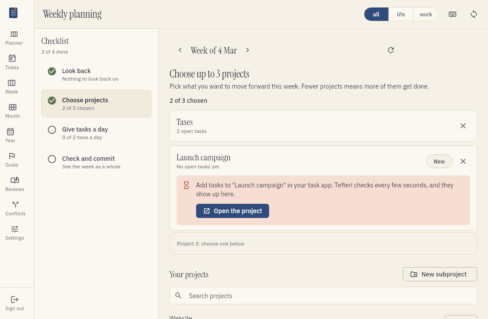

# Plan your week

The weekly planning session helps you choose what to work on in the coming week. You pick up to
three projects and give their tasks a day. A week later, you look back at how it went.
This page tells you how to do a weekly planning session.

## What the session does

The session has four steps:

1. Look back at the week before.
2. Choose up to three projects.
3. Give every task of these projects a day.
4. Check the plan and commit it.

The list of steps shows which steps you finished. You can choose any step at any time. The session
saves your work as you go, so you can stop and come back later.

Tefteri keeps your projects and your tasks in your task app. When you give a task a day, tefteri
writes that day as the due date of the task in your task app.

## Start the session

1. Choose Week in the menu.
2. Choose the button on the planning card at the top, for example Start planning.

From Friday on, the card is about the coming week. On the other days, it is about the week that
you see.

## Go through your own checklist

You can make a list of what you want to do in every weekly planning, for example "Clear the
inbox" or "Check the calendar for the week". Tefteri shows this weekly checklist next to the steps,
on every step, so it stays in view while you plan. On a narrow screen, it is above the step. Choose
its title to open or close it.

- Choose an item to tick it. Choose it again to untick it. The list shows how many items are done.
- The ticks belong to the week that you plan. When you plan the next week, the list starts clean.
  The weeks before keep their ticks.
- An item that is not ticked never stops you from committing the plan. The list is there to remind you.
- Choose Edit the list to change the items.

If you have no weekly checklist, tefteri shows a hint and a Create a checklist button. Refer to
[Make a checklist](planning-goals.md#make-a-checklist) to write one.

## See how the week goes

After you commit a plan, the Week view shows a Committed plan card under the planning card. It
shows:

- How many of the committed tasks are done and how many are left.
- How many tasks you finished on each day, and the total for the week.
- Your cadence: the tasks you finished per day since Monday. Next to it is the pace the rest of
  the week needs, counting today, and whether you are on track.
- The tasks that you did outside the plan. Refer to the list below.
- A burndown chart. The dashed line is the ideal pace from all tasks on Monday to none on Sunday.
  The solid line is the open tasks at the end of each day.

### Tasks done outside the plan

Often you also finish tasks that were not in the plan. A task from another project is one example.
A task that you added to a chosen project after you committed is another. The card lists them
under Done outside the plan, with the day and the project of each task.

- The card shows a count next to Done, for example +3, and the total, for example
  "Total 5 + 3 outside the plan".
- A day that has these tasks shows how many, for example +2, under the number for that day.
- The first five tasks show. Choose Show all to see the rest.
- These tasks do not change the plan. The done and left counts, the cadence and the burndown chart
  count only the tasks that you committed to.

A task is in the list when your task app says that you finished it on a day of this week, in your
time zone. A task without a completion date is not in the list, because tefteri cannot tell which
week it belongs to. It gets its date at the next sync. The list shows at most 200 tasks.

Tefteri takes the day of a task from the date that your task app gives for its completion. Tasks
that were done before the week began, or that have no completion date yet, count as done but not
in the chart. A task that was finished before this feature gets its day at the next sync.

## Step 1: look back at the week before

This step shows when you committed a plan last week. For each project of that plan, you see how many
of its tasks you finished. Tefteri counts a project as done when you finished all its planned tasks.

For a project that is not done, you decide two things:

- What happens to the tasks that remain. Choose Carry them over to suggest the project again
  for the new week. Choose Back to the backlog to remove the old day of the tasks. They stay open
  in your task app.
- Whether to count the project as done anyway. Use the switch when you finished the project, even if
  some tasks are open.

You can also archive a project in your task app. Use the switch Archive the project in your task
app. Tefteri archives the project when you save the look-back. It first stores the counts of the
project, so the history keeps them.

You can also write a short note about the week. Then choose Save the look-back. To plan without
a look-back, choose Skip the look-back.

## See your earlier weeks

After you save a look-back, tefteri shows your earlier weeks. Each week has two counters: the
projects that you committed to and the projects that you finished. Tefteri adds up all weeks and
tells you if you plan more or less than you finish. Use this to choose how much to plan.

## Step 2: choose up to three projects

Choose the projects that you want to move forward this week. You can choose at most three.
Projects with tasks that you carried over show first.

1. Find the project in the list. To find it faster, type in the search field.
2. Choose Add.
3. To remove a project, choose the cross on its card.

To work on a new part of a project, create a subproject:

1. Choose New subproject, or choose the folder icon of the project that holds it.
2. Choose the project that holds the new subproject.
3. Type the name.
4. Choose Create and add.

Tefteri creates the subproject in your task app and adds it to the week. A new subproject has no
tasks. Choose Open the project and add the tasks in your task app. Tefteri checks your task app
every few seconds, so the tasks show up in tefteri when you add them. To check at once, choose
the refresh button.

## Archive a project

To archive a project that you do not need any more, choose the archive icon of the project in the
list. Tefteri asks you to confirm.

Tefteri archives the project in your task app, with the projects inside it. The tasks of these
projects leave tefteri. Your task app keeps them. To get a project back, restore it in your task
app.

Tefteri refuses to archive a project that is in a committed plan with no look-back yet. The
look-back counts the tasks of that project. Look back first, and then archive the project.

## Tell projects apart

Tefteri groups the tasks by project. Each project has a card, and each card has a stripe in the
color of the project. A project keeps its color in every view. In the Week view, each task shows
a dot in the color of its project, with the name of the project next to it.

## Step 3: give every task a day

For each task of your projects, choose a day. Choose the same day again to remove it. The strip at
the top shows how many tasks each day has, and how many events your calendar has.

To save time, choose Spread the rest evenly. Tefteri gives the tasks that have no day a day from
Monday to Friday, so that no day gets too many. It never uses a day that has passed.

A task shows Was due and a date when its old day was in another week.

### Finish, change or park a task

Each task has these controls:

- To mark a task as done, choose the circle at the left of the task. Tefteri marks the task as done
  in your task app and takes it off the list.
- To change a task, choose its title. The same pop-up as in the planner opens. Change the title,
  the description or the day, and then choose Save.
- To set a task aside, choose the box icon at the right of the title (Park for later).

A parked task is not part of this plan. Tefteri does not give it a day when you choose Spread the
rest evenly, does not count it, and leaves it out when you commit the plan. Your task app does not
change.

Tefteri shows all parked tasks at the end of the page, in the section Parked. The section starts
closed. Choose it to open it. To bring a task back, choose Put back. You cannot park or put back a
task while the plan is committed. Choose Change the plan first.

## Step 4: check the plan and commit

The last step shows all the tasks of the week, grouped by project, with the total number of
projects and tasks. Tasks of your projects that have no day are not part of the plan. Tefteri
tells you how many there are.

Choose Commit the plan when it looks right. Tefteri remembers which tasks you planned. A week
later, the look-back uses this list. To change a committed plan, choose Change the plan.

## If something goes wrong

- If a project does not show tasks that you added, choose the refresh button. Then check that
  the tasks are in the project that you chose, not in another project.
- If your task app does not answer, tefteri tells you and changes nothing. Make the change again
  when the app answers. Read [Troubleshooting](troubleshooting.md) for more information.
- Tefteri does not show the saved filters of Vikunja, such as My Open Tasks, because they are
  not projects.
