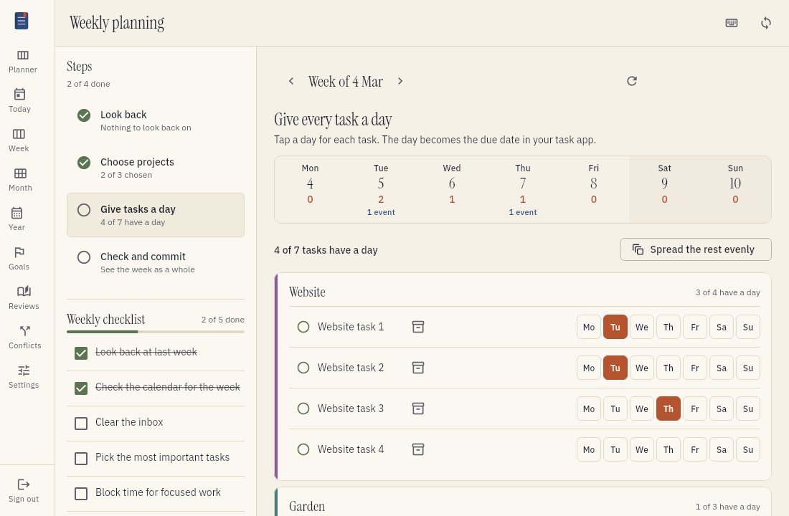
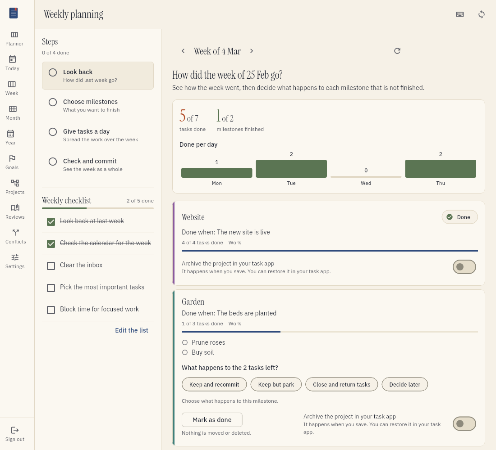
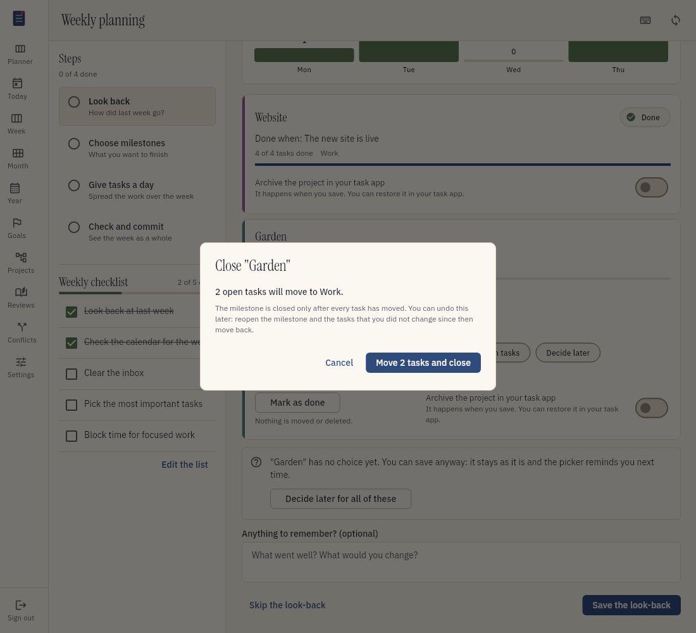
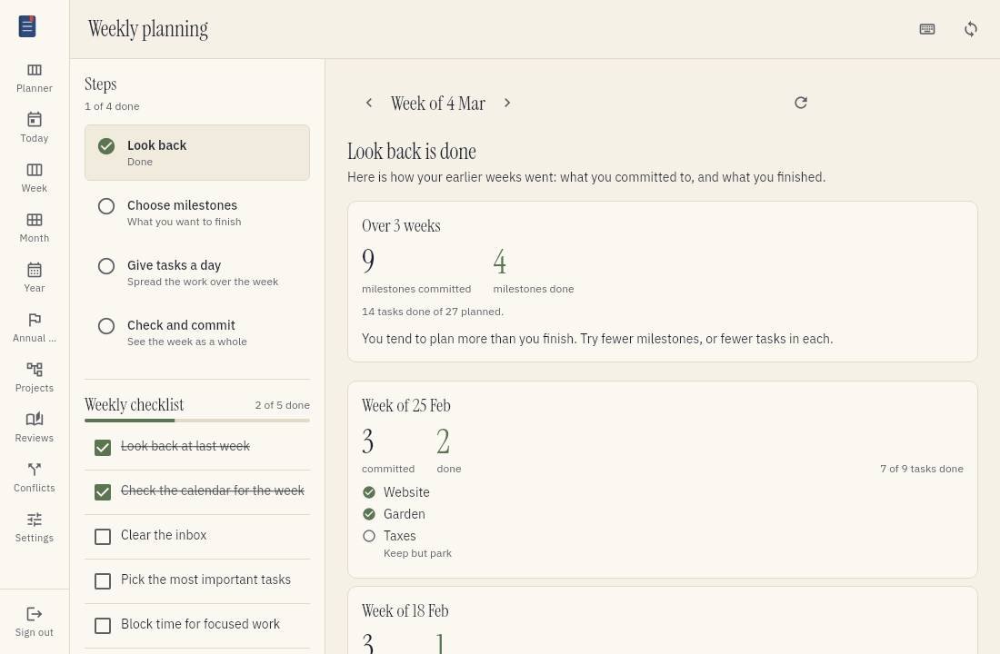
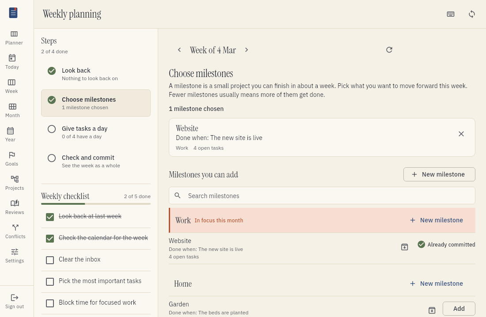
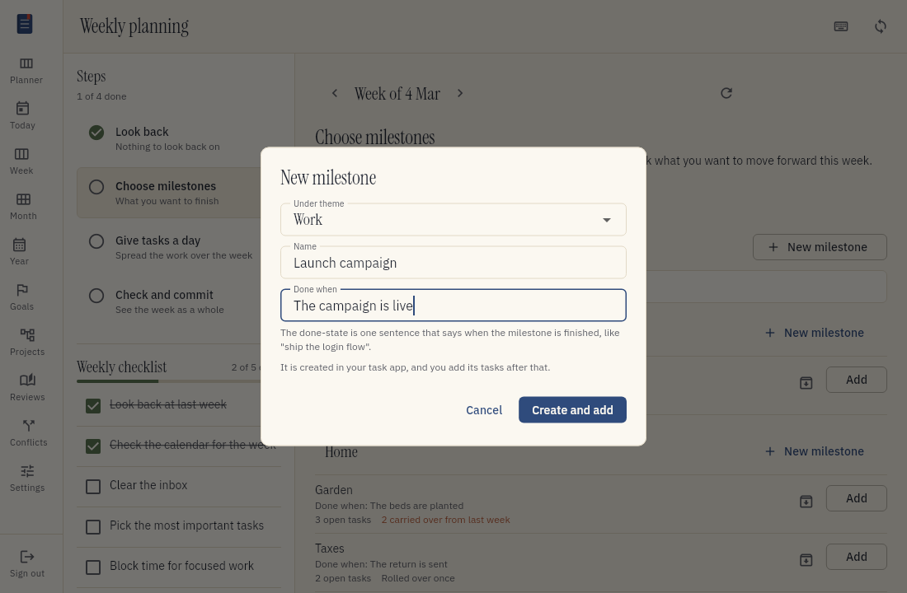
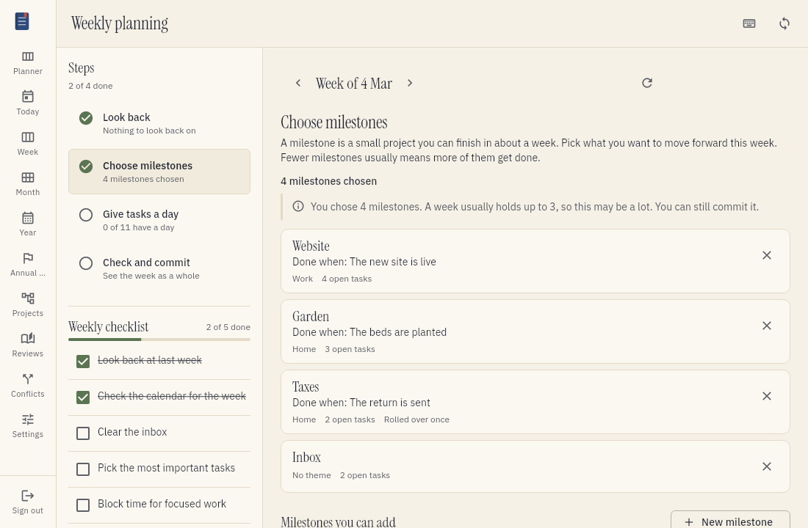
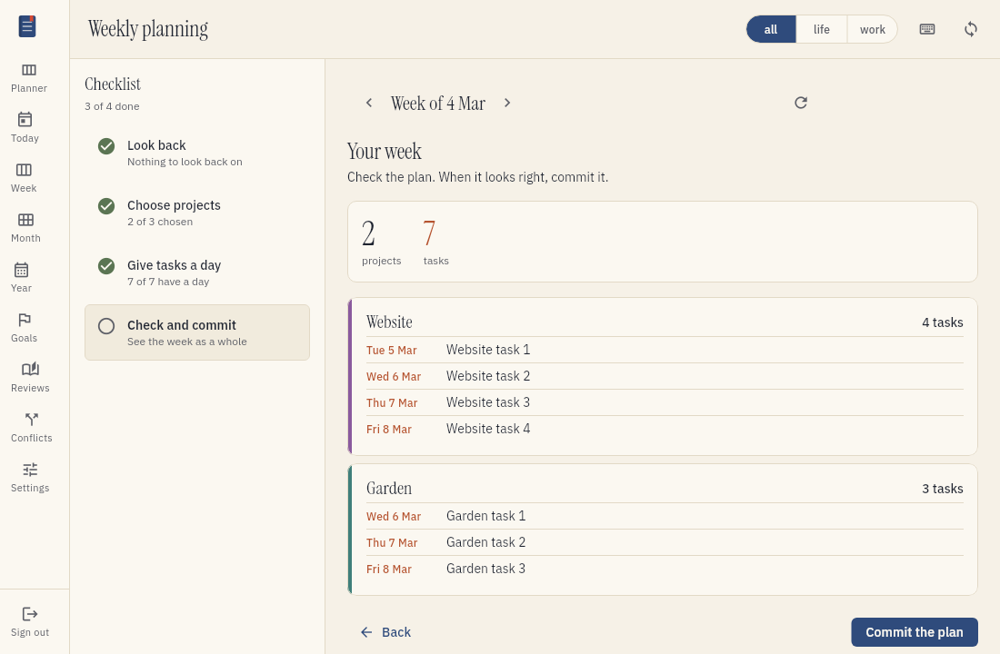

# Plan your week

The weekly planning session helps you choose what to work on in the coming week. You pick the
milestones that you want to finish, and you give their tasks a day. A week later, you look back at
how it went and decide what happens to each milestone that is not finished. This page tells you how
to do a weekly planning session.

## Words used in this guide

- Theme. A long-running home for related work, such as "Home" or "Open source". You never plan a
  theme for a week.
- Milestone. A small project inside a theme. You can finish it in about a week. A milestone is the
  unit of your weekly plan.
- Done-state. One sentence that says when you finish a milestone, for example "Ship the login
  flow". Write the result, not the work.
- Committed. Chosen for the plan of the week.
- Parked. A state of a milestone. You set it in the look-back. A parked milestone comes back in the
  list of milestones later.
- Rollover. You recommit a milestone because it was not finished.
- Outside focus. The theme of the milestone is not one of the themes that you chose for the month.

Read [Sort your projects](organizing-projects.md) to give your projects a label.

## What the session does

The session has four steps:

1. Look back at the week before.
2. Choose milestones.
3. Give every task of these milestones a day.
4. Check the plan and commit it.

The list of steps shows which steps you finished. You can choose any step at any time. The session
saves your work as you go, so you can stop and come back later.

Tefteri keeps your projects and your tasks in your task app. When you give a task a day, tefteri
writes that day as the due date of the task in your task app.

The weekly session has no goals. You plan goals once a year. Months work on themes, and weeks work
on milestones.

## Start the session

1. Choose Week in the menu.
2. Choose the button on the planning card at the top, for example Start planning.

From Friday on, the card is about the coming week. On the other days, it is about the week that
you see.

## Go through your own checklist

You can make a list of the things to do in every weekly planning. Examples are "Clear the
inbox" and "Check the calendar for the week". Tefteri shows this weekly checklist next to the steps,
on every step, so it stays in view while you plan. On a narrow screen, it is above the step. Choose
its title to open or close it.

- Choose an item to tick it. Choose it again to untick it. The list shows how many items you ticked.
- The ticks belong to the week that you plan. When you plan the next week, the list starts clean.
  The weeks before keep their ticks.
- An item that is not ticked never stops you from committing the plan. The list is there to remind you.
- Choose Edit the list to change the items.

If you have no weekly checklist, tefteri shows a hint and a Create a checklist button. Refer to
[Make a checklist](planning-goals.md#make-a-checklist) to write one.

## See how the week goes

After you commit a plan, the Week view shows a Committed plan card under the planning card. It
shows:

- How many of the committed tasks you finished, and how many remain.
- How many tasks you finished on each day, and the total for the week.
- Your cadence: the tasks you finished per day since Monday. Next to it is the pace the rest of
  the week needs, counting today, and whether you are on track.
- The tasks that you did outside the plan. Refer to the list below.
- A burndown chart. The dashed line is the ideal pace from all tasks on Monday to none on Sunday.
  The solid line is the open tasks at the end of each day.

### Tasks done outside the plan

Often you also finish tasks that were not in the plan. A task from another project is one example.
A task that you added to a chosen milestone after you committed is another. The card lists them
under Done outside the plan, with the day and the project of each task.

- The card shows a count next to Done, for example +3, and the total, for example
  "Total 5 + 3 outside the plan".
- A day that has these tasks shows how many, for example +2, under the number for that day.
- The first five tasks show. Choose Show all to see the rest.
- These tasks do not change the plan. The done and left counts, the cadence and the burndown chart
  count only the tasks that you committed to.

A task is in the list when your task app says that you finished it on a day of this week, in your
time zone. A task without a completion date is not in the list, because tefteri cannot tell which
week it belongs to. It gets its date at the next sync. The list shows at most 200 tasks.

Tefteri takes the day of a task from the date that your task app gives for its completion. Tasks
that you finished before the week began, or that have no completion date yet, count as done but not
in the chart. A task that you finished before this feature gets its day at the next sync.

## Step 1: look back at the week before

This step shows when you committed a plan last week. It has no questions about goals. It shows how
the week went, and then it asks what happens to each milestone that is not finished.

### Read the numbers

The top of the step shows:

- How many committed tasks you finished, out of all committed tasks.
- How many milestones you finished, out of all committed milestones.
- Your pace: how many tasks you finished on each day of the week. The pace counts finished tasks.
  It never counts the time that you worked.
- The focus share, when you chose themes for the month. It is the share of the finished tasks
  that were in one of these themes. Without monthly themes, tefteri does not show the focus share.

If you committed no task that week, tefteri shows a short note instead of these numbers.

Each milestone has a card. The card shows the done-state, the theme, the number of tasks that you
finished, and the tasks that remain. A milestone that you finished shows Done. It needs no
decision.

### When tefteri marks a milestone as done

Tefteri marks a milestone as done when no task is open and you closed at least one task. A dropped
task is a task that your task app does not list any more. It never keeps a milestone open. A
milestone with no tasks, or with only dropped tasks, is never done by itself.

Tefteri checks this each time your tasks sync. The done date is the day that you closed the
last task. Tefteri also keeps the theme that the milestone had on that day. A later change of the
theme does not change it.

To mark a milestone as done yourself, choose Mark as done on its card. The window shows how many open
tasks stay in the project. Tefteri moves and deletes nothing. The done date is the day that you save the
review. You can take the mark back before you save.

### Decide what happens to a milestone that is not finished

Each milestone that is not finished has four choices. Choose one for each milestone.

| Choice | What it does |
| ------ | ------------ |
| Keep and recommit | Puts the milestone in the plan of the next week. Its rollover count goes up by one. |
| Keep but park | Sets the milestone aside. It stays in your task app. It comes back in the list of milestones, marked as parked. The rollover count does not change. |
| Close and return tasks | Moves the open tasks to the theme of the milestone, and closes the milestone. |
| Decide later | Changes nothing. The rollover count does not change. |

The park choice does not change the days of the tasks in your task app.

If you choose Keep and recommit, you can also use the switch `This rollover is expected`. Use it when you
planned the milestone to take more than a week. Refer to [Rollovers and the re-scope hint](#rollovers-and-the-re-scope-hint).

You never need to make all the choices. If a milestone has no choice when you save, tefteri names
it. Choose Decide later for all of these to leave all of them as they are. Then save the review.
Nothing blocks you.

### Close a milestone and return its tasks

Use this choice when you do not want to finish the milestone. The open tasks go back to the theme,
so you do not lose them.

1. Choose Close and return tasks on the card.
2. Read the window. It tells you how many open tasks will move, and to which theme. For example,
   "4 open tasks will move to Home".
3. Choose the button, for example Move 4 tasks and close.

Tefteri moves the tasks one at a time in your task app. It closes the milestone only after it moved
all of them. The close happens when you confirm, not when you save the review.

The choice Close and return tasks is not shown when:

- The milestone is not inside a theme. The card says "no theme to return the tasks to", and shows
  a button to label a project as theme.
- You ignored the theme, or your task app does not have it any more.
- Your task app cannot move tasks from one project to another. The other choices work as usual.

If the move fails part way, the milestone stays open. The window tells you which tasks moved already.
Choose Try again. Tefteri moves only the tasks that remain.

To undo a close, choose Reopen on the card. The milestone is active again. Tefteri moves the tasks
back to the milestone, if you did not change them or move them since. It lists the tasks that it
could not move back, and says why. These tasks stay where they are. A task that did not move back
never stops the reopen.

### Rollovers and the re-scope hint

Each time you choose Keep and recommit, the rollover count of the milestone goes up by one. Tefteri
never sets the count back to zero. A park or a decision to decide later does not change it.

When a milestone rolls over two times in a row, tefteri shows a hint: "has rolled over twice in a
row. Try to shrink it, split it or close it." It shows the hint in the review and in the list of
milestones. The hint never stops you. You can commit the milestone as it is.

A rollover that you mark as expected does not give a hint. It also ends the run: the next rollover
starts the count again. For example, if you recommit a milestone without the mark, with the mark, and
without the mark, no hint shows. The two last rollovers are not both without a mark.

### Decide later

Decide later leaves the milestone as it is. Tefteri shows a reminder on the milestone in the list of
milestones, until you make a real decision in a review. You can still commit the milestone.

### Save the look-back

You can also archive a project in your task app. Use the switch Archive the project in your task
app. Tefteri archives the project when you save the look-back. It first stores the counts of the
project, so the history keeps them.

You can also write a short note about the week. Then choose Save the look-back. To plan without
a look-back, choose Skip the look-back.

If you chose Keep and recommit, the milestone is in the plan of the next week now. If you committed that plan
before, it goes back to draft, so that you can pick the tasks. Tefteri tells you.

## See your earlier weeks

After you save a look-back, tefteri shows your earlier weeks. Each week has two counters: the
milestones that you committed to and the milestones that you finished. Tefteri adds up all weeks and
tells you if you plan more or less than you finish. Use this to choose how much to plan.

Each week lists its milestones and the choice that you made for each one. A week that you planned
before milestones existed shows its old choices with the new names. "Carry them over" shows as Keep
and recommit. "Back to the backlog" shows as Keep but park. Tefteri does not change these old weeks.

## Step 2: choose milestones

Choose the milestones that you want to finish this week. A week usually holds up to three
milestones. This is a guide, not a rule. Tefteri never stops you from choosing more.

The list shows the milestones that you can plan, in groups. Each group is a theme. Under a theme you
see its milestones. Each milestone shows:

- The done-state, after "Done when".
- The number of open tasks.
- The word Parked, when you parked it in a look-back.
- How often it rolled over, for example "Rolled over once".
- The re-scope hint, when it rolled over twice in a row.
- A reminder, when your last review left it with Decide later.

Tefteri shows the milestones of the focus themes of this month first, with the label In focus this month.
A focus theme is a theme that you chose for the month. The week belongs to the month of its Monday.
When you chose no themes for the month, all themes look the same.

The list leaves out themes, routine projects, ignored projects and projects that are no longer in
your task app. It also leaves out a project inside a routine or an ignored project. It leaves out
milestones that you closed or finished. Read [Sort your projects](organizing-projects.md) to change a
label.

1. Find the milestone in the list. To find it faster, type in the search field.
2. Choose Add.
3. To remove a milestone, choose the cross on its card.

A milestone that is in the plan shows Already committed. You cannot add it a second time.

### Projects without a label

A project with no label and no subproject shows in the group Unsorted. When you add one, tefteri
labels it as milestone. A quiet line above the list tells you how many projects have no label. Choose
Label them to open the Projects view. Planning works while projects have no label.

A milestone that is not inside a theme shows in the group No theme. You can add it. You cannot
close it later, because there is no theme to take its tasks.

### Create a milestone

If a theme has no suitable milestone, create one:

1. Choose New milestone, or choose Create a milestone in the group of the theme.
2. Choose the theme in the field Under theme.
3. Type a name.
4. In the field Done when, type one sentence that says when you finish the milestone. For example,
   "Users can sign in with a passkey".
5. Choose Create and add.

Tefteri creates the milestone as a subproject of the theme in your task app. Then it labels it and
adds it to the week. If you leave Done when empty, tefteri refuses and keeps what you typed. If your
task app fails, tefteri stores nothing. Your text stays, so you can try again.

A new milestone has no tasks. You add them in the next step.

### Too many milestones

When you choose more than three milestones, a quiet note says how many you chose and that a week
usually holds up to three. Tefteri saves the plan, and you can commit it. When you remove a milestone
so that three or fewer remain, the note goes away. Only milestones count. Tasks and routine projects
do not.

### Outside focus

When you have monthly themes, a milestone under another theme shows the tag Outside focus. You can do this. The tag only tells you that the work is not in the plan of the month. It changes when the
monthly themes change. Tefteri does not store it. A milestone that has no theme also shows the tag.

If you have no monthly themes, tefteri never shows this tag.

### If you have no milestones yet

If you have no milestone and no theme, the list explains what a theme and a milestone are. It shows
the buttons Label a project as theme and Create a theme. You can also finish the plan with no
milestone. Refer to [Step 4](#step-4-check-the-plan-and-commit).

## Archive a project

To archive a project that you do not need any more, choose the archive icon of the project in the
list. Tefteri asks you to confirm.

Tefteri archives the project in your task app, with the projects inside it. The tasks of these
projects leave tefteri. Your task app keeps them. To get a project back, restore it in your task
app.

Tefteri refuses to archive a project that is in a committed plan with no look-back yet. The
look-back counts the tasks of that project. Look back first, and then archive the project.

## Tell projects apart

Tefteri groups the tasks by project. Each project has a card, and each card has a stripe in the
color of the project. A project keeps its color in every view. In the Week view, each task shows
a dot in the color of its project, with the name of the project next to it.

## Step 3: give every task a day

For each task of your milestones, choose a day. Choose the same day again to remove it. The strip at
the top shows how many tasks each day has, and how many events your calendar has. Each milestone
shows its done-state above its tasks.

To save time, choose Spread the rest evenly. Tefteri gives the tasks that have no day a day from
Monday to Friday, so that no day gets too many. It never uses a day that has passed.

A task shows Was due and a date when its old day was in another week.

### Add a task

You can add a task to a milestone without a visit to your task app:

1. Find the milestone.
2. Type the title in the field that starts with Add a task to.
3. Choose Add task.

Tefteri creates the task in your task app, in the milestone. The new task has no day yet. It is not
part of the plan until you give it a day.

A milestone with no open task shows "No tasks in this milestone yet". It also shows the field to
add the first task.

### Finish, change or set aside a task

Each task has these controls:

- To mark a task as done, choose the circle at the left of the task. Tefteri marks the task as done
  in your task app and takes it off the list.
- To change a task, choose its title. The same pop-up as in the planner opens. Change the title,
  the description or the day, and then choose Save.
- To set a task aside, choose the box icon at the right of the title (Not this week).

A task that you set aside is not part of this plan. Tefteri gives it no day when you choose Spread
the rest evenly. It does not count the task. It leaves the task out when you commit the plan. The task stays
open in the milestone. Your task app does not change.

Tefteri shows all these tasks at the end of the page, in the section Not this week. The section
starts closed. Choose it to open it. To bring a task back, choose Put back. You cannot set aside or
put back a task after you commit the plan. Choose Change the plan first.

Tasks that you did not pick are also not part of the plan. They stay open in the milestone.

## Step 4: check the plan and commit

The last step shows all the tasks of the week, grouped by milestone, with the total number of
milestones and tasks. Tasks of your milestones that have no day are not part of the plan. Tefteri
tells you how many there are. If you chose more than three milestones, the quiet note shows here too.

Choose Commit the plan when it looks right. Tefteri remembers which tasks you planned. A week
later, the look-back uses this list. To change a committed plan, choose Change the plan.

You can commit a plan with no milestone. Then the week has only the work that you do outside the
plan. The look-back of that week shows only that work.

## If something goes wrong

- If a milestone does not show tasks that you added, choose the refresh button. Then check that
  the tasks are in the project that you chose, not in another project.
- If your task app does not answer, tefteri tells you and changes nothing. Make the change again
  when the app answers. Read [Troubleshooting](troubleshooting.md) for more information.
- If the choice Close and return tasks is missing, read the line under the choices. It tells you why.
  Refer to [Close a milestone and return its tasks](#close-a-milestone-and-return-its-tasks).
- If a milestone is no longer in your task app, tefteri still shows it with its stored name, marked
  as orphaned. You can park it, recommit it or decide later. You cannot close it, because there
  are no tasks to move.
- If you gave a milestone another label after you committed it, it stays in the plan of that week with
  a notice. Tefteri does not offer it again as a milestone.
- Tefteri does not show the saved filters of Vikunja, such as My Open Tasks, because they are
  not projects.
