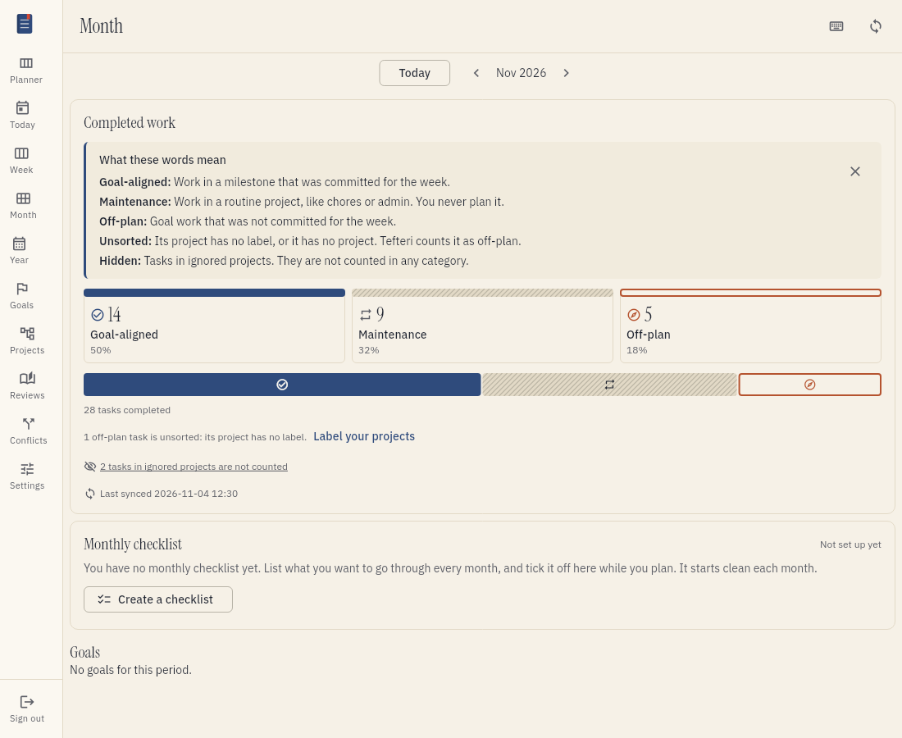
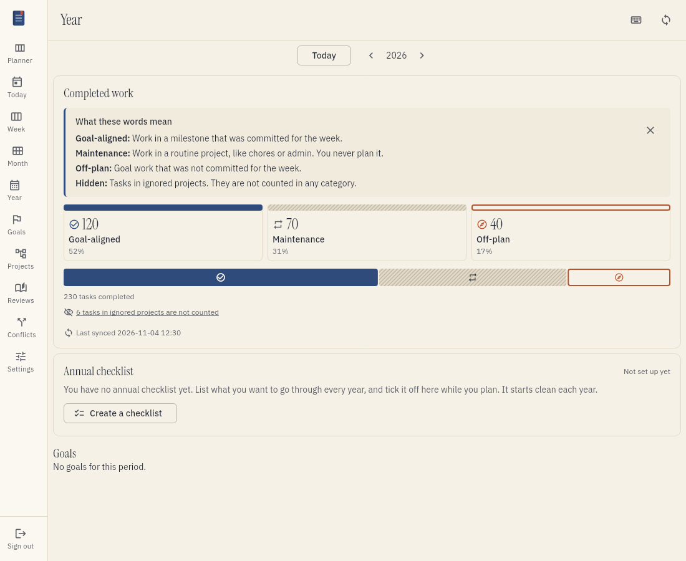
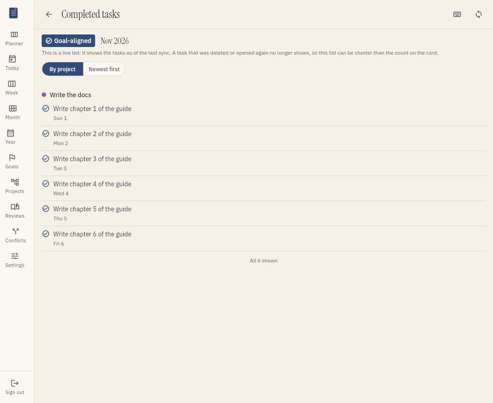
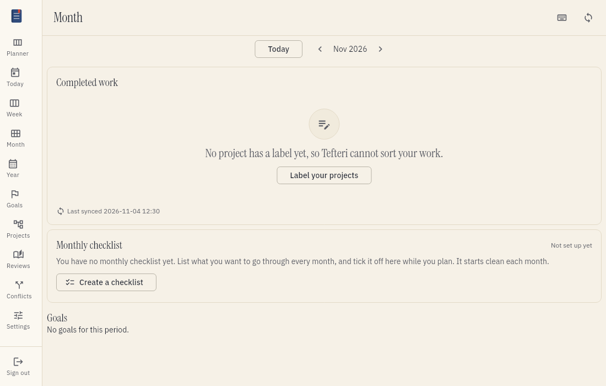
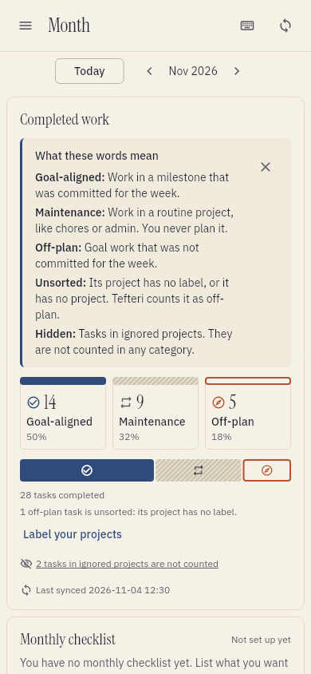

# See what you did: work categories

Tefteri sorts every task that you complete into a work category. The Week, Month and Year views
show how many tasks are in each category. You can see if your work matches your plan. This page
tells you what the categories mean, how tefteri chooses one, and how to read the numbers.

## The three categories

Each completed task is in one category.

- Goal-aligned. You completed the task in a milestone that you committed to for that week.
- Maintenance. You completed the task in a routine project, such as chores or admin. You never
  plan this work.
- Off-plan. You completed the task in goal work that you did not commit to for that week.

Tefteri also keeps a hidden count. It is not a category. It is the number of tasks that you
completed in ignored projects. Tefteri does not count these tasks in a category. It shows the
number in one quiet line, so no work disappears without a trace.

Here are some examples:

| What you completed | Category |
| ------------------ | -------- |
| A task in the milestone "Ship the login flow", which is in your plan for the week | Goal-aligned |
| A task in the milestone "Write the docs", which is not in your plan for the week | Off-plan |
| A task in the routine project "Chores" | Maintenance |
| A task in the theme "Home". You never commit to a theme | Off-plan |
| A task in a project with no label, or a task with no project | Off-plan, with the note "unsorted" |
| A task in the ignored project "Old stuff" | Hidden. Not in a category |

A task that you did not plan can still be goal-aligned. Tefteri looks at the project of the task,
not at the list of tasks that you planned. If you commit to a milestone, all the work that you do
in it counts as goal-aligned.

A week with no committed plan has no goal-aligned tasks. Your goal work is off-plan. Your routine
work is still maintenance. A plan that you did not commit counts as no plan.

You can park, close or finish a milestone during the week. The tasks that you completed in it
that week stay goal-aligned.

## Work inside a routine project

A task in a project inside a routine project is maintenance. This is true at any depth. It does
not matter which label the inner project has. For example, you can label "Garden" as theme and put
it inside the routine project "Home care". The tasks that you complete in "Garden" are
maintenance.

One rule is stronger: an ignored project, or a project inside an ignored project, is hidden even
if a routine project is above it.

## Unsorted tasks

Tefteri cannot sort a task if its project has no label, or if the task has no project. It counts
the task as off-plan and marks it as unsorted. A line under the bar tells you how many tasks have
this note. Choose Label your projects to open the Projects view. Read
[Sort your projects](organizing-projects.md) to give your projects a label.

## How a task gets its category

Tefteri chooses the category once. It does this when it first sees the task as completed. It uses
these facts:

- The project of the task when you completed it.
- The label that the project had on the day that you completed the task. Tefteri keeps the history
  of each label.
- The plan that you committed for the week of that day.

Tefteri then stores the category. It never changes the stored category. This is true when:

- You give the project a new label later.
- You change a past plan.
- You rename the project, or move the task to another project.
- The project leaves your task app.
- You sync again.

For example, you label "Chores" as routine in March. In June you change it to theme. The tasks that
you completed in March stay maintenance. The tasks that you complete after the change are off-plan.
Your past weeks keep their numbers.

If you move a task to another project and then complete it, the new project decides. If you
complete the task and then move it, the category does not change. If you complete a task in tefteri,
tefteri uses the project that it shows for the task. Your task app may not tell tefteri where
a task was at completion. Then tefteri uses the project where it last saw the task open.

If you reopen a task and complete it again, this is a new completion. The task gets a new category.
It counts once, with its latest completion.

When you upgrade, tefteri sorts your old completed tasks at the next sync. It uses the label
history and the plans that exist at that time.

### Which week and day

Tefteri uses your time zone to find the day of a completion. A week is Monday to Sunday. Tefteri
stores the day with the category. If you change your time zone later, your past tasks stay on
their days.

## What tefteri counts

- Tefteri counts each task. A recurring task counts once for each completion.
- Tefteri does not count the items of a checklist inside a task.
- Tefteri counts a task in the week, the month and the year of its completion day. It counts the
  task only once in each period.
- A task that your task app gives no completion time is not counted. Tefteri cannot tell which week
  it belongs to.
- If you delete a completed task in your task app, it leaves the numbers at the next sync. A past
  count can go down. This is correct: the count shows what your task app holds now.
- A task that you completed in your task app shows after the next sync. Choose the sync button to
  see it at once.

## Read the Week view

Open Week in the menu. The card Completed work shows the tasks that you completed in the week.

The card has these parts:

- A helper line: "Goal-aligned means work in a milestone you committed to this week."
- A hint that explains the three names. It shows until you close it. Tefteri also explains
  unsorted and hidden the first time that they show.
- Three counts, one for each category. Each count has the percentage of the week next to it. A
  category with no task shows 0. Tefteri never hides a category.
- One bar with a part for each category.
- The line "5 tasks completed".
- The line about unsorted tasks, when there are some.
- The line about hidden tasks, for example "1 task in an ignored project is not counted".
- The time of the last sync.

Under the planning cards, the list Completed this week shows the tasks in three groups. Each group
has its category and its count. Each task shows its day and its project. A group with no task says
"Nothing completed here". A long list has no limit. Choose Show more to load more tasks.

The card Committed plan above it shows each day of the week. The large number is the tasks from your
plan. The three small numbers are all the tasks that you completed that day, by category.

## Read the Month and Year views

Open Month or Year in the menu. Each view has the same card. It does not list tasks. It shows the
three counts, the bar and the lines about unsorted and hidden tasks.

The numbers of a month are the sum of its days. The numbers of a year are the sum of its months.
The Week, Month and Year views always agree.

### The bar and the counts

The bar shows the share of each category. The percentages are whole numbers, and they add up to
100. Tefteri does not count the hidden tasks in the bar.

A small category stays visible. If you completed 1 task in 100 in a category, its part of the bar
is thin but you can still see it. The count is always next to the percentage. Use the counts to see
if you did more or less work. A change in a percentage does not tell you that.

You can tell the three categories apart without color. Goal-aligned is a solid block with a check
mark. Maintenance is a pale block with diagonal lines and a repeat mark. Off-plan is an open block
with an outline and a compass mark. The name is always in the text.

## See the tasks behind a number

To see the tasks behind a number, choose one of these:

- A count.
- A part of the bar.
- The line about hidden tasks.

The list shows the tasks of that category and period. Use the two buttons at the top to choose the
order: By project, or Newest first. The default is By project. Choose the arrow at the top to go
back.

The list is live. It shows the tasks as your last sync found them. A task that you deleted, or
that is open again, leaves the list. So the list can be shorter than the count on the card. The list has no limit. Choose Show more to load the next tasks.

If the project of a task left your task app, the list still shows the name that the project had.
It adds the note "no longer in your task app".

## Empty periods

A period with no completed task shows no bar. It shows a message and a button.

- If no project has a label yet, the message is "No project has a label yet, so Tefteri cannot sort
  your work." Choose Label your projects to open the Projects view.
- If your projects have labels, the message says that you completed no task this week, this
  month or this year. In the Week view, choose Plan your week to plan the week.

## On a phone

The same card fits a narrow screen. The three counts and the bar keep their styles.

## If something goes wrong

The numbers always show the last data that tefteri stored. They never go blank while a sync runs
or after a sync fails.

- If the last sync failed, the card says so under the time of the sync. It says "These are the last
  numbers it had." Fix the connection and sync again. If your sign-in expired, choose Open
  connections. Read [Troubleshooting](troubleshooting.md) for more information.
- If tefteri cannot read your weekly plan, the card says "Tefteri cannot read your weekly plan
  right now." It shows no numbers instead of a guess. Sync again, or open the page again in a
  moment.
- If the card cannot load, it shows a message and the button Try again.
- If a task is not in the list, sync first. The task must also have a completion time in your task
  app.
- If a task has a category that you did not expect, check the label that its project had on
  the day that you completed it. You cannot change the category of a task by hand. Tasks that you
  complete after you change a label follow the new label.

## Why tefteri does not track time

Tefteri counts tasks. It never records, shows or estimates time spent, duration or effort. There is
no timer. A count of tasks is a plain fact, and it needs no extra work from you. A time number
would look exact when it is not. Tefteri also does not give a task more weight because it is big.
